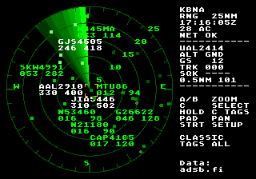
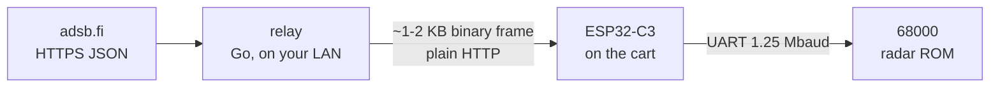

# mega-wifi-radar

A live, ATC-style radar scope for the **Sega Mega Drive / Genesis**, running on a
**MegaWiFi Rev.C** Wi-Fi cartridge. It shows range rings, a rotating thin-line sweep with
phosphor afterglow, and aircraft blips with history trails and data tags (callsign, altitude,
ground speed). The traffic is real ADS-B traffic around an airport you choose.

<p align="center"></p>



The console has 64 KiB of RAM and no TLS, so a small **relay** runs on your network. It
fetches ADS-B JSON over HTTPS, digests it into a compact binary frame, and the cart polls it
once per sweep.

## What you need

| | |
|---|---|
| Console | Mega Drive / Genesis. Tested on NTSC; PAL should work, with a slower sweep (5.1 s instead of 4.3 s). |
| Cartridge | **MegaWiFi Rev.C**: [jfryman/mw-cart](https://github.com/jfryman/mw-cart), a fork of [doragasu/mw-cart](https://gitlab.com/doragasu/mw-cart) with a TL16C550D UART at 20 MHz / 1.25 Mbaud. Earlier revisions and stock firmware **won't** work with this ROM. See [docs/hardware.md](docs/hardware.md). |
| ESP32 firmware | [`rev-c-1250k`](https://github.com/jfryman/mw-fw-rtos/releases/tag/rev-c-1250k) of jfryman/mw-fw-rtos |
| Flasher | A FlashKit MD (or any programmer that can write the cart's S29GL064N) |
| Relay host | Anything that runs a container or a Go binary on the same network (a Raspberry Pi is fine) |
| Wi-Fi | 2.4 GHz, WPA2 |

## Quick start

1. **Flash the ESP32 firmware** (new or blank modules only). Connect the cart's USB-C and run `make esp-flash`.
2. **Run the relay** on a machine on your LAN:
   ```sh
   docker run -d --name mwradar-relay --restart unless-stopped -p 8080:8080 \
       ghcr.io/jfryman/mega-wifi-radar-relay:latest
   ```
3. **Flash the ROM.** Download `mega-wifi-radar-<version>.bin` from
   [Releases](https://github.com/jfryman/mega-wifi-radar/releases) and write it with your
   flasher (`flashkit-md write-rom mega-wifi-radar-<version>.bin`).
4. **First boot.** With no Wi-Fi or relay configured, the ROM opens the setup screen. Pick
   your network, type the password, set **RELAY** to `http://<relay-host>:8080` (use the full
   DNS name or an IP address), choose your **AIRPORT**, then **SAVE & EXIT**. Settings are stored
   in the ESP32's flash and survive power cycles.

See [docs/usage.md](docs/usage.md) for controls and settings.

## Documentation

| Doc | |
|---|---|
| [docs/hardware.md](docs/hardware.md) | The Rev.C board, firmware, flashing both chips |
| [docs/usage.md](docs/usage.md) | Boot, setup screen, controls, themes, what's on screen |
| [docs/relay.md](docs/relay.md) | Running and configuring the relay; its HTTP API |
| [docs/building.md](docs/building.md) | Building the ROM and relay from source, emulator builds, CI |
| [lode/](lode/lode-map.md) | Design notes in depth: frame format, renderer, timing budget, lessons learned |

## Release files

Each [release](https://github.com/jfryman/mega-wifi-radar/releases) contains:

- `mega-wifi-radar-<version>.bin` is the cart ROM. It contains no credentials; you configure it on the console.
- `mega-wifi-radar-<version>-emu.bin` is an emulator build that replays a recorded feed around KBNA, so
  it needs no MegaWiFi hardware. It runs in MAME, BlastEm and others.
- `SHA256SUMS`

The relay image is published as `ghcr.io/jfryman/mega-wifi-radar-relay` (linux/amd64 and linux/arm64).

## Credits and data

- Built with [SGDK](https://github.com/Stephane-D/SGDK) (MIT) and the MegaWiFi API by
  [doragasu](https://gitlab.com/doragasu).
- Live traffic: **[adsb.fi](https://adsb.fi)** open data, which is for personal, non-commercial use.
  The ROM credits the source on screen. The recorded snapshots in `relay/testdata/` and
  `res/fake/` are adsb.fi data; see [relay/testdata/NOTICE.md](relay/testdata/NOTICE.md).
- Airport table: [OurAirports](https://ourairports.com/data/) (public domain).

Not for navigation or any operational use.

## License

[MIT](LICENSE)
