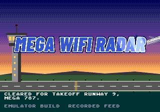
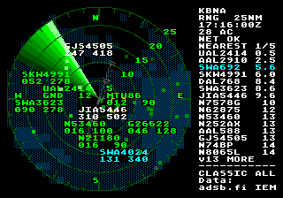
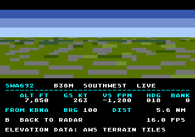
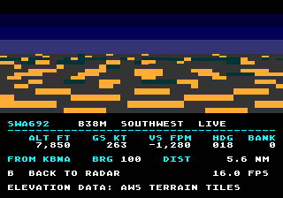
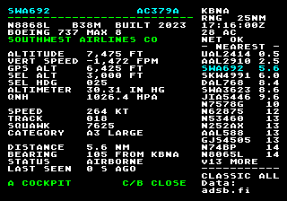
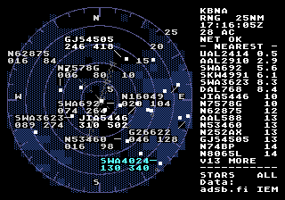
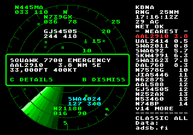
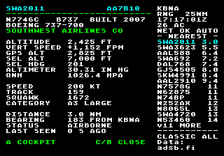
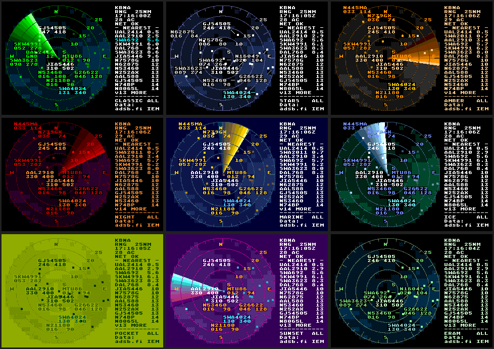
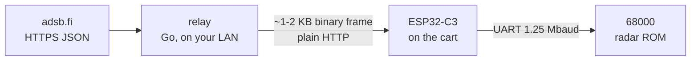

# mega-wifi-radar

A live, ATC-style radar scope for the **Sega Mega Drive / Genesis**, running on a
**MegaWiFi Rev.C** Wi-Fi cartridge. The traffic is real ADS-B traffic around an airport you choose: range
rings, a rotating thin-line sweep with phosphor afterglow, aircraft blips with history trails and data tags.
Pick any aircraft to ride along in a **cockpit view** over the real terrain beneath it.

<p align="center"> </p>

## What it does

- **Radar scope:** range rings at 5 to 100 nm, a sweep that updates each target as it passes, five-dot trails,
  and tags with callsign, altitude and ground speed, coloured by altitude band.
- **Weather:** rain and storms from NEXRAD radar behind the traffic, as stippled cells like a real STARS scope
  (light, moderate, heavy), refreshed every five minutes (US only).
- **Video map:** the runways in view as solid bars, and your airport's dashed extended centrelines with mile ticks;
  arrivals line up on them.
- **Spotter's logbook:** the relay logs everything within 25 nm all day, cart on or off: the day's count, records
  (fastest, highest, longest) and rare aircraft (military, A380s, C-17s, warbirds), which also pop up as alerts.
- **Traffic list:** every aircraft by distance, A–Z or altitude, emergencies pinned on top. Pick one for a
  **detail pop-up**: registration, type, operator, autopilot settings, squawk, distance and bearing.
- **Cockpit view:** the view from the selected aircraft, drawn by the 68000 over real elevation data in real
  time. The sky follows the sun where the aircraft is, and towns show as lights at night.
- **Nine themes:** Classic green phosphor, STARS (data blocks on leader lines whose second line alternates with the aircraft type, like a modern TRACON), AMBER,
  NIGHT, MARINE, ICE, POCKET, SUNSET and ERAM.
- **Emergency alert:** a box and a two-tone alert when any aircraft squawks 7700, 7600 or 7500.
- **Flyover notices:** with an MQTT feed of planes passing over your house, a box and a chime the moment one
  goes over ([docs/flyover.md](docs/flyover.md)).
- **Ambient mode:** left alone, it tours flights by itself (details, a cockpit ride, back to the radar), for a
  cartridge that lives on a TV.
- **Boot sequence:** a 787 departure in which every radio call is a real boot step, with engine and radio
  sound. Settings (airport, Wi-Fi, theme, zoom, sort...) are kept on the cartridge.

<p align="center">


</p>
<p align="center">


</p>
<p align="center">


</p>
<p align="center"></p>

## How it works



The console has 64 KiB of RAM and no TLS, so a small **relay** runs on your network. It
fetches ADS-B JSON over HTTPS, digests it into a compact binary frame, and the cart polls it
once per sweep. For the cockpit view it also serves terrain patches built from elevation tiles, and
the aircraft's track placed in them; the 68000 draws the view itself (Voxel Space, straight into VRAM).

## What you need

| | |
|---|---|
| Console | Mega Drive / Genesis. Tested on NTSC; PAL should work, with a slower sweep (5.1 s instead of 4.3 s). |
| Cartridge | **MegaWiFi Rev.C**: [jfryman/mw-cart](https://github.com/jfryman/mw-cart), a fork of [doragasu/mw-cart](https://gitlab.com/doragasu/mw-cart) with a TL16C550D UART at 20 MHz / 1.25 Mbaud. Earlier revisions and stock firmware **won't** work with this ROM. See [docs/hardware.md](docs/hardware.md). |
| ESP32 firmware | [`rev-c-1250k`](https://github.com/jfryman/mw-fw-rtos/releases/tag/rev-c-1250k) of jfryman/mw-fw-rtos |
| Flasher | A FlashKit MD (or any programmer that can write the cart's S29GL064N) |
| Relay host | Anything that runs a container or a Go binary on the same network (a Raspberry Pi is fine) |
| Wi-Fi | 2.4 GHz, WPA2 |

## Quick start

1. **Flash the ESP32 firmware** (new or blank modules only). Connect the cart's USB-C and run `make esp-flash`.
2. **Run the relay** on a machine on your LAN. It announces itself over mDNS, so the cart finds it on its own.
   - **Linux / Raspberry Pi:**
     ```sh
     docker run -d --name mwradar-relay --restart unless-stopped --network host \
         ghcr.io/jfryman/mega-wifi-radar-relay:latest
     ```
   - **macOS:** from a clone, `make relay-start`. Docker Desktop's VM can't announce on your LAN, so your
     Mac announces the container for it. Or run it natively: `cd relay && go run .`
     (allow "Local Network" access when macOS asks).
3. **Flash the ROM.** Download `mega-wifi-radar-<version>.bin` from
   [Releases](https://github.com/jfryman/mega-wifi-radar/releases) and write it with your
   flasher (`flashkit-md write-rom mega-wifi-radar-<version>.bin`).
4. **First boot.** With no Wi-Fi configured, the ROM opens the setup screen. Pick your network,
   type the password, choose your **AIRPORT**, then **SAVE & EXIT**. **RELAY** stays on **AUTO**,
   and the cart finds the relay at every boot. Settings are stored in the ESP32's flash and survive power cycles.

See [docs/usage.md](docs/usage.md) for controls and settings.

## Documentation

| Doc | |
|---|---|
| [docs/hardware.md](docs/hardware.md) | The Rev.C board, firmware, flashing both chips |
| [docs/usage.md](docs/usage.md) | Boot, setup screen, controls, themes, ambient mode, what's on screen |
| [docs/relay.md](docs/relay.md) | Running and configuring the relay; its HTTP API |
| [docs/flyover.md](docs/flyover.md) | Flyover notices: connecting an MQTT feed of planes over your home, and its message format |
| [docs/print.md](docs/print.md) | Cartridge label, box cover and manual: building and printing them |
| [docs/building.md](docs/building.md) | Building the ROM and relay from source, emulator builds, CI |
| [CHANGELOG.md](CHANGELOG.md) | Release history |
| [lode/](lode/lode-map.md) | Design notes in depth: frame format, renderer, timing budget, lessons learned |

## Release files

Each [release](https://github.com/jfryman/mega-wifi-radar/releases) contains:

- `mega-wifi-radar-<version>.bin` is the cart ROM. It contains no credentials; you configure it on the console.
- `mega-wifi-radar-<version>-emu.bin` is an emulator build that replays a recorded feed around KBNA, so
  it needs no MegaWiFi hardware. It runs in MAME, BlastEm and others.
- `mega-wifi-radar-<version>-label.pdf`, `-cover.pdf` (with `-cover-a4.pdf` for home printing), `-manual.pdf` and
  `-manual-booklet-letter.pdf` / `-a4.pdf` are the printable cartridge label, clamshell wrap (back, spine, front) and manual (see [docs/print.md](docs/print.md)).
- `SHA256SUMS`

The relay image is published as `ghcr.io/jfryman/mega-wifi-radar-relay` (linux/amd64 and linux/arm64),
tagged with each release. **Run the relay from the same release as your cartridge** (`:latest` is the newest
release; `:0.4.3` pins one). A mismatched pair says so on screen instead of working half-way.

## Credits and data

- Built with [SGDK](https://github.com/Stephane-D/SGDK) (MIT) and the MegaWiFi API by
  [doragasu](https://gitlab.com/doragasu).
- Live traffic: **[adsb.fi](https://adsb.fi)** open data, which is for personal, non-commercial use.
  The ROM credits the source on screen. The recorded snapshots in `relay/testdata/` and
  `res/fake/` are adsb.fi data; see [relay/testdata/NOTICE.md](relay/testdata/NOTICE.md).
- Airport table: [OurAirports](https://ourairports.com/data/) (public domain).
- Cockpit view terrain: elevation from [AWS Terrain Tiles](https://registry.opendata.aws/terrain-tiles/)
  (Mapzen / Tilezen), resampled and coloured by the relay. The cockpit view credits it on screen; the
  manual's credits and [docs/relay.md](docs/relay.md#data-terms) carry the
  [required attribution](https://github.com/tilezen/joerd/blob/master/docs/attribution.md) for each source.
- Cockpit view city lights: [VIIRS City Lights 2012](https://earthobservatory.nasa.gov/features/NightLights)
  (NASA Earth Observatory / NOAA NGDC), served by [NASA GIBS](https://www.earthdata.nasa.gov/eosdis/science-system-description/eosdis-components/gibs).
  We acknowledge the use of imagery provided by services from NASA's Global Imagery Browse Services (GIBS),
  part of NASA's Earth Science Data and Information System (ESDIS).

Not for navigation or any operational use.

## License

[MIT](LICENSE)
