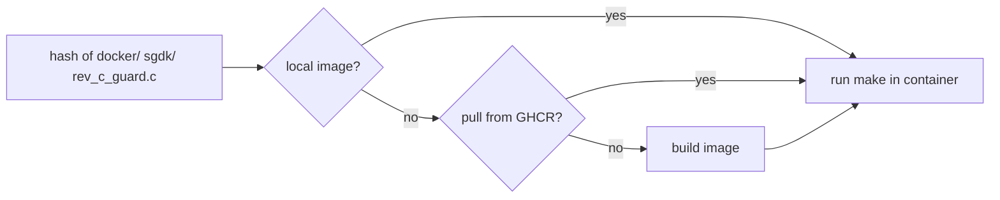

# Building from source

All 68000 compiling happens in a container, so macOS and Linux get the same toolchain. You
need **podman or docker**, `make`, `git`, and `go` 1.22+ (only for the relay and the generators).

```sh
git clone https://github.com/jfryman/mega-wifi-radar && cd mega-wifi-radar
make            # cart ROM  -> out/rom.bin
make sim        # emulator ROM (recorded feed, no MegaWiFi) -> out/sim.bin
make flash      # build + write out/rom.bin with a FlashKit MD
```

## The build image

`docker/Dockerfile` builds binutils 2.42 and gcc 13.2.0 for `m68k-elf` (sources pinned by
SHA-256), then SGDK master `9a78a44` with the Rev.C patches from `sgdk/patches/`. It rebuilds
`libmd.a` and checks that the patched UART constants made it in.

`scripts/md <command>` runs a command inside that image. The image tag is a hash of `docker/`,
`sgdk/` and `src/rev_c_guard.c`, so changing any of them selects a new image, and a stale or
unpatched SGDK can never be used by mistake. If the tagged image isn't present locally,
`scripts/md` first tries to pull it from `ghcr.io/jfryman/mega-wifi-radar-sgdk:<hash>` (CI
publishes every hash there). Otherwise it builds the image locally, which compiles gcc and takes 15–30 min.

| Variable | Effect |
|---|---|
| `CTR=docker` | Force docker (default: podman if installed) |
| `MD_REGISTRY=` | Never pull; always build the image locally |
| `MD_BUILD_FLAGS=...` | Extra flags for the image build |



## Make targets

| Target | |
|---|---|
| `release` (default) | Cart ROM, `out/rom.bin` |
| `debug` | SGDK debug build |
| `sim` | Emulator ROM with the fake feed, `out/sim.bin` (wipes `out/release` before and after, so objects never mix) |
| `sim-run` | Runs `out/sim.bin` headless in MAME and saves PNGs to `out/snap/` (`SNAP=3,8,15`, `SIM_PRESS="7:P1 C"`). Needs a container image with MAME (`SIM_IMAGE`). |
| `flash` | Build and write the ROM with a FlashKit MD |
| `esp-flash` | Write the `rev-c-1250k` firmware to the cart's ESP32 |
| `image` | Just make sure the build image exists |
| `relay-image`, `relay-run`, `relay-start`, `relay-stop` | The relay container |
| `print` | Label, cover and manual PDFs in `out/print/` ([print.md](print.md)) |
| `print-shots` | Recapture the manual's screenshots in MAME |
| `splash-art` | Regenerate the boot splash data from `res/splash/src/art.typ` |
| `contract` | Check the relay against `src/arframe.h` (frame and detail layouts, constants, HTTP queries, version, mDNS) and `relay/contract.lock`; runs before `release` and `sim` |
| `contract-lock` | Record `src/arframe.h`'s hash for the current `AR_VER` in `relay/contract.lock` (after a bump) |
| `fake-feed` | Rebuild the emulator feed (`res/fake/`) from `relay/testdata/kbna-seq/` |
| `clean` | |

The boot screen shows the version from `git describe --tags --always --dirty`. `make` writes it to the
git-ignored `src/version.h`; override it with `make VERSION=v1.2.3`.

## Dev builds: `src/dev_config.h`

To skip the setup screen while developing, copy `src/dev_config.h.example` to `src/dev_config.h`
and fill in your Wi-Fi network and relay URL. The file is git-ignored. The values are compiled
**into the ROM**, so don't share a ROM built with it. Release builds (and CI) never have it.

## Regenerating data

These are committed. Regenerate them only if you change the generator:

```sh
cd tools && go run ./scopegen -o ../res/scope                 # scope tiles + sweep pixel lists
cd tools && go run ./airportgen -o ../src/airports.c          # airport table (OurAirports)
make splash-art                                               # boot splash: Typst art -> tiles (tools/splashgen)
make fake-feed                                                # emulator feed: res/fake/kbna_seq.bin + kbna_detail.bin (relay -pack, -pack-detail)
```

## The relay ↔ cartridge contract

`src/arframe.h` is the single definition of everything the relay and the cartridge must agree on: the frame layout
(`AR_AT` offsets, which the C compiler also checks), the version and flag constants, the HTTP path and query, and the mDNS
service. `relay/contract_test.go` parses it and checks the relay against every item. It also fails on any `AR_*` item it
doesn't recognise, so a change on either side that isn't mirrored can't pass `make release` or CI. To change the contract,
edit `arframe.h` first, then the relay, then the mapping in the test.

The relay and the cartridge are one product: relay vX serves cartridge vX. `relay/contract.lock` pins a hash of
`arframe.h` (comments and whitespace ignored) to `AR_VER`, so any contract change must bump `AR_VER`; the test says so,
and after the bump `make contract-lock` records the new hash. At runtime every request carries `v=AR_VER`, the relay
answers other versions with `409`, and the cart shows the mismatch on screen.

## Tests

```sh
make contract                     # relay <-> cartridge contract (also runs before every ROM build)
cd relay && go vet ./... && go test ./...
cd tools && go vet ./...
```

## CI and releases

`.github/workflows/build.yml` runs on every push and pull request:

1. **rom**: gets the build image (pulls it from GHCR, or builds it and pushes it to GHCR on
   `main` and tags), builds `make sim` and `make release`, and uploads both ROMs as workflow artifacts.
2. **relay**: `go vet`/`go test` for `relay/` and `tools/`, then a multi-arch image
   (amd64 + arm64) that is pushed to `ghcr.io/jfryman/mega-wifi-radar-relay` on `main` (`:edge`) and on tags
   (`:<version>`, `:latest`).
3. **print**: builds the label, cover and manual PDFs.
4. **release** (tags `v*` only): creates a GitHub release with the ROMs, the print PDFs and
   `SHA256SUMS`, with notes taken from `CHANGELOG.md`.

To cut a release:
```sh
git tag -a v0.1.0 -m "v0.1.0" && git push origin v0.1.0
```
