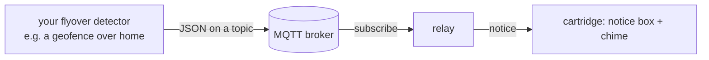

# Flyover notices: connecting a feed

When a plane passes over your home, a box pops open on the radar (and a chime plays) with its callsign,
airline, type, route, altitude and speed. The cartridge doesn't detect this itself: something on your
network decides that a plane is overhead and publishes a message to an **MQTT broker**. The relay
subscribes to that topic and passes notices on to the cartridge. Without a broker configured, nothing
changes.



What you need:

- **An MQTT broker** the relay can reach: Mosquitto, the one in Home Assistant, EMQX... MQTT 3.1.1
  over plain TCP (port 1883). TLS isn't supported, so keep the broker on your LAN or in the same cluster.
- **A publisher** that sends a JSON message when a plane enters the area above your home. The author's
  is a small service polling Flightradar24 for aircraft within 500 m; anything that can publish the format
  below works (Node-RED, Home Assistant, a script).

## Configure the relay

All settings can be flags or environment variables. A flag wins over the variable, and the variable wins
over the default.

| Variable | Flag | Default | |
|---|---|---|---|
| `MQTT_BROKER_HOST` | `-mqtt-host` | (empty: notices off) | Broker host name or IP |
| `MQTT_BROKER_PORT` | `-mqtt-port` | `1883` | |
| `MQTT_USERNAME` | `-mqtt-user` | (none) | If your broker needs a login |
| `MQTT_PASSWORD` | (none) | (none) | Environment only, so it never shows in `ps` |
| `MQTT_TOPIC` | `-mqtt-topic` | `atc/status` | The topic your publisher uses |
| `MQTT_CLEAR` | `-mqtt-clear` | `false` | Clear a *retained* message after reading it (below) |
| `MQTT_CLIENT_ID` | `-mqtt-client-id` | `mwradar-relay-<random>` | Must be unique on the broker |
| `RELAY_NOTICE_TTL` | `-notice-ttl` | `30s` | How long a notice waits for a cartridge to pick it up |

### Docker (Linux, Raspberry Pi)

Keep the password out of your shell history with an env file:

```sh
cat > relay.env <<'EOF'
MQTT_BROKER_HOST=broker.home.lan
MQTT_USERNAME=radar
MQTT_PASSWORD=change-me
EOF
chmod 600 relay.env

docker run -d --name mwradar-relay --restart unless-stopped --network host \
    --env-file relay.env ghcr.io/jfryman/mega-wifi-radar-relay:latest
```

### From this repository (macOS or Linux)

`scripts/relay` passes any exported `MQTT_*` and `RELAY_*` variables to the container:

```sh
export MQTT_BROKER_HOST=broker.home.lan MQTT_USERNAME=radar MQTT_PASSWORD=change-me
make relay-start
```

For development, `make mqtt-start` runs a local Mosquitto container instead; `make relay-start` then finds
and uses it by itself (see [relay.md](relay.md#flyover-notices-mqtt)).

### Kubernetes

The variable names are the ones the author's flyover service already uses, so both can read the same
config map and secret:

```yaml
containers:
  - name: relay
    image: ghcr.io/jfryman/mega-wifi-radar-relay:0.4.0
    args: ["-listen", ":8080"]
    env:
      - { name: RELAY_MDNS, value: "false" }                   # mDNS doesn't leave the pod network
      - { name: MQTT_BROKER_HOST, value: mosquitto.mqtt.svc.cluster.local }
      - { name: MQTT_USERNAME, valueFrom: { secretKeyRef: { name: mqtt, key: username } } }
      - { name: MQTT_PASSWORD, valueFrom: { secretKeyRef: { name: mqtt, key: password } } }
    ports: [{ containerPort: 8080 }]
```

In a cluster the cartridge can't discover the relay, so type its address under **RELAY** in Setup. Expose
port 8080 as plain HTTP (a `LoadBalancer` or `NodePort` service) and use a fully qualified name or an IP,
for example `http://radar-relay.home.lan:8080`. The cartridge needs plain HTTP responses with a
`Content-Length`: no TLS, no compression, no chunked encoding, so avoid putting the relay behind an
ingress that changes them.

## The message format

Publish JSON to the topic. The relay accepts two shapes.

**A status message** with the planes that just entered the area (other keys are ignored):

```json
{
  "timestamp": "2026-11-01T14:30:00Z",
  "entering_flights": [
    {
      "flight_uuid": "550e8400-e29b-41d4-a716-446655440000",
      "flight_number": "SWA1234",
      "airline": "Southwest Airlines",
      "aircraft_type": "B738",
      "origin": "BNA",
      "destination": "MDW",
      "heading": 20,
      "altitude_feet": 1800,
      "latitude": 36.1301,
      "longitude": -86.6750,
      "ground_speed_knots": 160,
      "timestamp": "2026-11-01T14:30:00Z"
    }
  ],
  "exiting_flights": []
}
```

**Or a single flight object** (the fields below at the top level), for publishers that send one message
per plane. It must have a `flight_uuid` (that's how the relay recognises one); `"event_type": "exiting"`
is ignored.

Otherwise every field is optional, but the more you send, the better the notice:

| Field | Used for |
|---|---|
| `flight_number` | The callsign on the notice. Use the **ADS-B callsign** (`SWA1234`, not `WN1234`): it's also how the relay finds the plane on the radar, so C opens its details. Missing: `MYSTERY PLANE` |
| `airline` | Second line, shortened (`Delta Air Lines` → `DELTA`). Missing: guessed from the callsign's airline prefix for common carriers |
| `aircraft_type` | Second line. An ICAO type code (`B738`) is shown as is; a name is shortened (`Boeing 737-800` → `B737-800`). Missing: the type from the radar's data, if the plane is found there |
| `origin`, `destination` | Third line: `BNA > MDW`, `FROM BNA` or `TO MDW`. Codes (3-4 letters) look best; a name shows its first word |
| `altitude_feet`, `ground_speed_knots` | Third line: `1,800FT 160KT`. Left out when 0 or missing |
| `latitude`, `longitude`, `heading`, `timestamp` | Finding the plane on the radar when the callsign doesn't match: the position is moved along its heading to the radar's time, and the nearest plane within 1.5 nm and 2,000 ft is taken |
| `flight_uuid` | A unique id per plane pass. The same id is never announced twice (MQTT can deliver a message twice) |
| `timestamp` (each flight) | RFC 3339 with a time zone (`...Z` or `...+00:00`). A flight reported more than **90 s** ago is dropped, so a backlog never floods the screen. Without a parsable timestamp it's always accepted |

Text is upper-cased and anything outside plain ASCII becomes `?`. A status message with a non-empty
`"error"` field is skipped (that's how the author's service reports a failed poll). `exiting_flights` and
any `tracked_flights` are ignored: only planes entering make notices.

### Timing

A notice waits on the relay for `RELAY_NOTICE_TTL` (30 s). A cartridge on the radar picks it up at its next
poll (within one sweep, about 4 s) and shows it for 15 s; in the cockpit view, within 2 s. If no cartridge
is on in that time, the notice is gone: nothing piles up. The relay keeps the newest 4. Several planes at
once come through one per poll, each replacing the one before it.

### Retained messages

The relay connects with a clean session, so it never replays messages from while it was offline. If your
publisher sends *retained* messages (the broker keeps the last one and delivers it to every new
subscriber), set `MQTT_CLEAR=true`: after reading a retained message, the relay publishes an empty retained
message to the same topic, which clears it. Don't use this on a topic other subscribers still need retained.

## Testing it

With the relay running and connected, publish a test message (stamped now, with a fresh id):

```sh
now=$(date -u +%Y-%m-%dT%H:%M:%SZ)
mosquitto_pub -h broker.home.lan -u radar -P change-me -q 1 -t atc/status -m \
  '{"entering_flights":[{"flight_uuid":"test-'$(date +%s)'","flight_number":"SWA1234","airline":"Southwest Airlines","aircraft_type":"B738","origin":"BNA","destination":"MDW","altitude_feet":1800,"ground_speed_knots":160,"timestamp":"'$now'"}]}'
```

The relay's log (`docker logs mwradar-relay`, or `scripts/relay logs`) should show:

```
mqtt: broker.home.lan:1883, topic "atc/status", user "radar", client mwradar-relay-3f9a1c2e
mqtt: broker.home.lan:1883: subscribed to "atc/status" (QoS 1)
notice 23654 (no match): LOOK UP!   SWA1234        |SOUTHWEST   B738          |BNA > MDW  1,800FT 160KT
```

`(icao a1b2c3)` instead of `(no match)` means the plane was found on the radar. With a cartridge on,
the notice appears within a sweep. You can also ask the relay directly, as the cartridge does:

```sh
curl -s 'http://localhost:8080/v1/notice?after=0&v=7' | xxd
```

### When it doesn't work

| Relay log | Meaning |
|---|---|
| `mqtt: off (no MQTT_BROKER_HOST): no flyover notices` | The variable didn't reach the relay (with Docker: `-e` or `--env-file`) |
| `mqtt: ...: connection refused; retrying in 5s` | Nothing listens at that host and port, or a firewall blocks it. The relay keeps retrying (5, 10, 30, 60 s) |
| `broker refused the connection: bad user name or password` / `not authorised` | Check `MQTT_USERNAME` and `MQTT_PASSWORD`, and the broker's ACLs for the topic |
| `broker refused the subscription to "..."` | The user may not read that topic |
| Subscribed, but no `notice` lines | Wrong topic, or the messages have no `entering_flights` (try `mosquitto_sub -t '#' -v` to see what's published) |
| `notice: SWA1234 reported 3m10s ago: dropped` | The flight's `timestamp` is older than 90 s: a clock or time-zone problem on the publisher, or a backlog |
| `mqtt: atc/status: atc-mqtt reports: ...` | The message carried an `error` field and was skipped |
| `mqtt: atc/status: invalid character ...` | Not valid JSON |
| `notice` lines, but nothing on screen | The cartridge isn't polling this relay, or not within 30 s; check its panel says `NET OK`, and that it's the same release as the relay |

No chime? Setup's **SOUND** row may be OFF.

Related: [relay.md](relay.md) (all relay settings and its HTTP API), [usage.md](usage.md) (what the notice
looks like on screen).
