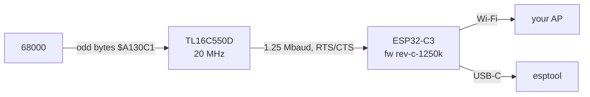

# Hardware: MegaWiFi Rev.C

This ROM targets one specific board: the **MegaWiFi Rev.C** cartridge,
[jfryman/mw-cart](https://github.com/jfryman/mw-cart). It is a fork of doragasu's
[MegaWiFi](https://gitlab.com/doragasu/mw-cart) design. The UART clock and baud rate are baked
into both the ROM and the ESP32 firmware, so other revisions won't work without rebuilding.

## The board

| Part | Detail |
|---|---|
| ROM flash | 8 MiB Spansion/Infineon S29GL064N, mapped flat at `$000000–$7FFFFF` |
| Wi-Fi module | Espressif ESP32-C3-WROOM-02 (2.4 GHz, 4 MB flash) |
| UART bridge | TI **TL16C550D** at `$A130C1` (odd bytes, registers at `+2n`), **20 MHz** crystal, **1.25 Mbaud**, RTS/CTS flow control |
| ESP32 control | 16C550 `~DTR` → ESP32 `EN` (reset); `~RTS` → ESP32 `GPIO9` (boot strap, also firmware CTS) |
| USB-C | ESP32-C3 USB-Serial/JTAG, used for flashing the firmware |
| Save RAM | None. Settings are kept in the ESP32's flash. |



### Differences from upstream MegaWiFi
- **UART clock 20 MHz, 1.25 Mbaud** (upstream: 24 MHz, 1.5 Mbaud). The divisor is exactly 1.
  Both ends must agree: stock SGDK and stock firmware will **not** talk to a Rev.C cart.
- The ROM is built with SGDK master patched for this
  (`sgdk/patches/0001-rev-c-uart-20mhz-1250k.patch`) and the `MW_CART` MegaWiFi implementation
  (`0002-config-megawifi-mw-cart.patch`). `src/rev_c_guard.c` stops the build if the patch is missing.

## ESP32 firmware

The module must run **[jfryman/mw-fw-rtos](https://github.com/jfryman/mw-fw-rtos) release
[`rev-c-1250k`](https://github.com/jfryman/mw-fw-rtos/releases/tag/rev-c-1250k)**. Modules from
the factory are blank. To flash one:

```sh
make esp-flash            # or: scripts/esp-flash, PORT=/dev/ttyACM0 scripts/esp-flash
```

`scripts/esp-flash` downloads `mw-fw-rtos-merged.bin`, verifies its SHA-256, and writes it at
offset `0x0` with esptool 4.8.1 (run through `uvx` or `pipx`, or the `esptool.py` on your PATH). It picks
the single `/dev/cu.usbmodem*` (macOS) or `/dev/ttyACM*` (Linux) port it finds.

The merged image doesn't touch the MegaWiFi config (`mw_cfg`, saved Wi-Fi networks) or
`user_data` (this ROM's settings), so reflashing keeps your setup.

Normal behaviour:
- The ESP32 **deep-sleeps 30 s after power-on** unless the 68000 talks to it. A cart that's sitting
  in the FlashKit, or a console on a ROM that never detects the module, will see the LED go off.
- The USB console prints only the ROM boot banner. The real health check is the cart's boot screen,
  which shows `Module fw 1.5 ...`.

## Flashing the ROM

Any programmer that writes the S29GL064N works. With a **FlashKit MD**:

```sh
make flash                # builds, then scripts/flashkit write-rom out/rom.bin
```

`scripts/flashkit` uses `flashkit-md` from your PATH. If there isn't one, it fetches a pinned,
checksum-verified release of [jfryman/flashkit-md-dotnet](https://github.com/jfryman/flashkit-md-dotnet)
into `.tools/`.

| FlashKit message | Meaning / fix |
|---|---|
| `No flash chip detected: CFI query returned FF-FF…` | The cart isn't seated in the FlashKit |
| `Device is not detected: … Value does not fall within the expected range` | The FlashKit's MCU is wedged. Unplug and replug its USB. |

On macOS the FlashKit shows up as `/dev/cu.usbserial-*` and the cart's ESP32 as `/dev/cu.usbmodem*`.
On Linux they are `/dev/ttyUSB*` and `/dev/ttyACM*`.

## Console

Mega Drive / Genesis, H40 mode (320×224). It has been tested on NTSC hardware and in MAME. On PAL
the sweep takes 5.1 s per turn instead of 4.3 s; everything else is the same.

## Troubleshooting

| Boot screen | Likely cause |
|---|---|
| *No reply: MegaWiFi module not found* | No firmware, or the wrong firmware (not `rev-c-1250k`) on the ESP32, or a non-Rev.C cart |
| *Hold position: Wi-Fi failed* | Wrong password, or the AP is out of range or 5 GHz only. Setup opens so you can fix it. |
| *Hold position: no relay found* | No relay answered the mDNS query: check it's running and advertising (`dns-sd -B _mwradar._tcp`), or type its URL under RELAY |
| Panel shows `ERR HTTP` / `ERR RECV` instead of `NET OK` | The relay can't be reached. Check the URL (use the full DNS name or an IP; `.local` doesn't resolve) and that port 8080 is open. |
| Panel shows `ERR FRAME` / `ERR SIZE` | Something other than the relay answered at that URL, or a relay with a newer frame version |
| Panel shows `UPSTRM ERR` | The relay is up, but adsb.fi isn't answering it. It keeps serving the last good frame. |
