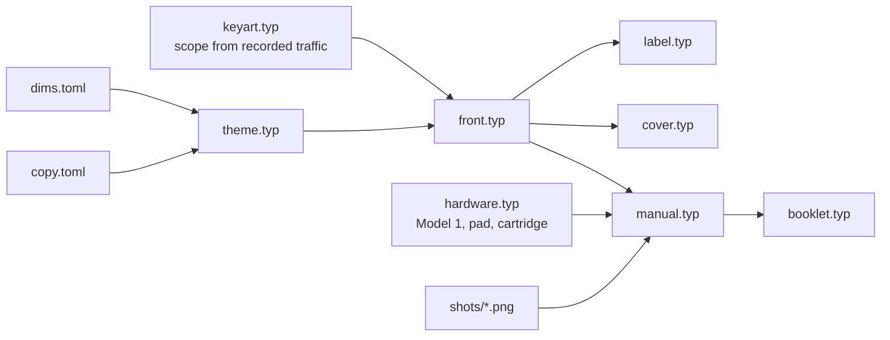

# Label, box cover and manual

`print/` builds three printable pieces from one shared theme, fixed copy and the same key art:

| Piece | Trim size | Output |
|---|---|---|
| Cartridge label | 80.5 × 77 mm | `out/print/label.pdf` |
| Clamshell front cover | 130 × 178 mm | `out/print/cover.pdf` |
| Instruction manual | 121 × 171 mm, 16 pages | `out/print/manual.pdf` (single pages), `manual-booklet-us-letter.pdf` / `-a4.pdf` (imposed) |

Every release attaches all of them. To build locally (needs podman or docker):

```sh
make print           # or: scripts/print [label|cover|manual]
scripts/print watch cover     # rebuild on save while editing
```

`*.pdf` files include a 3 mm bleed and crop marks for a print shop. `*-trim.pdf` files have the bleed but no marks,
and `*-N.png` files are 150 dpi previews.

## Printing at home

- **Label and cover:** print at **100% / actual size** (never "fit to page") on matte photo paper or
  sticker paper, and cut on the crop marks.
- **Manual booklet:** print `manual-booklet-*.pdf` **duplex, flip on short edge**, at 100%. Stack the
  sheets in order (sheet 1 on the outside), fold along the dashed marks, staple twice on the fold,
  then trim to the crop marks.

The sizes are for an original US Sega clamshell and a stock cartridge shell. They come from published
templates and haven't been checked against a real case yet. Measure a test print against yours and
fix `print/dims.toml` if needed. Every size is defined only there.

## How it fits together



- `theme.typ`: colours, fonts, the print box (bleed + crop marks), the black grid, banner, wordmark, title.
- `keyart.typ`: draws the scope as vectors from `relay/testdata/kbna-seq` (real KBNA traffic), with
  trails and non-overlapping tags, just as the ROM does.
- `hardware.typ`: line drawings of the Model 1, the 3-button pad and the cartridge, with numbered callouts.
- `manual/*.typ`: one file per manual section, in the order listed in `manual.typ`. Notes pages pad
  the manual to a multiple of 4 pages.
- `shots/`: screenshots from the emulator build, listed in `shots.txt` (name, time, button presses).
  `make print-shots` recaptures them; it needs the MAME image (see `scripts/sim`).

Typst 0.15.1 runs in its official container, pinned by digest. Fonts are bundled in `print/fonts/`
(Barlow and Press Start 2P, SIL OFL) and system fonts are ignored, so the output is the same everywhere.

## Adding a feature to the manual

When a feature changes what the player sees or does, the same change updates:
1. the section in `print/manual/` (or a new file, added to `sections` in `manual.typ`),
2. `print/shots.txt` and `make print-shots` if the screen changed,
3. `CHANGELOG.md`.

## Trademarks

The pieces copy the *style* of a 1989 Genesis release but carry no Sega logos, Genesis wordmark or
seal. "Sega Genesis" appears only as plain text, and the manual and back cover include a
non-affiliation notice.
