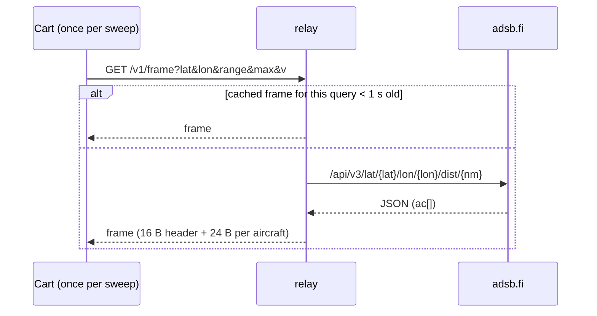

# The relay

The console can't parse ~40 KB of JSON or speak TLS, so a small Go service on your network
does that for it. It polls [adsb.fi](https://adsb.fi) over HTTPS, converts the result into the
compact v1 binary frame, and serves it over plain HTTP. It uses only the standard library and
has no state on disk.



## Running it

| How | Command |
|---|---|
| Published image (Linux) | `docker run -d --name mwradar-relay --restart unless-stopped --network host ghcr.io/jfryman/mega-wifi-radar-relay:latest` |
| From this repo, container | `make relay-start` (detached; also registers the mDNS advertisement on the host), `make relay-run` (foreground), `make relay-stop`, `scripts/relay logs` |

From the repo, the container is built from your checkout and tagged with its version (`mwradar-relay:v0.2.0-3-gabc1234`; a dirty tree adds a hash of `relay/`), so it's rebuilt whenever the code changes. To run a published release that way instead: `RELAY_IMAGE=ghcr.io/jfryman/mega-wifi-radar-relay:0.2.0 make relay-start`.
| From this repo, native Go | `cd relay && go run . -listen :8080` |

The image is distroless, runs as non-root, and is about 15 MB, built for linux/amd64 and
linux/arm64. `scripts/relay` uses podman if it's installed, otherwise docker (override with `CTR=docker`).

Leave the cart's **RELAY** on **AUTO** and it finds the relay over mDNS. To pin one instead, type
`http://<host>:8080`, where `<host>` is a fully qualified name your router's DNS resolves, or an IP address.

## Discovery (mDNS)

The relay advertises **`_mwradar._tcp`** ("MegaWiFi Radar", TXT `v=4 path=/v1/frame`: the contract version and frame path) with a small built-in
responder. Check it with `dns-sd -B _mwradar._tcp` (macOS) or `avahi-browse -r _mwradar._tcp` (Linux).

| Where the relay runs | Who advertises |
|---|---|
| Native (`go run .`, a binary) | The relay itself. On macOS, allow "Local Network" access when asked. |
| Linux container with `--network host` | The relay itself |
| Bridged container, Docker Desktop, Podman machine | **The host**: `scripts/relay start` runs `dns-sd -P` (macOS) or `avahi-publish` (Linux) for it, and the container runs with `-mdns=false`. After a reboot, run `scripts/relay advertise` (the container restarts by itself, the advertisement doesn't). |

The cart sends a *legacy unicast* query (from UDP port 5354), and responders answer it directly, so the
ESP32 never joins the multicast group. Details: [lode/net/discovery.md](../lode/net/discovery.md).

### Flags and environment

Every server setting can also come from an environment variable (for containers and Kubernetes). A flag on
the command line wins over the variable, which wins over the default. The MQTT variables use the same names
as the `atc-mqtt` service, so both can share one secret or config map.

| Flag | Variable | Default | |
|---|---|---|---|
| `-listen` | `RELAY_LISTEN` | `:8080` | HTTP listen address |
| `-upstream` | `RELAY_UPSTREAM` | `https://opendata.adsb.fi` | Any adsb.fi-compatible base URL |
| `-min-interval` | `RELAY_MIN_INTERVAL` | `1s` | Minimum time between upstream requests (adsb.fi allows 1 per second) |
| `-mdns` | `RELAY_MDNS` | `true` | Advertise `_mwradar._tcp` over mDNS (UDP 5353) |
| `-dem` | `RELAY_DEM` | AWS Terrain Tiles | Terrarium elevation tile base URL, for cockpit mode |
| `-lights` | `RELAY_LIGHTS` | NASA GIBS VIIRS City Lights 2012 | Night-lights tile base (WMTS, `/{z}/{row}/{col}.jpeg`): towns in cockpit mode, lit at night; empty turns it off |
| `-sky` | `RELAY_SKY` | `real` | Cockpit sky: `real` follows the sun at the aircraft; `day`, `golden`, `twilight` or `night` fixes it (also for `-pack-cockpit`) |
| `-convert FILE -o OUT -lat -lon -range` |  | | Convert a saved upstream JSON file into one frame, then exit |
| `-pack OUT FILES...` |  | | Pack several JSON snapshots into a fake-feed file for the emulator build |
| `-pack-detail OUT FILES...` |  | | Pack the details of every aircraft in the snapshots for the emulator build's pop-up |
| `-mqtt-host` | `MQTT_BROKER_HOST` | (off) | MQTT broker for flyover notices; empty turns them off |
| `-mqtt-port` | `MQTT_BROKER_PORT` | `1883` | |
| `-mqtt-user` | `MQTT_USERNAME` | | Password: `MQTT_PASSWORD` only (never a flag, so it can't show in `ps`) |
| `-mqtt-topic` | `MQTT_TOPIC` | `atc/status` | The topic `atc-mqtt` publishes flights to |
| `-mqtt-clear` | `MQTT_CLEAR` | `false` | After a *retained* message, publish an empty retained one to clear the topic |
| `-mqtt-client-id` | `MQTT_CLIENT_ID` | `mwradar-relay-<random>` | Unique per process; the relay always uses a clean session |
| `-notice-ttl` | `RELAY_NOTICE_TTL` | `30s` | How long a flyover notice waits for a cart |

### Flyover notices (MQTT)

Setting it up against your own broker, the message format and troubleshooting: [flyover.md](flyover.md).

With `MQTT_BROKER_HOST` set, the relay subscribes to `atc-mqtt`'s `atc/status` topic (QoS 1) and reads the
flights entering its geofence, reconnecting with back-off (5, 10, 30, 60 s) if the broker goes away. Each becomes
a three-line notice, matched to the aircraft in the adsb.fi feed when a cart is polling and kept for `-notice-ttl`
(30 s); carts pick it up through `/v1/notice` (below) and show it in a box on the radar or along the cockpit HUD. For development, run a local broker:

```sh
make mqtt-start      # eclipse-mosquitto container mwradar-mqtt, localhost:1883, network "mwradar"
make relay-start     # finds the running broker and uses it (MQTT_BROKER_HOST=mwradar-mqtt)
make mqtt-pub        # publish relay/testdata/atc/entering.json to atc/status (stamped now)
scripts/relay logs   # notice 23654 (no match): LOOK UP!   SWA1234 |SOUTHWEST   B738 |BNA > MDW ...
scripts/mqtt sub     # watch atc/#
```

`scripts/relay` passes any exported `RELAY_*` and `MQTT_*` variables to the container by name, so
`MQTT_BROKER_HOST=broker.lan MQTT_USERNAME=radar MQTT_PASSWORD=... make relay-start` points it at another broker.

## HTTP API

- **Versions:** the relay and the cartridge ship together; use the relay from your cartridge's release.
  Every request carries `v=<contract version>` (`AR_VER`, 4 since 0.4.0). Any other value, or none, gets
  `409` with a message naming the relay's release, and the cart reports `RELAY MISMATCH` at boot or
  `RELAY VER?` on the radar. The relay logs its release and contract version at start-up.
- `GET /v1/frame?lat=<deg>&lon=<deg>&range=<nm>&max=<n>&n=<notice id>&v=4` returns `200` with
  `application/octet-stream` and an explicit `Content-Length`. `range` is clamped to 1–250 and `max` to 1–96.
  A missing or bad `lat`/`lon` gives `400`.
- `GET /v1/detail?icao=<6 hex>&v=4` returns one 96-byte detail record for the pop-up (below), from the newest
  upstream snapshot if it's under 30 s old, otherwise from a single-aircraft upstream request
  (`/api/v2/hex/<icao>`, inside the same rate limit). An unknown aircraft gets a record without the FOUND flag.
- `GET /v1/terrain?icao=<6 hex>&v=4` returns the cockpit view's terrain patch: a 104-byte header (scale, palette,
  and a patch key), then 128×128 height levels and 128×128 colour indices, centred on the aircraft with cells of
  its height above ground / 5. Elevation comes from AWS Terrain Tiles (`-dem` sets another Terrarium tile URL),
  so the relay needs HTTPS out to `s3.amazonaws.com`; without it the patch is flat ground. `404` if the
  aircraft isn't in the feed.
- `GET /v1/track?icao=<6 hex>&p=<patch key>&n=<notice id>&v=4` returns 40 bytes: the aircraft placed in that patch (position,
  height, velocity, heading, bank), for the cockpit camera.
- `GET /v1/strip?p=<patch key>&x=<cell>&y=<cell>&w=<n>&h=<n>&v=4` returns more of the patch's grid (`w·h` heights,
  then `w·h` colours; at most 1,024 cells), which the cart streams in ahead of the aircraft.
- **Flyover notices:** `n=` on `/v1/frame` and `/v1/track` is the id of the last notice the cart has seen (0 for
  none). If a newer one is waiting, the frame's header flags get `NOTICE` (`0x04`) and the track's flags
  `NOTICE` (`0x10`). `GET /v1/notice?after=<id>&v=4` then returns an 82-byte notice: magic `"AN"`, version,
  flags (matched ICAO, emergency), a 16-bit id (ids wrap; 0 = none waiting any more), the ICAO address, the
  seconds to show it, and three 24-character lines of text composed by the relay.
- If adsb.fi fails, the relay serves the last good frame with the `UPSTREAM_ERR` header flag set
  (the cart shows `UPSTRM ERR`). If there's no previous frame, it returns `502`.
- `GET /healthz` returns `ok`.

Try it:
```sh
curl -s 'http://localhost:8080/v1/frame?lat=36.1245&lon=-86.6782&range=25&max=96&n=0&v=4' | xxd | head
curl -s 'http://localhost:8080/v1/detail?icao=abfcda&v=4' | xxd
curl -s 'http://localhost:8080/v1/notice?after=0&v=4' | xxd
curl -s 'http://localhost:8080/v1/terrain?icao=abfcda&v=4' | head -c 104 | xxd
```

## Frame format (contract v4)

Big-endian and word-aligned: a 16-byte header followed by `count` 24-byte records. Positions are
east/north offsets from the home point in 1/32 nm. The records are sorted nearest first.

| Header (16 B) | Size | Record (24 B) | Size |
|---|---|---|---|
| magic `"AR"` | 2 | ICAO address | 3 |
| version (4) | 1 | flags (ground, stale, emergency, unknown alt/gs/track/vrate) | 1 |
| count | 1 | x, y: east, north of home (1/32 nm) | 2+2 |
| record size (≥ 24) | 2 | altitude (25 ft) | 2 |
| sequence | 2 | squawk (digits as nibbles, `0x7700`) | 2 |
| time (Unix s) | 4 | ground speed (2 kt), track (1/256 turn) | 1+1 |
| range (nm) | 2 | vertical rate (64 fpm), category | 1+1 |
| source, header flags (truncated, upstream error, notice) | 1+1 | callsign (8 chars, space padded) | 8 |

### Detail record (96 B)

| Field | Size | Field | Size |
|---|---|---|---|
| magic `"AD"`, version, flags (found, geom alt, sel alt, sel hdg, QNH, year, seen) | 2+1+1 | year built | 2 |
| ICAO address, category | 3+1 | registration (space padded) | 8 |
| GPS altitude (25 ft) | 2 | ICAO type (`B38M`) | 4 |
| selected altitude (25 ft) | 2 | seconds since last message | 2 |
| selected heading (°) | 2 | description (`BOEING 737 MAX 8`) | 32 |
| QNH (0.1 hPa) | 2 | owner / operator | 32 |

The C header [src/arframe.h](../src/arframe.h) is the machine-checked definition: `relay/contract_test.go` fails the
build if the relay drifts from it. The prose spec, with exact offsets, flag bits and versioning rules, is
[lode/architecture/frame-format.md](../lode/architecture/frame-format.md). The console-side
structs (with offset static asserts) are in [src/arframe.h](../src/arframe.h).

## Data terms

adsb.fi open data is free for **personal, non-commercial** use, and it requires attribution.
The cart shows `Data: adsb.fi` in the panel. Keep `-min-interval` at 1 s or more. If several
carts share one relay, the per-query cache means identical queries cost one upstream call.

The cockpit view's terrain comes from [AWS Terrain Tiles](https://registry.opendata.aws/terrain-tiles/)
(Mapzen / Tilezen, no key needed); the cart shows `ELEVATION DATA: AWS TERRAIN TILES`. Its sources ask for
this attribution ([details](https://github.com/tilezen/joerd/blob/master/docs/attribution.md)):

> ArcticDEM terrain data DEM(s) were created from DigitalGlobe, Inc., imagery and funded under National
> Science Foundation awards 1043681, 1559691, and 1542736; Australia terrain data © Commonwealth of Australia
> (Geoscience Australia) 2017; Austria terrain data © offene Daten Österreichs – Digitales Geländemodell (DGM)
> Österreich; Canada terrain data contains information licensed under the Open Government Licence – Canada;
> Europe terrain data produced using Copernicus data and information funded by the European Union - EU-DEM
> layers; Global ETOPO1 terrain data U.S. National Oceanic and Atmospheric Administration; Mexico terrain data
> source: INEGI, Continental relief, 2016; New Zealand terrain data Copyright 2011 Crown copyright (c) Land
> Information New Zealand and the New Zealand Government (All rights reserved); Norway terrain data ©
> Kartverket; United Kingdom terrain data © Environment Agency copyright and/or database right 2015. All rights
> reserved; United States 3DEP (formerly NED) and global GMTED2010 and SRTM terrain data courtesy of the U.S.
> Geological Survey.
