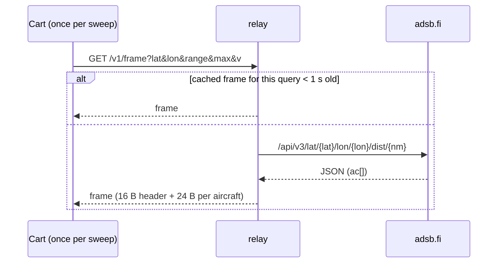

# The relay

The console can't parse ~40 KB of JSON or speak TLS, so a small Go service on your network
does that for it. It polls [adsb.fi](https://adsb.fi) over HTTPS, converts the result into the
compact v1 binary frame, and serves it over plain HTTP. It uses only the standard library and
has no state on disk.



## Running it

| How | Command |
|---|---|
| Published image (Linux) | `docker run -d --name mwradar-relay --restart unless-stopped --network host ghcr.io/jfryman/mega-wifi-radar-relay:latest` |
| From this repo, container | `make relay-start` (detached; also registers the mDNS advertisement on the host), `make relay-run` (foreground), `make relay-stop`, `scripts/relay logs` |
| From this repo, native Go | `cd relay && go run . -listen :8080` |

The image is distroless, runs as non-root, and is about 15 MB, built for linux/amd64 and
linux/arm64. `scripts/relay` uses podman if it's installed, otherwise docker (override with `CTR=docker`).

Leave the cart's **RELAY** on **AUTO** and it finds the relay over mDNS. To pin one instead, type
`http://<host>:8080`, where `<host>` is a fully qualified name your router's DNS resolves, or an IP address.

## Discovery (mDNS)

The relay advertises **`_mwradar._tcp`** ("MegaWiFi Radar", TXT `v=2 path=/v1/frame`: the contract version and frame path) with a small built-in
responder. Check it with `dns-sd -B _mwradar._tcp` (macOS) or `avahi-browse -r _mwradar._tcp` (Linux).

| Where the relay runs | Who advertises |
|---|---|
| Native (`go run .`, a binary) | The relay itself. On macOS, allow "Local Network" access when asked. |
| Linux container with `--network host` | The relay itself |
| Bridged container, Docker Desktop, Podman machine | **The host**: `scripts/relay start` runs `dns-sd -P` (macOS) or `avahi-publish` (Linux) for it, and the container runs with `-mdns=false`. After a reboot, run `scripts/relay advertise` (the container restarts by itself, the advertisement doesn't). |

The cart sends a *legacy unicast* query (from UDP port 5354), and responders answer it directly, so the
ESP32 never joins the multicast group. Details: [lode/net/discovery.md](../lode/net/discovery.md).

### Flags

| Flag | Default | |
|---|---|---|
| `-listen` | `:8080` | HTTP listen address |
| `-upstream` | `https://opendata.adsb.fi` | Any adsb.fi-compatible base URL |
| `-min-interval` | `1s` | Minimum time between upstream requests (adsb.fi allows 1 per second) |
| `-mdns` | `true` | Advertise `_mwradar._tcp` over mDNS (UDP 5353) |
| `-convert FILE -o OUT -lat -lon -range` | | Convert a saved upstream JSON file into one frame, then exit |
| `-pack OUT FILES...` | | Pack several JSON snapshots into a fake-feed file for the emulator build |
| `-pack-detail OUT FILES...` | | Pack the details of every aircraft in the snapshots for the emulator build's pop-up |

## HTTP API

- **Versions:** the relay and the cartridge ship together; use the relay from your cartridge's release.
  Every request carries `v=<contract version>` (`AR_VER`, 2 in 0.2.0). Any other value, or none, gets
  `409` with a message naming the relay's release, and the cart reports `RELAY MISMATCH` at boot or
  `RELAY VER?` on the radar. The relay logs its release and contract version at start-up.
- `GET /v1/frame?lat=<deg>&lon=<deg>&range=<nm>&max=<n>&v=2` returns `200` with
  `application/octet-stream` and an explicit `Content-Length`. `range` is clamped to 1–250 and `max` to 1–96.
  A missing or bad `lat`/`lon` gives `400`.
- `GET /v1/detail?icao=<6 hex>&v=2` returns one 96-byte detail record for the pop-up (below), from the newest
  upstream snapshot if it's under 30 s old, otherwise from a single-aircraft upstream request
  (`/api/v2/hex/<icao>`, inside the same rate limit). An unknown aircraft gets a record without the FOUND flag.
- If adsb.fi fails, the relay serves the last good frame with the `UPSTREAM_ERR` header flag set
  (the cart shows `UPSTRM ERR`). If there's no previous frame, it returns `502`.
- `GET /healthz` returns `ok`.

Try it:
```sh
curl -s 'http://localhost:8080/v1/frame?lat=36.1245&lon=-86.6782&range=25&max=96&v=2' | xxd | head
curl -s 'http://localhost:8080/v1/detail?icao=abfcda&v=2' | xxd
```

## Frame format (contract v2)

Big-endian and word-aligned: a 16-byte header followed by `count` 24-byte records. Positions are
east/north offsets from the home point in 1/32 nm. The records are sorted nearest first.

| Header (16 B) | Size | Record (24 B) | Size |
|---|---|---|---|
| magic `"AR"` | 2 | ICAO address | 3 |
| version (2) | 1 | flags (ground, stale, emergency, unknown alt/gs/track/vrate) | 1 |
| count | 1 | x, y: east, north of home (1/32 nm) | 2+2 |
| record size (≥ 24) | 2 | altitude (25 ft) | 2 |
| sequence | 2 | squawk (digits as nibbles, `0x7700`) | 2 |
| time (Unix s) | 4 | ground speed (2 kt), track (1/256 turn) | 1+1 |
| range (nm) | 2 | vertical rate (64 fpm), category | 1+1 |
| source, header flags | 1+1 | callsign (8 chars, space padded) | 8 |

### Detail record (96 B)

| Field | Size | Field | Size |
|---|---|---|---|
| magic `"AD"`, version, flags (found, geom alt, sel alt, sel hdg, QNH, year, seen) | 2+1+1 | year built | 2 |
| ICAO address, category | 3+1 | registration (space padded) | 8 |
| GPS altitude (25 ft) | 2 | ICAO type (`B38M`) | 4 |
| selected altitude (25 ft) | 2 | seconds since last message | 2 |
| selected heading (°) | 2 | description (`BOEING 737 MAX 8`) | 32 |
| QNH (0.1 hPa) | 2 | owner / operator | 32 |

The C header [src/arframe.h](../src/arframe.h) is the machine-checked definition: `relay/contract_test.go` fails the
build if the relay drifts from it. The prose spec, with exact offsets, flag bits and versioning rules, is
[lode/architecture/frame-format.md](../lode/architecture/frame-format.md). The console-side
structs (with offset static asserts) are in [src/arframe.h](../src/arframe.h).

## Data terms

adsb.fi open data is free for **personal, non-commercial** use, and it requires attribution.
The cart shows `Data: adsb.fi` in the panel. Keep `-min-interval` at 1 s or more. If several
carts share one relay, the per-query cache means identical queries cost one upstream call.
