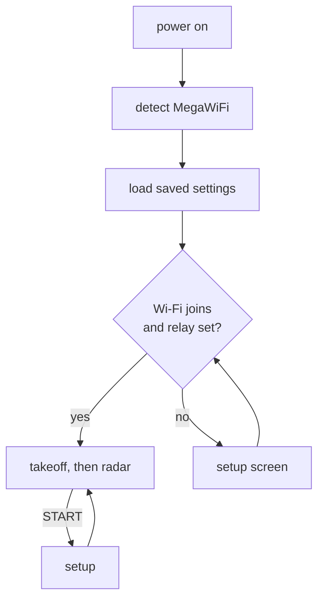

# Using the radar

## Boot

The boot is a departure: your flight, **MEGA 787**, waits at the gate beside the tower, and each
real boot step is a radio call, in a speech bubble from whoever is talking. With SOUND on you hear it too:
the engines spool up, idle through taxi and roar on takeoff, and every call crackles over the radio.

| Radio call | What the cartridge is doing |
|---|---|
| *Ground, MEGA 787, at gate, radio check* | Looking for the MegaWiFi module |
| *Taxi runway 9 via Alpha* | Module found, settings loaded: the 787 taxis out |
| *Hold short runway 9* | Joining your Wi-Fi network |
| *Request radar service* | RELAY is AUTO: finding the relay over mDNS |
| *Cleared for takeoff* | Connected: it rolls, climbs out behind the logo, and the radar starts |
| *Hold position* (red reason) | Wi-Fi failed or no relay found: setup opens, then the 787 resumes at the hold line |
| *No reply: MegaWiFi module not found* (red) | The module didn't answer; the 787 stays at the gate |

The tower uses the first word of your home airport's name (*Nashville Ground*). The line under the logo
shows the ROM version and module firmware, then the cart's IP and the relay in use. Press **START** to skip the waits and
the takeoff. **Hold START while powering on** to go straight to setup.

## Setup screen

Use up/down to move between rows; each row lists its controls below.

| Row | Controls |
|---|---|
| THEME | left/right: CLASSIC, STARS, AMBER, NIGHT, MARINE, ICE, POCKET, SUNSET, ERAM |
| RANGE | left/right: 5 / 10 / 25 / 50 / 100 nm |
| TAGS | left/right: ALL / SELECTED / OFF |
| SOUND | left/right: ON / OFF, the boot sounds and the flyover notice chime; switching it on plays the chime |
| AIRPORT | left/right steps through airports; C jumps to the next letter; A types an ICAO code (1,143 large airports with scheduled service) |
| WI-FI | A: scan, pick a network, type the password, connect. The network is saved on the module. |
| RELAY | **AUTO** (default): found over mDNS at every boot; shows what it found. A: type a URL to pin one, for example `http://radar-pi.home.lan:8080`. C: back to AUTO |
| CONTROLS | A: list every radar and setup button; B or START goes back |
| RESET | A: choose **Wi-Fi networks** (forget saved Wi-Fi), **Settings** (back to defaults) or **Everything**; press A again to confirm, and the console restarts into the first-boot flow |
| SAVE & EXIT | A: write the settings to the ESP32 flash and return |
| EXIT | A: leave and discard the changes |

**START** on any row saves and exits. When setup opens because Wi-Fi failed, it starts on the
Wi-Fi page; if no relay is set, the cursor then starts on RELAY.

On the keyboard: the D-pad moves, **A** types, **B** deletes, **START** accepts. SPACE / DEL / OK /
CANCEL are on the bottom row.

**Relay discovery:** with RELAY on AUTO, the cart sends one mDNS query for `_mwradar._tcp` after joining
Wi-Fi. After three failed polls in a row, it looks again, so a relay that moves to a new IP is found again.
**Typed URLs:** use plain `http://`, a fully qualified name or an IP, and the port. The module's DNS client
ignores your network's search domain, and `.local` host names don't resolve (only the discovery query uses mDNS).

## Radar controls

| Button | Action |
|---|---|
| A / B | zoom in / out (5 to 100 nm); B closes a flyover notice instead while one is up |
| up / down | select the previous / next aircraft in the traffic list (hold to scroll) |
| C | open the detail pop-up for the selected aircraft (with a flyover notice up: for its aircraft); C or B closes it |
| A (in the pop-up) | cockpit view from that aircraft; B goes back to the radar |
| hold C | sort the list: nearest, A-Z, Z-A, lowest altitude, highest altitude (remembered) |
| left / right | tags: all, selected only, off |
| X (6-button pad) | next theme |
| Y (6-button pad) | cockpit view from the selected aircraft. X and Y are shortcuts: Z is unused, and everything works on a 3-button pad |
| START | setup |

**Detail pop-up:** covers the scope (which keeps running) with the selected aircraft's callsign and ICAO
address, registration, type, year, model and operator, then altitude, vertical speed, GPS altitude,
autopilot-selected altitude and heading, altimeter setting (inHg and hPa), speed, track, squawk with its
meaning, category, distance and bearing, status and time since last heard. The live values come from the
frame; the rest from the relay's `/v1/detail`, refreshed once per sweep. Up/down move the selection
without closing it. `--` means the aircraft doesn't report that value.

**Cockpit view:** A in the pop-up (or Y) puts you in the selected aircraft, looking ahead over the real terrain
around it, drawn by the console as the aircraft flies. The relay sends a patch of terrain (elevation from the
public AWS Terrain Tiles) centred on the aircraft, scaled to its height, and its position every 2 seconds; the
console flies the camera smoothly in between, banking and pitching with the aircraft, and streams in new terrain
ahead of it as it goes. Entering takes a few seconds while the first patch loads; after that the view only pauses
for a moment while an update loads, and for a few seconds if the aircraft climbs or descends far enough to need a
patch at a new scale. The bottom of the screen shows the
callsign, type and operator, then an instrument strip (altitude in feet, ground speed in knots, vertical speed in
ft/min, heading, bank) and the aircraft's bearing and distance from your home airport. `NO SIGNAL` means updates have stopped; after
20 seconds without one the cart goes back to the radar. B goes back at any time, with the aircraft still
selected. Colours come from the terrain's height (water, low ground, forest, high ground, snow), not imagery.

**Flyover notices:** if the relay is connected to a flyover feed (an MQTT topic announcing planes over your home;
see [flyover.md](flyover.md)), a box pops open over the middle of the scope for 15 seconds when one
passes (and shrinks shut again): a headline and the callsign, the airline and aircraft type, then the route, altitude and speed where
they're known. When the relay finds the aircraft in its feed, it's selected on the radar and C opens its details.
B dismisses it. Tags move out of its way while it's open. If the detail pop-up is open, the notice waits
until it closes. A chime plays as it
arrives (setup's SOUND turns it off); some home airports have a tune of their own. In the cockpit view the notice
never covers the view: `OVERHEAD!` shows next to the callsign and the notice scrolls across the bottom row once.

## What's on screen

- **Scope:** range rings with range labels, rim ticks every 10°, and N/E/S/W. North is up, and the scope is centred on the home airport.
- **Sweep:** turns once every 4.3 s. Each aircraft's position updates when the sweep passes over it,
  and the blip fades between hits, the way a real primary display does. The relay is polled
  once per sweep, as it passes north.
- **Trails:** the last 5 positions (about 21 s).
- **Tags:** two lines, `CALLSIGN` and `ALT GS`, where altitude is in hundreds of feet (`GND` or
  `---` if unknown) and ground speed is in knots. Tag colour shows the altitude band:
  green below FL100 or on the ground, cyan FL100–FL179, white FL180 and above, red for emergencies
  (squawk 7500/7600/7700). Aircraft on the ground don't get tags.
- **Stale targets** (no position for 15 s) are drawn dim. Targets are dropped after 60 s.
- **Panel** (right): airport, range, UTC time, aircraft count, link state (`NET OK`, `STALE 20s`,
  `ERR HTTP`, `RELAY VER?`, `UPSTRM ERR`, …), then the **traffic list**: a header with the sort order,
  15 rows of `CALLSIGN DIST` (nm) with the selection highlighted and emergencies pinned on top in red,
  and `^3 v10 MORE` when it scrolls. Below that, the theme and tag mode, and the data source credit.

## Themes

| Theme | Look | Sweep + blip fade |
|---|---|---|
| Classic | green phosphor on black | yes |
| STARS | black, white/cyan tags, blue rings | no, constant blips |
| AMBER | amber phosphor on black, orange sweep | yes |
| NIGHT | dim reds for a dark room | yes |
| MARINE | ship's radar: yellow-orange targets on navy, steel-blue rings | yes |
| ICE | blue-white phosphor on black | yes |
| POCKET | handheld LCD: dark olive on pea green | no, constant blips |
| SUNSET | cyan sweep over purple, magenta rings | yes |
| ERAM | en-route centre: grey-green maps, green targets | no, constant blips |

## Settings storage

Settings are saved as one record (`MWR3`) in ESP32 flash sector 0 of `user_data`, by SAVE & EXIT and also
after a change on the radar (zoom, tags, theme with X, sort order with hold C) at the next poll, at most every
30 s. Records from 0.3.x (`MWR1`) and 0.4.0-0.4.1 (`MWR2`) are upgraded on load. **RESET** in setup erases them and/or the
module's Wi-Fi config. On a dev build (`src/dev_config.h`) it also keeps the compiled-in dev Wi-Fi and relay off
until a different ROM is flashed, so you can test the Wi-Fi-not-set and AUTO-relay flows. Wi-Fi credentials are
kept separately by the MegaWiFi firmware. Reflashing the ROM or the ESP32 firmware
(`make esp-flash`) doesn't erase either.
