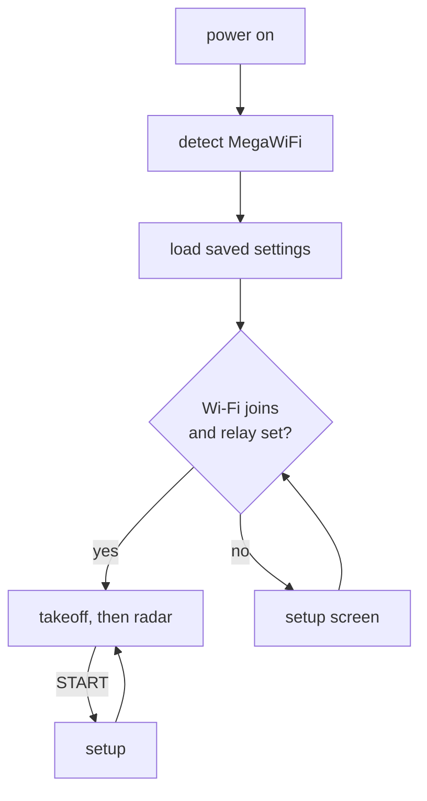

# Using the radar

## Boot

The boot is a departure: your flight, **MEGA 787**, waits at the gate beside the tower, and each
real boot step is a radio call.

| Radio call | What the cartridge is doing |
|---|---|
| *Ground, MEGA 787, at gate, radio check* | Looking for the MegaWiFi module |
| *Taxi runway 9 via Alpha* | Module found, settings loaded: the 787 taxis out |
| *Hold short runway 9* | Joining your Wi-Fi network |
| *Request radar service* | RELAY is AUTO: finding the relay over mDNS |
| *Cleared for takeoff* | Connected: it rolls, climbs out behind the logo, and the radar starts |
| *Hold position* (red reason) | Wi-Fi failed or no relay found: setup opens, then the 787 resumes at the hold line |
| *No reply: MegaWiFi module not found* (red) | The module didn't answer; the 787 stays at the gate |

The tower uses the first word of your home airport's name (*Nashville Ground*). The bottom line shows
the ROM version and module firmware, then the cart's IP and the relay in use. Press **START** to skip the waits and
the takeoff. **Hold START while powering on** to go straight to setup.

## Setup screen

Use up/down to move between rows; each row lists its controls below.

| Row | Controls |
|---|---|
| THEME | left/right: CLASSIC / STARS |
| RANGE | left/right: 5 / 10 / 25 / 50 / 100 nm |
| TAGS | left/right: ALL / SELECTED / OFF |
| AIRPORT | left/right steps through airports; C jumps to the next letter; A types an ICAO code (1,143 large airports with scheduled service) |
| WI-FI | A: scan, pick a network, type the password, connect. The network is saved on the module. |
| RELAY | **AUTO** (default): found over mDNS at every boot; shows what it found. A: type a URL to pin one, for example `http://radar-pi.home.lan:8080`. C: back to AUTO |
| RESET | A: choose **Wi-Fi networks** (forget saved Wi-Fi), **Settings** (back to defaults) or **Everything**; press A again to confirm, and the console restarts into the first-boot flow |
| SAVE & EXIT | A: write the settings to the ESP32 flash and return |
| EXIT | A: leave and discard the changes |

**START** on any row saves and exits. When setup opens because Wi-Fi failed, it starts on the
Wi-Fi page; if no relay is set, the cursor then starts on RELAY.

On the keyboard: the D-pad moves, **A** types, **B** deletes, **START** accepts. SPACE / DEL / OK /
CANCEL are on the bottom row.

**Relay discovery:** with RELAY on AUTO, the cart sends one mDNS query for `_mwradar._tcp` after joining
Wi-Fi. After three failed polls in a row, it looks again, so a relay that moves to a new IP is found again.
**Typed URLs:** use plain `http://`, a fully qualified name or an IP, and the port. The module's DNS client
ignores your network's search domain, and `.local` host names don't resolve (only the discovery query uses mDNS).

## Radar controls

| Button | Action |
|---|---|
| A / B | zoom in / out (5 to 100 nm) |
| C | select the next aircraft, nearest first; details appear in the panel |
| hold C | cycle tags: all, selected only, off |
| D-pad | pan the scope |
| START | setup |

## What's on screen

- **Scope:** range rings with range labels, rim ticks every 10°, and N/E/S/W. North is up, and the scope is centred on the home airport.
- **Sweep:** turns once every 4.3 s. Each aircraft's position updates when the sweep passes over it,
  and the blip fades between hits, the way a real primary display does. The relay is polled
  once per sweep, as it passes north.
- **Trails:** the last 5 positions (about 21 s).
- **Tags:** two lines, `CALLSIGN` and `ALT GS`, where altitude is in hundreds of feet (`GND` or
  `---` if unknown) and ground speed is in knots. Tag colour shows the altitude band:
  green below FL100 or on the ground, cyan FL100–FL179, white FL180 and above, red for emergencies
  (squawk 7500/7600/7700). Aircraft on the ground don't get tags.
- **Stale targets** (no position for 15 s) are drawn dim. Targets are dropped after 60 s.
- **Panel** (right): airport, range, UTC time, aircraft count, link state (`NET OK`, `STALE 20s`,
  `ERR HTTP`, `UPSTRM ERR`, …), the selected aircraft (callsign, altitude with climb/descent arrow,
  ground speed, track, squawk, distance/bearing), controls, theme, and the data source credit.

## Themes

| | Classic | STARS |
|---|---|---|
| Look | green phosphor on black | black, white/cyan tags, blue rings |
| Sweep | thin line with afterglow | none |
| Blips | fade after each sweep hit | constant |

## Settings storage

Settings are saved as one record in ESP32 flash sector 0 of `user_data`. **RESET** in setup erases them and/or the
module's Wi-Fi config. On a dev build (`src/dev_config.h`) it also keeps the compiled-in dev Wi-Fi and relay off
until a different ROM is flashed, so you can test the Wi-Fi-not-set and AUTO-relay flows. Wi-Fi credentials are
kept separately by the MegaWiFi firmware. Reflashing the ROM or the ESP32 firmware
(`make esp-flash`) doesn't erase either.
