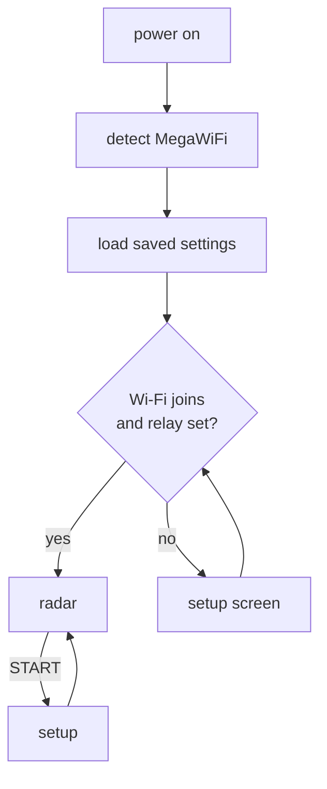

# Using the radar

## Boot

The boot screen shows the ROM version, the module firmware, `Settings loaded` (or
`Default settings` on a first boot), and the IP address. **Hold START while powering on** to go
straight to setup.

## Setup screen

Use up/down to move between rows; each row lists its controls below.

| Row | Controls |
|---|---|
| THEME | left/right: CLASSIC / STARS |
| RANGE | left/right: 5 / 10 / 25 / 50 / 100 nm |
| TAGS | left/right: ALL / SELECTED / OFF |
| AIRPORT | left/right steps through airports; C jumps to the next letter; A types an ICAO code (1,143 large airports with scheduled service) |
| WI-FI | A: scan, pick a network, type the password, connect. The network is saved on the module. |
| RELAY | A: edit the relay base URL, for example `http://radar-pi.home.lan:8080` |
| SAVE & EXIT | A: write the settings to the ESP32 flash and return |
| EXIT | A: leave and discard the changes |

**START** on any row saves and exits. When setup opens because Wi-Fi failed, it starts on the
Wi-Fi page; if no relay is set, the cursor then starts on RELAY.

On the keyboard: the D-pad moves, **A** types, **B** deletes, **START** accepts. SPACE / DEL / OK /
CANCEL are on the bottom row.

**Relay URLs:** use plain `http://`, a fully qualified name or an IP, and the port. The module's
DNS client ignores your network's search domain, and `.local` (mDNS) names don't resolve.

## Radar controls

| Button | Action |
|---|---|
| A / B | zoom in / out (5 to 100 nm) |
| C | select the next aircraft, nearest first; details appear in the panel |
| hold C | cycle tags: all, selected only, off |
| D-pad | pan the scope |
| START | setup |

## What's on screen

- **Scope:** range rings with range labels, rim ticks every 10°, and N/E/S/W. North is up, and the scope is centred on the home airport.
- **Sweep:** turns once every 4.3 s. Each aircraft's position updates when the sweep passes over it,
  and the blip fades between hits, the way a real primary display does. The relay is polled
  once per sweep, as it passes north.
- **Trails:** the last 5 positions (about 21 s).
- **Tags:** two lines, `CALLSIGN` and `ALT GS`, where altitude is in hundreds of feet (`GND` or
  `---` if unknown) and ground speed is in knots. Tag colour shows the altitude band:
  green below FL100 or on the ground, cyan FL100–FL179, white FL180 and above, red for emergencies
  (squawk 7500/7600/7700). Aircraft on the ground don't get tags.
- **Stale targets** (no position for 15 s) are drawn dim. Targets are dropped after 60 s.
- **Panel** (right): airport, range, UTC time, aircraft count, link state (`NET OK`, `STALE 20s`,
  `ERR HTTP`, `UPSTRM ERR`, …), the selected aircraft (callsign, altitude with climb/descent arrow,
  ground speed, track, squawk, distance/bearing), controls, theme, and the data source credit.

## Themes

| | Classic | STARS |
|---|---|---|
| Look | green phosphor on black | black, white/cyan tags, blue rings |
| Sweep | thin line with afterglow | none |
| Blips | fade after each sweep hit | constant |

## Settings storage

Settings are saved as one record in ESP32 flash sector 0 of `user_data`. Wi-Fi credentials are
kept separately by the MegaWiFi firmware. Reflashing the ROM or the ESP32 firmware
(`make esp-flash`) doesn't erase either.
