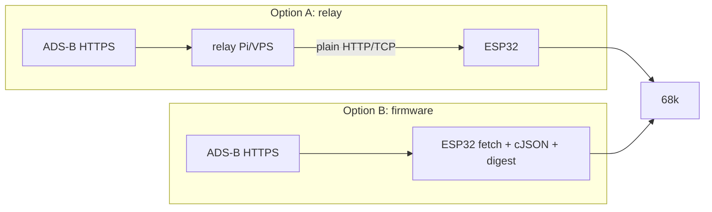

# Data path options

The digester turns ADS-B JSON into compact frames. The compact frame format must be identical in
both options, so the logic can move from A to B without changing the ROM.



| | A: Relay | B: Firmware extension |
|---|---|---|
| Iteration speed | fast (Python/Go) | slow (IDF rebuild + reflash) |
| Standalone cart | no (needs a server) | yes |
| HTTPS problem | avoided | needs the cert-bundle patch ([firmware.md](../platform/firmware.md)) |
| Fork divergence | none | new command in mw-fw-rtos |

Owner's lean: **start with A** (relay), and keep B possible. Path A is what's being built.

## Frame format
Agreed v1: [frame-format.md](frame-format.md) (16-byte header + 24-byte records, 1/32 nm,
nearest-first, cap 96). It's identical for A and B.

Either digester answers the same request, so the console doesn't care which one is in use:
```sh
curl -s 'http://<relay>:8080/v1/frame?lat=36.1245&lon=-86.6782&range=25&max=96' | xxd | head -2
# 00000000: 4152 0118 0018 ...   "AR" v1, count, rec_size 24, ...
```

Related: [../data/adsb-sources.md](../data/adsb-sources.md), [../plans/roadmap.md](../plans/roadmap.md).
