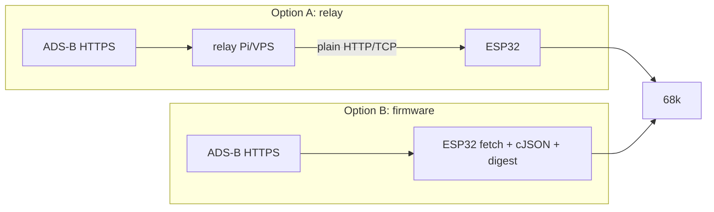

# Data path options (UNDECIDED)

The digester turns ADS-B JSON into compact frames. The compact frame format must be identical in
both options, so the logic can move from A to B without changing the ROM.



| | A: Relay | B: Firmware extension |
|---|---|---|
| Iteration speed | fast (Python/Go) | slow (IDF rebuild + reflash) |
| Standalone cart | no (needs a server) | yes |
| HTTPS problem | avoided | needs the cert-bundle patch ([firmware.md](../platform/firmware.md)) |
| Fork divergence | none | new command in mw-fw-rtos |

Owner's lean: **start with A**, and keep B possible.

## Candidate compact frame (draft, not agreed)
```c
/* big-endian, positions in 1/16 nm relative to home */
struct ac {            /* 18 bytes */
    u8  icao[3];
    char cs[8];        /* space-padded callsign */
    s16 x, y;          /* east, north; ±2048 nm range */
    u8  alt100;        /* alt/100 ft, 0..255 (FL255 cap?) -> TBD */
    u8  gs4;           /* gs/4 kt  -> TBD */
    u8  trk;           /* track * 256/360 */
    u8  flags;         /* emergency, on-ground, stale ... */
};
```
Related: [../data/adsb-sources.md](../data/adsb-sources.md), [../plans/roadmap.md](../plans/roadmap.md).
