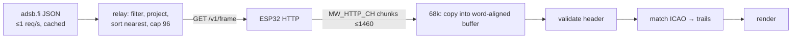

# Compact frame format (v1, agreed 2026-10-28)

The binary snapshot of nearby traffic that the console consumes. The digester produces it: the relay
(option A) now, possibly the ESP32 firmware (option B) later, in byte-identical form. The console
definition is `src/arframe.h`. The relay must match it field for field.



## Invariants
- **Big-endian**, every field **naturally aligned**, records an **even size**. The 68000 raises an
  address error on an odd-address word or long access, so the console reads the buffer through
  struct pointers. The buffer itself must be word-aligned (`u16[]`).
- **Full snapshot every poll.** No deltas, and the relay keeps no per-client state. A lost poll costs
  nothing. Trails come from the console matching `icao` across snapshots.
- **Positions are projected by the relay** (azimuthal equidistant about home). The 68k only shifts and adds.
- The console polls **once per sweep rotation** (~4–5 s). The relay fetches upstream at most
  1×/s (the adsb.fi limit) and shares that result between clients.

## Header: 16 bytes
| Off | Type | Field | Meaning |
|---|---|---|---|
| 0 | `char[2]` | magic | `"AR"` |
| 2 | `u8` | ver | `1` |
| 3 | `u8` | count | records that follow (≤ requested `max`, ≤ 96 by default) |
| 4 | `u16` | rec_size | `24` in v1. Read the first 24 bytes of each record and skip `rec_size - 24` |
| 6 | `u16` | seq | +1 per upstream fetch (wraps). The same seq means the same snapshot |
| 8 | `u32` | time | Unix seconds of the upstream snapshot |
| 12 | `u16` | range_nm | filter radius applied |
| 14 | `u8` | source | `1` adsb.fi, `2` adsb.lol, `3` OpenSky. Drives the on-screen attribution ("Data: adsb.fi") |
| 15 | `u8` | hflags | bit0 `TRUNCATED` (cap hit), bit1 `UPSTREAM_ERR` (this is the last good snapshot) |

## Aircraft record: 24 bytes
| Off | Type | Field | Unit / encoding |
|---|---|---|---|
| 0 | `u8[3]` | icao | 24-bit ICAO address |
| 3 | `u8` | flags | see below |
| 4 | `s16` | x | east of home, **1/32 nm** (±1024 nm, ~58 m) |
| 6 | `s16` | y | north of home, 1/32 nm |
| 8 | `s16` | alt | barometric, **25 ft** units. The tag shows `alt >> 2` (hundreds of ft) |
| 10 | `u16` | squawk | one octal digit per nibble: `7700` → `0x7700`. `0xFFFF` = none |
| 12 | `u8` | gs | ground speed, **2 kt** units (0–510), saturating |
| 13 | `u8` | track | true track in 1/256 of a circle (direct sin/cos table index) |
| 14 | `s8` | vrate | baro rate, **64 ft/min** units, saturating at ±127 |
| 15 | `u8` | cat | emitter category: letter offset in the high nibble, digit in the low (`A3` → `0x03`, `B1` → `0x11`). `0xFF` = none |
| 16 | `char[8]` | cs | callsign, space-padded, not NUL-terminated. Fallback order: `flight` → `r` (registration) → hex of `icao` |

### Record flags
| Bit | Name | Set when |
|---|---|---|
| 0 | `GROUND` | `alt_baro == "ground"` |
| 1 | `EMERG` | squawk 7500/7600/7700 or `emergency` ≠ `none` |
| 2 | `STALE` | `seen_pos` > **15 s** (aircraft with `seen_pos` > **60 s** are dropped) |
| 3 | `ALT_UNK` | no barometric altitude (`alt` = 0) |
| 4 | `GS_UNK` | no ground speed (`gs` = 0) |
| 5 | `TRK_UNK` | no track (`track` = 0) |
| 6 | `VR_UNK` | no vertical rate (`vrate` = 0) |
| 7 | — | reserved, 0 |

```c
struct ar_hdr { char magic[2]; u8 ver, count; u16 rec_size, seq; u32 time;
                u16 range_nm; u8 source, hflags; };                     /* 16 */
struct ar_rec { u8 icao[3], flags; s16 x, y, alt; u16 squawk;
                u8 gs, track; s8 vrate; u8 cat; char cs[8]; };          /* 24 */
```

## Transport
`GET http://<relay>/v1/frame?lat=<deg>&lon=<deg>&range=<nm>&max=<n>` returns `200`,
`Content-Type: application/octet-stream`, **with a `Content-Length`** (no chunked encoding:
`net_http_get` needs the length). Errors are non-200 statuses with no frame. The relay filters to
`range`, drops aircraft with no position or `seen_pos > 60`, sorts **nearest first** and keeps
`max` (default and maximum 96), so truncation drops the furthest traffic.

Sizing: 16 + 96 × 24 = **2,320 B maximum**. KORD at 25 nm (~74 aircraft) = 1,792 B, which is two
MSS chunks. The console's frame buffer is 2,320 B.

## Versioning
- New fields go **after** byte 24 and increase `rec_size`, so v1 consoles keep working.
  v2 adds the aircraft **type** (`t`, e.g. `B738`, 4 chars) → 28 bytes.
- An incompatible change bumps `ver`. The console rejects a `ver` it doesn't know and shows
  "relay version".

## Validation on the console
`magic == "AR"`, `ver == 1`, `rec_size >= 24`, `rec_size` even, and
`16 + count × rec_size == content_len`. Otherwise the snapshot is discarded and the previous one kept.

The machine-checked form of this spec is `src/arframe.h`; `relay/contract_test.go` holds the relay to it
([contract.md](contract.md)).

Related: [data-path-options.md](data-path-options.md), [../data/adsb-sources.md](../data/adsb-sources.md),
[../net/net-layer.md](../net/net-layer.md).
