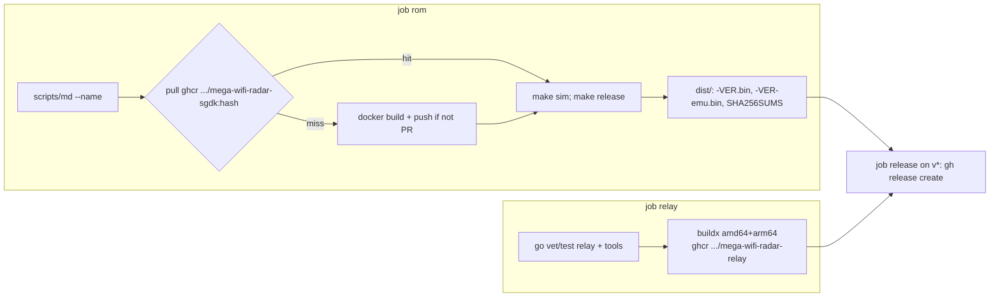

# CI, releases and publishing

Public repo **github.com/jfryman/mega-wifi-radar** (MIT). One workflow, `.github/workflows/build.yml`,
runs on pushes to `main`, `v*` tags, PRs and manual dispatch. User-facing docs live in `README.md`
and `docs/` (hardware, usage, relay, building). The lode stays the in-depth design record and is published too.



## Contracts
- **SDK image cache:** CI pushes the SGDK image as `ghcr.io/jfryman/mega-wifi-radar-sgdk:<hash>`, using the
  same content hash as `scripts/md`. `scripts/md` pulls that tag before building locally (`MD_REGISTRY=`
  disables this), so users skip the 15–30 min gcc build. CI adds the `org.opencontainers.image.source` label
  at build time instead of in the Dockerfile, which would change the hash.
- **Relay image tags:** `:edge` (main), `:<semver>` and `:latest` (tags), `:pr-N` (PRs, never pushed).
  `relay/Dockerfile` cross-compiles (`FROM --platform=$BUILDPLATFORM`, `GOOS/GOARCH` from `TARGET*`), so arm64 needs no QEMU.
- **Release ROMs never contain credentials:** CI asserts that `src/dev_config.h` is absent. The cart ROM
  boots into setup when no Wi-Fi works or no relay is set.
- **Version:** `make` writes `#define APP_VERSION "<git describe --tags --always --dirty>"` to the git-ignored
  `src/version.h` (only rewritten when it changes). It's included only by `devcfg.c` (always rebuilt), and the
  boot screen shows `app_version` at column 17. `VERSION=` overrides it; the checkout needs `fetch-depth: 0`.
- Order matters: `make sim` wipes `out/release` and `out/rom.bin`, so CI runs it **before** `make release`.
- **GHCR visibility:** packages pushed by Actions to a personal account may start out private. If so,
  flip them to public once in each package's settings, or anonymous pulls fail.

## Third-party data in the repo
`relay/testdata/*.json` and `res/fake/kbna_seq.bin` are adsb.fi snapshots (personal, non-commercial,
attribution), excluded from MIT by `relay/testdata/NOTICE.md`. `src/airports.c` is from OurAirports (public domain).
Never commit LAN hostnames or IPs; docs use `relay-host.example.lan` / `192.168.1.x` placeholders.

## Cutting a release
```sh
git tag -a v0.1.0 -m "v0.1.0" && git push origin v0.1.0
```

Related: [container-build.md](container-build.md), [../relay/relay.md](../relay/relay.md).
