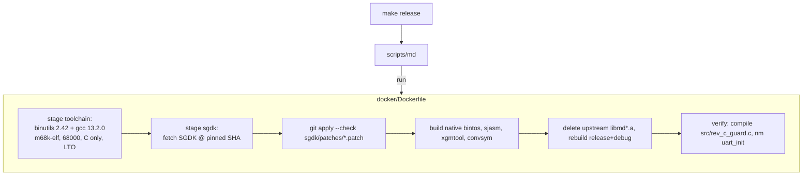

# Container build

All compiling happens in one image, `mwradar-sgdk:<hash>`, which runs the same way on macOS and
Arch. The host only needs **Podman or Docker** (podman is preferred when both exist; override with
`CTR=docker`).



## Pins
| What | Value | Where |
|---|---|---|
| SGDK | `9a78a44143a867cd8c5053b95cd061a21f0b73c2` (master, 2026-10-20) | `ARG SGDK_COMMIT` |
| binutils | 2.42, sha256 `f6e4d41f…a800` | `ARG BINUTILS_*` |
| gcc | 13.2.0 (the version SGDK ships for Windows), sha256 `e275e764…43da` | `ARG GCC_*` |
| base | `debian:bookworm-slim` | `ARG DEBIAN` |

## Invariants
- **The image tag is a content hash** of `docker/`, `sgdk/` and `src/rev_c_guard.c`
  (`scripts/md`, using `sha256sum` or `shasum -a 256`). Editing a patch or a pin always forces
  a rebuild, so a stale or unpatched `libmd.a` can't be used.
- Upstream's prebuilt `lib/libmd.a` is **deleted** before rebuilding, because it was built unpatched.
- `src/rev_c_guard.c` is compiled into every ROM *and* into the image check. It `#error`s or
  fails a `_Static_assert` unless `UART_CLK=20 MHz`, `UART_BR=1.25 M`, and the implementation is `MW_CART`.
- Containers run as the host user (`--user uid:gid` on Docker, `--userns=keep-id` on Podman), so `out/` isn't owned by root.
- Patches must apply cleanly (`git apply --check`). When the pin moves, regenerate them; don't fuzz them.

## Usage
```sh
make            # = make release -> out/rom.bin
make debug      # libmd_debug + symbols
make image      # build/print the image tag only
make flash      # scripts/flashkit write-rom out/rom.bin (host side)
scripts/md sh   # shell inside the image (GDK=/sgdk)
```

## Flashing (host side)
`scripts/flashkit` runs `flashkit-md` from PATH if it's there. Otherwise it downloads the pinned,
self-contained **v1.12.0** release for the host (osx-arm64/x64, linux-arm64/x64) into the
git-ignored `.tools/`, checks it against the release's SHA256SUMS, and runs it. `FLASHKIT_FETCH=1`
forces the pinned copy even if one is on PATH. No .NET runtime is needed. The FlashKit
auto-detects its port (`/dev/cu.usbserial-*` / `/dev/ttyUSB*`).

## Bring-up diagnostic ROM (jfryman/mw-cart `bringup-rom/`)
The SGDK-free hardware test ROM (UART regs, loopback, crystal frequency, ESP32 VERSION, echo
stress) builds in our image. Its own container installs MAME, which we don't need:
```sh
docker run --rm --user $(id -u):$(id -g) -v <mw-cart>/bringup-rom:/w -w /w \
    $(scripts/md --image) make PREFIX=m68k-elf-
scripts/flashkit write-rom <mw-cart>/bringup-rom/mw-revc-bringup.bin
```
Use it whenever the spike ROM can't detect the module: it separates hardware/firmware from SGDK.

## Emulator workflow (no cart needed)
`make sim` builds `out/sim.bin` with `-DFAKE_FEED` (16 recorded KBNA frames from `res/fake/kbna_seq.bin`,
made by `relay -pack`). `make sim-run SNAP=6,12` runs it headless in MAME (the mw-cart bring-up image,
`mw-bringup-rom:fedora42`) and writes PNGs to `out/snap/genesis/`. `SIM_PRESS="9:P1 C,13:P1 Start"`
presses buttons (MAME field names: `P1 A/B/C`, `P1 Start`, `P1 Up`...). Generated data:
`cd tools && go run ./scopegen -o ../res/scope` and `go run ./airportgen -o ../src/airports.c`.

## Updating the SGDK pin
1. Change `SGDK_COMMIT`.
2. In a checkout at the new SHA, re-make both edits and `git diff > sgdk/patches/000N-*.patch`.
3. Run `make image`. The guard step must pass.

Related: [../platform/sgdk-megawifi.md](../platform/sgdk-megawifi.md), [../practices.md](../practices.md).
