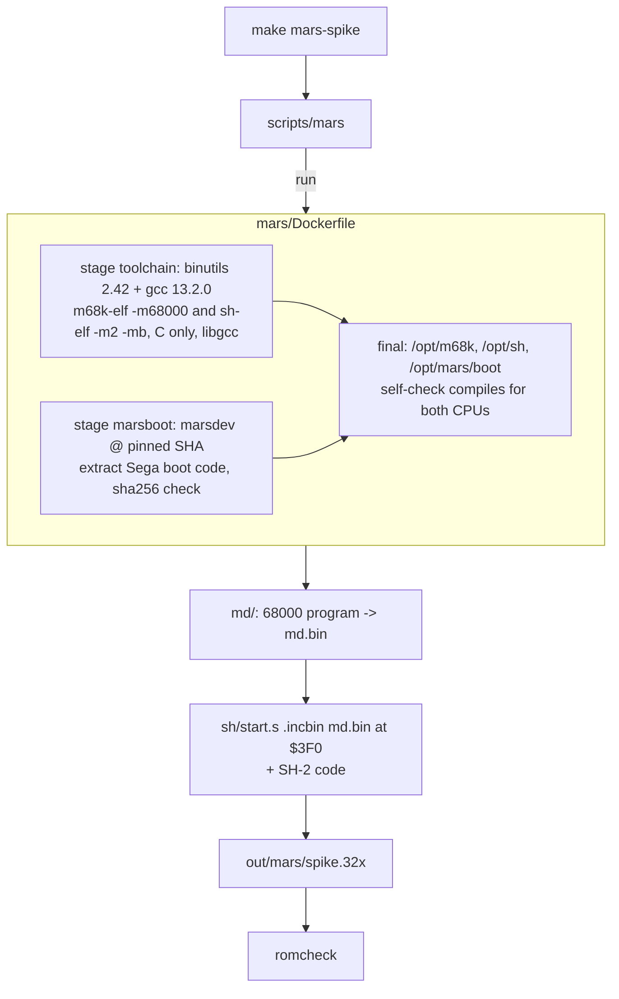

# 32X build (toolchain, spike ROM, CI)

The 32X work builds in its own image, `mwradar-mars:<hash>`, kept apart from the Genesis image so the
Genesis build, its hash and its CI cache are untouched. Plan and status: [../plans/32x.md](../plans/32x.md).
Genesis image: [container-build.md](container-build.md). CI overall: [ci-release.md](ci-release.md).



## Pins
| What | Value | Where |
|---|---|---|
| binutils / gcc | 2.42 / 13.2.0, same sha256s as the Genesis image | `mars/Dockerfile` ARGs |
| marsdev | `3318d3f39823154b24ce48bfa5d8fe6e3f6cde3f` (MIT) | `ARG MARSDEV_COMMIT` |
| Sega boot code | sha256 `ff474866…b47fa` of the extracted `dc.w` block | `ARG MARS_BLOB_SHA256` |

## Invariants
- **The tag is a content hash of `mars/Dockerfile` only** (`scripts/mars`, cloned from `scripts/md`). The build
  context is `mars/`. Nothing under `docker/`, `sgdk/` or `src/` changes, so the Genesis image hash doesn't move.
- **No Sega code in the repo.** The 1040-byte 68000 security/boot code every 32X cart carries at `$3F0` is
  extracted at image build from marsdev's `examples/32x-skeleton/md_src/md_start.s` into
  `/opt/mars/boot/mars_security.inc` (`$MARS_BOOT`), hash-checked. The spike `.include`s it.
- **No BIOS anywhere in the build.** The 32X BIOS dumps are only for emulation (`scripts/mars-sim`) and live in
  `bios/32x/` under MAME's names, git-ignored (`bios/` in `.gitignore`); `MARS_BIOS=dir` overrides. CI never emulates.
- One gcc per CPU, no multilib: `m68k-elf` is 68000-only, `sh-elf` is configured `--with-cpu=m2 --with-endian=big`,
  so `-lgcc` is always the right library.
- The ROM build is reproducible: a clean copy produces a byte-identical `spike.32x`.

## Cartridge layout (what `romcheck` enforces)
| ROM offset | Contents | Source |
|---|---|---|
| `$000` | 68000 vectors: SSP `$01000000`, every vector `$3F0` | `sh/start.s` |
| `$100` | Mega Drive header, `"SEGA 32X"` | `sh/start.s` |
| `$200` | 68000 jump table: `jmp $880800`, `jsr $880806`..., level 4 `$88080C`, level 6 `$880812` | `sh/start.s` |
| `$3C0` | MARS header: `.data` source = `_stext`, size = `_sdata`, entries `$06000240`/`$06000244`, VBRs | `sh/start.s` |
| `$3F0` | `md.bin`: Sega boot code (1040 bytes), then `_irq_jmptab` at `$880800`, then our 68000 code, then `.data` (with `.ramcode`) | `md/` |
| after | SH-2 `.text` (runs from ROM via `$02000000`), then `.data` image copied to SDRAM `$06000000` | `sh/` |

```c
/* md/md.ld: the jump table in the header hard-codes the entry points */
ASSERT(_irq_jmptab == 0x00880800, "32X boot code must be exactly 1040 bytes: _irq_jmptab != $880800")
/* sh/sh.ld: so does the MARS header */
ASSERT(mstart == 0x06000240, "mstart must be at $06000240")
```

- The 68000 program is linked at `$8803F0`: with ADEN = 1 cart offset 0 is at `$880000`, and it must fit the fixed
  512 KiB window.
- sh-elf prefixes C symbols with `_` (`m_main` is `_m_main` in `start.s`).
- `.global mstart, sstart` is required: the linker-script ASSERTs can't see local labels.

## Make targets (repo root)
```sh
make mars-image                      # pull/build mwradar-mars:<hash>, print the tag
make mars-spike                      # out/mars/spike.32x (+ md.elf/spike.elf/maps), romcheck
make mars-spike RELAY=10.0.0.5:8080  # also GET /healthz from that relay (baked in; rebuilds main.o when it changes)
make mars-spike-flash                # scripts/flashkit write-rom out/mars/spike.32x
make mars-spike-sim SNAP=2,6         # MAME 32x driver + bios/32x/ -> out/snap/32x/*.png (exit 2 without BIOS)
make mars-clean
scripts/mars sh                      # shell in the image (m68k-elf-*, sh-elf-*, $MARS_BOOT)
```
`mars/spike/Makefile` runs inside the image; objects depend on the Makefile itself so flag changes rebuild.

## CI
Job `mars` in `.github/workflows/build.yml`: pull `ghcr.io/jfryman/mega-wifi-radar-mars:<hash>`, else build it
from `mars/` and push it (not on PRs); `make mars-spike`; upload artifact `mars-spike`
(`mega-wifi-radar-32x-spike.32x` + `SHA256SUMS`). It isn't in `release`'s `needs` and ships in no release.
If marsdev ever vanishes, the cached GHCR image still builds the ROM; only a Dockerfile change needs the fetch.

## Emulator (MAME 0.287, `mw-bringup-rom:fedora42`)
| File in `bios/32x/` | Size | CRC32 |
|---|---|---|
| `32x_g_bios.bin` (68000) | 256 B | `5c12eae8` |
| `32x_m_bios.bin` (master SH-2) | 2 KiB | `dd9c46b8` |
| `32x_s_bios.bin` (slave SH-2) | 1 KiB | `bfda1fe5` |

The spike boots in MAME: rows 1-3 pass (code at `$880994`, MARS ID, both SH-2 counters move) and the 32X frame
buffer shows behind the VDP text. Rows 4+ fail by design (no MegaWiFi in MAME: SPR reads `00`).

## Lessons
- **In 32X mode the 68000 can't reach the MegaWiFi UART while RV = 0**: odd-address writes are dropped (/LWR held
  inactive) and reads return open bus (`C0`, measured on the tower). All UART access runs from RAM with RV = 1
  (`md/uart_ram.c`, `.ramcode` in `md.ld`). Code that sets RV = 1 must not execute from or read `$88xxxx` until it
  clears RV again ([../plans/32x.md](../plans/32x.md)).
- Put the build on screen (`BUILD=$(VERSION)`, git describe): photos of a cart run must say which ROM ran.
- MAME returns `0000` for a 68000 **word** read of `$A15100`; byte reads give `80 80`. The spike reads bytes and
  treats "running at `$88xxxx`" as the ADEN proof.
- A build flag that is computed but not passed fails silently: with `RELAY_HOST` empty, gcc drops the whole relay
  path (constant-folded early return). Check for `GET /healthz` in `out/mars/md.bin` after a `RELAY=` build.
