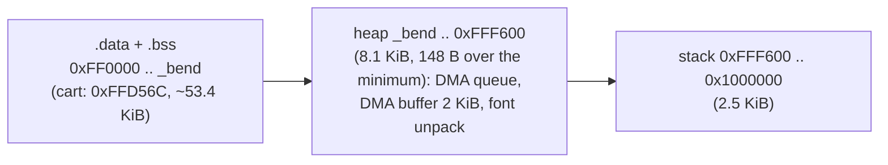

# RAM budget (68000 work RAM, 64 KiB)

Static RAM (`.data` + `.bss`) runs from `0xFF0000` to `_bend`. SGDK's heap is everything from `_bend` to
`MEMORY_HIGH` (`0xFFF600`: 0xA00 of stack above it). SGDK fills part of that heap **before `main()`**: the DMA
queue (80 × 8 B), the DMA copy buffer, and a temporary buffer to unpack the default font (~3 KiB). If any of
those allocations fails, the console hangs on a **black screen before the splash**, with no error.



## Rules
- **`scripts/ram-check`** runs after every `make release` / `make sim` link: it fails if the start-up heap is
  under `RAM_MIN_HEAP` (8192 B). Don't lower the threshold to make a build pass; shrink a buffer.
- SGDK's DMA copy buffer is patched from 8 KiB to **2 KiB** (`sgdk/patches/0003-dma-buffer-2k.patch`). It only backs
  `DMA_QUEUE_COPY`, which the ROM never uses (grep `DMA_QUEUE` in `src/` before starting to). This freed ~6 KiB.
- **The emulator build doesn't prove the cart build boots**: `-DFAKE_FEED` drops the network code and its buffers
  (`frame_buf` 2.3 KiB, `cmd_buf` 1.5 KiB...), so its `_bend` is ~5 KiB lower. After RAM-affecting changes,
  boot the cart ROM in MAME: `scripts/sim out/rom.bin 2,5` must show the 787 *AT GATE* (no MegaWiFi there, so it
  stops at the radio check). A black frame means start-up ran out of heap.

## The mode overlay (`src/overlay.h`)
`overlay_ram` (36,736 B) belongs to one screen mode at a time. The radar keeps its three big arrays there; cockpit
mode ([../ui/cockpit.md](../ui/cockpit.md)) puts its terrain patch and render state (`struct vox_ram`, 34,624 B)
in the same bytes. Entering a mode initialises its part (`radar_init`, `cockpit_run`); nothing survives a switch.
Users reach their arrays through constant addresses, so the code is the same as for static arrays:
```c
#define tracks ((struct track *)(overlay_ram + OV_TRACKS))   /* traffic.h; never sizeof(tracks) */
```
`overlay.c` sizes the block to the larger mode. A new mode borrows it instead of adding static RAM.

## Largest static users (cart build, 0.6.1: **9,918 B heap**; 11,096 after the trim, then the type line took 1,156: records 24 → 28 B in `tracks` and `frame_buf`; 0.6.1's cockpit state ~22 B)
| Symbol | Bytes | What |
|---|---|---|
| `overlay_ram` | 36,736 | radar: scope tiles 18,176 (568 tiles, for the sweep), trail bitmaps 4,544, `tracks` 14,016 (96 × 146 B); or cockpit: `struct vox_ram` (36,608: only **128 B** spare); or the boot splash (`OV_SPLASH`) / setup's Wi-Fi scan list (`OV_SETUP`) |
| `frame_buf` | 2,320 | one compact frame (cart only); the logbook borrows it after ingest |
| `cmd_buf` | 1,500 | MegaWiFi command buffer (SGDK, cart only) |
| `dirty_q`, `dirty_flag` | 1,136, 568 | scope dirty-tile queue + flags |
| `popup_text`, `grid` | 785, 784 | pop-up rows, tag placement grid |
| `vdpSpriteCache` | 768 | SGDK's sprite cache (setup/splash; the radar has its own `spr`) |
| `map_buf`, `spr` | 650, 640 | video map segments; the radar's sprite table |
| `rowcmd` (voxel), `hdr` + `nh` (cockpit) | 448, 208 | cockpit only, but its overlay share has no room for them |

## Trimmed 2026-11-02 (+2,756 B heap, from 8,340)
- `cell_tile` reads `scope_map_rom` in place (it was a RAM copy of it): 1,352 B.
- `label_cells` (a byte per cell) → `label_bits`, 1 bit per cell, indexed `(y << 5) - (y << 2) + x` (no multiply in the
  V-Int): ~686 B. **Lesson:** SGDK's `bool` is a `u8`, not `_Bool`: a "bool" helper returned the raw bit (0x40) and
  `grid += label_at()` broke the grid's low-nibble count, so weather rows painted over the compass and ring labels.
  `label_at` returns `u8` 0/1 now; never add or compare a masked bit as a count.
- The splash's bubble `lines` + `pal_now` (232 B) and setup's `aps` scan list (490 B) live in the mode overlay
  (`OV_SPLASH` 0, `OV_SETUP` 1024): neither runs alongside the radar or cockpit mode, and they don't overlap each other.
- Tried and backed out: cockpit's `rowcmd`/`hdr`/`nh` into `vox_ram`: the cockpit's share is 36,608 of 36,736.

## Where to free RAM next
| Change | Saves | Risk |
|---|---|---|
| `dirty_flag` + `dirty_q` → a 568-bit dirty bitmap scanned at flush | ~1,630 | medium: V-Int flush timing, re-measure |
| `rowcmd` computed (`(u32)y << 18`) instead of a table | 448 | low; cockpit render speed to re-measure |
| Measure the real start-up heap peak and set `RAM_MIN_HEAP` from it | ? | owner's call: the floor moves only on a measurement |
List them with: `python3` over `out/release/symbol.txt` (sort the `b`/`B`/`d`/`D` symbols by address, diff
neighbours). Lesson (2026-10-29): the 0.2.0 pop-up added ~1.2 KiB of static RAM; with the stock 8 KiB DMA buffer the
font unpack no longer fitted and the cart booted to black, while `make sim` looked fine. `make sim` also deletes
`out/rom.bin`: run `make` again before booting the cart ROM.

Related: [container-build.md](container-build.md), [../ui/detail-popup.md](../ui/detail-popup.md), [../practices.md](../practices.md).
