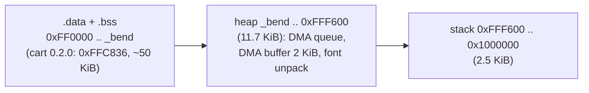

# RAM budget (68000 work RAM, 64 KiB)

Static RAM (`.data` + `.bss`) runs from `0xFF0000` to `_bend`. SGDK's heap is everything from `_bend` to
`MEMORY_HIGH` (`0xFFF600`: 0xA00 of stack above it). SGDK fills part of that heap **before `main()`**: the DMA
queue (80 × 8 B), the DMA copy buffer, and a temporary buffer to unpack the default font (~3 KiB). If any of
those allocations fails, the console hangs on a **black screen before the splash**, with no error.

## Rules
- **`scripts/ram-check`** runs after every `make release` / `make sim` link: it fails if the start-up heap is
  under `RAM_MIN_HEAP` (8192 B). Don't lower the threshold to make a build pass; shrink a buffer.
- SGDK's DMA copy buffer is patched from 8 KiB to **2 KiB** (`sgdk/patches/0003-dma-buffer-2k.patch`). It only backs
  `DMA_QUEUE_COPY`, which the ROM never uses (grep `DMA_QUEUE` in `src/` before starting to). This freed ~6 KiB.
- **The emulator build doesn't prove the cart build boots**: `-DFAKE_FEED` drops the network code and its buffers
  (`frame_buf` 2.3 KiB, `cmd_buf` 1.5 KiB...), so its `_bend` is ~5 KiB lower. After RAM-affecting changes,
  boot the cart ROM in MAME: `scripts/sim out/rom.bin 2,5` must show the 787 *AT GATE* (no MegaWiFi there, so it
  stops at the radio check). A black frame means start-up ran out of heap.

## Largest static users (cart build, 0.2.0)
| Symbol | Bytes | What |
|---|---|---|
| `tiles` (scope.c) | 18,176 | RAM copy of the scope's 568 tiles, for the sweep |
| `tracks` | 14,016 | 96 × `struct track` (146 B: next/cur records, tags, trails, sprite words) |
| `trail_bits` | 4,544 | scope trail-dot bitmaps |
| `frame_buf` | 2,322 | one compact frame (cart only) |
| `cmd_buf` | 1,500 | MegaWiFi command buffer (cart only) |
| `cell_tile`, `dirty_q` | 1,352, 1,136 | scope tile bookkeeping |
| `popup_text`, `grid`, `label_cells` | 784 each | pop-up rows, tag placement grids |

List them with: `python3` over `out/release/symbol.txt` (sort the `b`/`B`/`d`/`D` symbols by address, diff
neighbours). Lesson (2026-10-29): the 0.2.0 pop-up added ~1.2 KiB of static RAM; with the stock 8 KiB DMA buffer the
font unpack no longer fitted and the cart booted to black, while `make sim` looked fine.

Related: [container-build.md](container-build.md), [../ui/detail-popup.md](../ui/detail-popup.md), [../practices.md](../practices.md).
