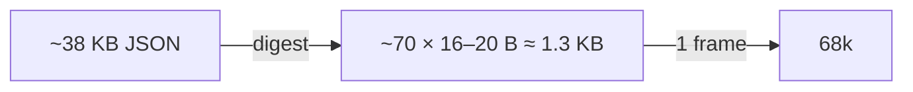

# ADS-B data sources

All three serve ADSBexchange-v2-style JSON (`hex, flight, r, t, lat, lon, alt_baro, gs, track,
baro_rate, squawk, category, seen_pos, …`), and all are HTTPS.

| Source | Endpoint | Terms |
|---|---|---|
| adsb.fi | `https://opendata.adsb.fi/api/v3/lat/{lat}/lon/{lon}/dist/{nm}` (≤ 250 nm) | 1 req/s, no key, personal non-commercial, **show "Data: adsb.fi"** |
| adsb.lol | `https://api.adsb.lol/v2/point/{lat}/{lon}/{nm}` | dynamic limits, feeder key planned; licence to verify |
| OpenSky | `/api/states/all?lamin=…` | OAuth2 client credentials, 4000 credits/day; relay-only |
| airplanes.live | — | 403 to a plain request; unverified |

## Measured at KBNA (dev home, 2026-10-28)
25 nm around KBNA: 20–29 aircraft, ~12.8 KB JSON, ~0.2–0.4 s from adsb.fi. As a frame that's
16 + 29 × 24 = 712 B, one MSS chunk. The upstream root object is `{msg, now(ms), total, ctime,
ptime, ac[]}`. adsb.fi also supplies `dst`/`dir` relative to the query point; the relay computes its
own. Snapshot saved in `relay/testdata/kbna-25nm.json`.

## Measured size (2026-10-28)
25 nm around KORD → 72–74 aircraft, **36–40 KB**, ~550–630 B/aircraft, ~40 fields. That's
~28 MSS frames, and it doesn't fit in the console's RAM. The console only ever sees digested frames.



```json
{"hex":"a1b2c3","flight":"UAL123  ","lat":41.98,"lon":-87.90,"alt_baro":4500,"gs":180.2,"track":271.4,"squawk":"1200"}
```

Related: [../architecture/data-path-options.md](../architecture/data-path-options.md).
