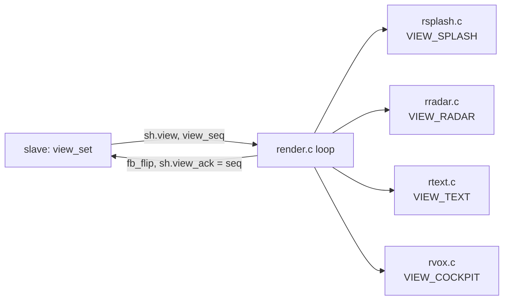

# 32X renderers (master SH-2)

The master SH-2 draws every screen into the 32X frame buffer: **256-colour packed mode, 320 x 224**, double
buffered (the back buffer is always at `$24000000`; lines of 320 bytes from word `$100`). Each view sets its own
palette on entry and redraws the whole frame each time (`sh/render.c` loop: draw, flip, ack the view). The Mega
Drive VDP shows only a black backdrop, so the 32X layer shows everywhere. Architecture: [summary.md](summary.md).



## Views
| View | Draws | From |
|---|---|---|
| splash | dawn airfield: 80-step sky, skyline, sun, runway lights twinkling by palette, a 787 that taxis, holds, rolls, rotates and climbs; the Genesis splash's ATC calls | `sh.sp` (phase, detail, status); `src/splash.h` via `splash32.c` |
| radar | disc (8-step vignette), 56-line afterglow over 32 colours behind the sweep, dotted rings, ticks, ring labels, 2x2 trails in 5 shades, 3x3 blips with halo in 8 brightness steps (red for emergencies), amber selection box, tags with leader lines (first free of 4 spots, the selection first), side panel with a highlight bar, pop-up | `sh.panel`, `sh.popup`, the track table; `src/radar.h` via `radar32.c` |
| text | setup, keyboard, controls: a 56-step backdrop, title and status bands, a 32X badge, `sh.text` in PAL0-3 | `src/ui.h` via `ui32.c` |
| cockpit | Voxel Space, heading tape, nose reticle, HUD (callsign, LIVE badge, ALT/GS, VS/HDG/BANK, fps, credit) | `sh.ck`, `ck_terrain`; `src/cockpit.h` via `cockpit32.c` |

The radar keeps the Genesis rules (`src/radar.c`, [../ui/screen-layout.md](../ui/screen-layout.md)): the sweep
advances one step (1/256 turn) per vblank whatever the frame rate, a track's `next` is applied as the sweep crosses
its bearing, blips fade by `(step - hit_step) >> 5`, theme and tag mode come from `settings`. It takes the lock
(`lock_take(0)`) only while applying and freeing tracks.

## Cockpit (`rvox.c`)
160 columns of 2 px x 160 rows, front to back with a y-buffer: per depth step (`zt`, 0.75..64 cells as
`src/voxel.c`), a 64-entry row table, then per column one map sample and at most one vertical span of words.
Bank: per-column roll `tan(bank) x 2` rows; pitch moves the horizon. Colour = `16 + palette index x 8 + fog`, fog
growing with the square of the depth step and blending into a haze from the patch's palette; the sky is a 64-step
gradient that follows the banked horizon. ~34-50 fps in MAME.

The master also **flies the camera** (`src/cockpit.c`'s `advance()`): it takes each fix the slave posts
(`sh.ck.fix_seq`), snaps or blends over 32 frames, eases heading, bank and horizon, and publishes `sh.ck.cam` for
the slave's streaming. When `sh.ck.terrain_gen` changes it purges its cache (the slave rewrote the maps) and
rebuilds the palette.

## Drawing (`draw.c`)
- **The fill hardware only increments the low 8 bits of the address**: a fill must stay inside a 256-word page
  (`fill()` splits at page boundaries; crossing one wraps and draws black streaks).
- Text: 8x8 font (doragasu's, MPL), 4 word writes per glyph row from a 4-entry LUT; transparent text goes through
  the overwrite image (`$24020000`), where 0 bytes leave the pixel alone.
- `fb_flip()` requests the swap and waits for `FS` to change: drawing never starts on the visible buffer.
- **Palette: `pal_set()` never touches CRAM.** It writes a 256-entry copy in SDRAM and widens a dirty range;
  `fb_flip()` copies the dirty range to CRAM after waiting for `FBCTL` VBLK, so a view's palette lands with its
  first frame. (Hardware may drop CRAM writes outside blanking, FBCTL PEN; MAME takes them any time. The spike
  wrote CRAM mid-frame on the tower and it showed, so this is caution, not a measured fix.)

```c
void pal_set(u16 i, u16 rgb) { pal[i] = rgb; /* widen pal_lo..pal_hi */ }
void fb_flip(void) { MARS_FBCTL = fb_cur ^ 1; while ((MARS_FBCTL & FB_FS) == fb_cur) {} fb_cur ^= 1; pal_flush(); }
```

## MARS_DEBUG build (`EXTRA=-DMARS_DEBUG`)
Start-up stages show as colours that stay put if that step hangs. The Mega Drive backdrop (border) is visible
even with the 32X picture on.

| Who | Where | Colour = reached |
|---|---|---|
| 68000 | `md/boot.s` `stage` macro (`--defsym MARS_DEBUG`) | magenta `_start`, yellow waiting M_OK, cyan waiting S_OK, white both boot ROMs done |
| 68000 | `md/main.c` `backdrop()` | blue `main()`, green after serving `LK_HELLO` |
| master | `sh/draw.c` `stage()`: all 256 CRAM entries, in V-Blank | red DISPMODE on, yellow line table, magenta first fill, cyan first flip, white V-Int on (`fb_ints_on`) |
| master | `sh/render.c` loop | bottom line: `V` frames, `W` view, `C` cmd/stage, `L`, COMM0, COMM8, COMM14 (top nibble = `md_stage`) |

Related: [summary.md](summary.md), [link.md](link.md), [../ui/cockpit.md](../ui/cockpit.md).
