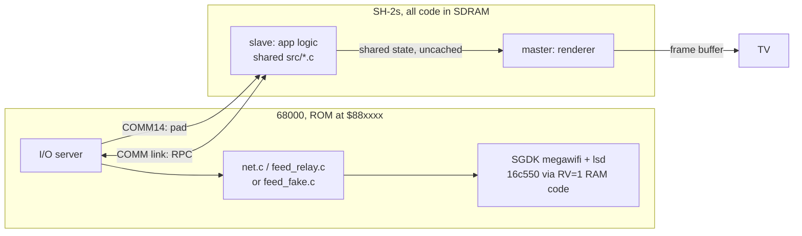

# 32X ROM: architecture

The 32X ROM (`mars/rom/`, `make mars` / `make mars-sim`) is a second product ROM next to the Genesis one: the same
radar, pop-up, list, setup and cockpit, drawn by the SH-2s into the 32X's 256-colour frame buffer. Plan, history and
the hardware rules it rests on: [../plans/32x.md](../plans/32x.md). Build: [../build/mars-build.md](../build/mars-build.md).
The COMM link: [link.md](link.md). Renderers: [renderer.md](renderer.md).

## Three CPUs, one job each
| CPU | Runs | Code |
|---|---|---|
| 68000 | **I/O processor**: MegaWiFi (UART with RV = 1 from RAM), pads, the feed (relay or recorded demo), ESP32 flash | `mars/rom/md/` + `src/net.c`, `src/feed_relay.c` or `src/feed_fake.c`, `src/feed.c`; SGDK's `comm.c`, `lsd.c`, `megawifi.c` |
| slave SH-2 | **the app**: boot, poll, input, list, pop-up, setup, keyboard, cockpit control (blocking calls, as the Genesis main loop) | `mars/rom/sh/app*.c` + `src/traffic.c`, `tlist.c`, `popup.c`, `setup.c`, `keyboard.c`, `settings.c`, `geo.c`, `fmt.c`, `airports.c` |
| master SH-2 | **the renderer**: radar scope, sweep, blips, tags, text screens, cockpit Voxel Space, at a fixed frame rate (the Genesis V-Int's job) | `mars/rom/sh/draw*.c`, `radar32.c`, `vox32.c` |

## Rules (from the cart runs, [../plans/32x.md](../plans/32x.md))
- **Every UART access is RV = 1, from 68000 work RAM** (`md/uart_ram.c`).
- **The SH-2s never touch the cartridge.** All SH-2 code and data are copied to SDRAM by the boot ROM (the MARS
  header's `.data` image); demo data and fonts live on the 68000 side or in SDRAM. So the 68000 may use the UART at
  any time, and the SH-2s never wait on RV.
- The 68000 never draws: its VDP shows only the backdrop, so the 32X layer shows everywhere.

## Sharing the Genesis code
The shared `src/*.c` files compile unchanged on both CPUs through small compatibility layers:
- **68000** (`mars/rom/md/compat/`): `genesis.h` (types, `sprintf`, `vtimer`, string helpers), SGDK's `config.h`,
  `task.h` (`TSK_superPend` polls `mw_process()` and the pads), `types.h`, `string.h`, `memory.h`, `maths.h`, and
  a 32X `16c550.h`/`16c550.c` that route every register access through the RV = 1 RAM routines.
- **SH-2** (`mars/rom/sh/compat/`): the same `genesis.h`, plus `overlay.h` (the track table in shared memory) and
  `ext/mw/megawifi.h` (flash calls as RPCs to the 68000, for `settings.c`). `SYS_disableInts()` takes the
  inter-CPU lock: wherever the Genesis code shut out its V-Int renderer, the 32X shuts out the master SH-2.
- The 32X's own `radar.h` / `ui.h` / `feed.h` / `net.h` implementations (`radar32.c`, `ui32.c`, `feed32.c`,
  `net32.c`) take the place of the Genesis renderer and network: the shared files call the same functions.

## Shared memory between the SH-2s
SH-2 caches are write-through but not coherent. Everything both SH-2s touch (the track table, panel / pop-up /
screen text, settings, the lock, frame counter, cockpit camera fixes) is in section `.shared`, linked at the
**cache-through alias** (`$2603xxxx`): every access goes to SDRAM. The terrain maps are cached on the master for
speed; the slave bumps a generation counter after writing them, and the master purges its cache when it changes.

Related: [link.md](link.md), [renderer.md](renderer.md), [../build/mars-build.md](../build/mars-build.md).
