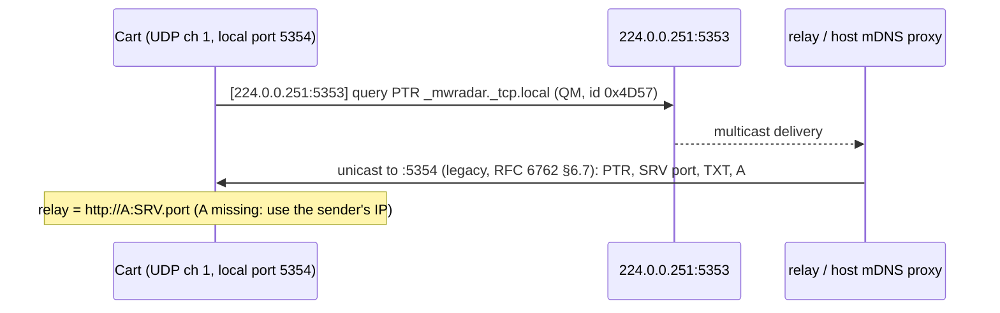

# Relay discovery: mDNS legacy unicast from the cartridge

The cartridge finds the relay with **one mDNS query**, so users don't type a URL. No firmware change: the
MegaWiFi UDP "reuse mode" socket (`mw_udp_set` with only a source port) is bound to `INADDR_ANY`. Each
payload we send starts with the destination IPv4 + port (6 bytes, network order). Each packet we receive
starts with its sender's IPv4 + port (`mw-fw-rtos/main/megawifi.c`: `MwUdpSet`, `MwUdpSend`, `MwUdpRecv`).



## Decisions (agreed 2026-10-28)
- **AUTO by default with a manual override.** `settings.relay` empty means AUTO, and discovery runs at every
  boot (it follows DHCP changes). A typed URL pins the relay and skips discovery.
- **Two advertisers.** The relay has a stdlib-only responder (`relay/mdns.go`, on by default, `-mdns=false`
  turns it off) for native runs and Linux `--network host`. `scripts/relay start` also registers the service
  through the host's mDNS (`dns-sd -P` on macOS, `avahi-publish` on Linux), because bridged and VM containers
  (Docker Desktop, Podman machine) never see LAN multicast, and inside them the relay can't see the host's LAN IP.
- **Verified on the cart (2026-10-28).** A spike ROM sent the query and the relay log showed
  `answered 192.168.1.142:5354 (legacy true)`: the ESP32 sends multicast from a reuse-mode socket with no IGMP join.

## Implementation
```c
enum net_err net_discover(char *url);   /* src/net.c: ch 1, port 5354, 3 tries x 1 s; "http://a.b.c.d:port" */
bool feed_find_relay(void);             /* src/feed_relay.c: typed settings.relay, else net_discover */
```
The query is a const byte array with the 6-byte reuse prefix (`224.0.0.251:5353`). `parse_reply` checks id `0x4D57`
and the QR bit, skips questions and names (pointers included), and takes the first SRV port and A address. If there's
no A record, the sender IP from the reuse prefix is used. Boot runs it as splash phase SP_RELAY.

## Contracts
- Service `_mwradar._tcp.local`. Instance `MegaWiFi Radar._mwradar._tcp.local`. TXT `v=1`, `path=/v1/frame`.
  Target `<hostname>.local`, with an A record from the interface whose subnet holds the querier.
- Legacy unicast replies (querier port ≠ 5353) echo the query ID and question, use TTL ≤ 10 s, and go to the
  querier's address and port. Queries from 5353 get a normal multicast answer (ID 0), so `dns-sd -B` sees us.
- The cartridge takes the first answer with an SRV (port) plus an A record or sender address. A single
  relay per network is assumed.

Related: [net-layer.md](net-layer.md), [../relay/relay.md](../relay/relay.md), [feed.md](feed.md).
