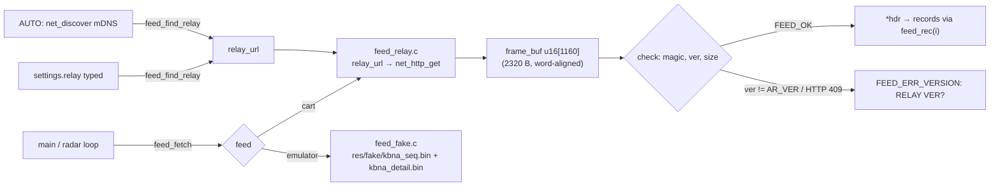

# Traffic feed (src/feed.h)

The console's single entry point for traffic data. The radar loop calls `feed_fetch()` (frames) and the
pop-up calls `feed_detail()` (one aircraft); neither deals with HTTP or URLs. There are two implementations,
and the build picks one: the relay (`src/feed_relay.c`, cart builds) and a fake in-ROM source
(`src/feed_fake.c`, `-DFAKE_FEED`: 16 recorded KBNA frames + their aircraft's details, `make fake-feed`).



```c
const struct ar_hdr *h;
struct feed_stats st;                 /* http_status, bytes, chunks, frames */
if (feed_fetch(&h, &st) == FEED_OK)
    for (u16 i = 0; i < h->count; i++) use(feed_rec(h, i));   /* nearest first */
```

## Measured on the cart (KBNA, 2026-10-28)
22–24 aircraft → 544–592 B in **1 chunk**. A whole `feed_fetch` blocks for **17–21 frames (~0.3 s)**
(URL/method/open/finish round trips + relay + upstream). The relay's `seq` advances once per poll.
Ordering, units, `GND` and stale flags match the relay's output.

## Contracts
- **Relay URL:** `feed_find_relay()` sets the runtime `relay_url`: `settings.relay` if a URL is typed, else
  AUTO (`net_discover`, [discovery.md](discovery.md)). It returns `FEED_OK`, `FEED_ERR_CONFIG` (none found) or
  `FEED_ERR_VERSION` (the only relay found is at another contract version). Boot calls it after joining Wi-Fi,
  then probes one `feed_fetch`, so a mismatched relay (typed or found) holds the 787 with
  `RELAY MISMATCH: RUN RELAY <app_version>` and opens setup. `feed_fetch` calls it when
  `relay_url` is empty, and in AUTO after `RELAY_RETRIES` (3) consecutive failed polls, so a moved relay is found
  again (each rediscovery blocks ≤ ~3 s; the V-Int radar keeps sweeping). `feed_relay_host()` is the URL without
  `http://`, for display. The fake feed stubs all three.
- **Blocking.** `feed_fetch` runs a whole HTTP request (`net_http_get`) and blocks the main loop for
  ~0.3 s. That's fine: the radar renders in the V-Int, so the sweep never stalls during a poll.
- The returned frame lives in `frame_buf` and is **valid until the next `feed_fetch()`**. Consumers that
  keep data across polls (trails) copy what they need.
- Records are read **in place**. `frame_buf` is `u16[]`, so `ar_hdr` and every `ar_rec` (16 + 24·i)
  are on even addresses; `feed_rec()` steps by `rec_size`, so future larger records skip cleanly.
- Validation (`check()`, as in [../architecture/frame-format.md](../architecture/frame-format.md)): magic `AR`
  (else `FEED_ERR_FORMAT`), `ver == AR_VER` (else `FEED_ERR_VERSION`: an older relay that ignores `v=`),
  `rec_size >= 24` and even, `16 + count·rec_size == bytes`. A body over 2,320 B → `FEED_ERR_SIZE`.
  HTTP `AR_HTTP_MISMATCH` (409) → `FEED_ERR_VERSION` (panel `RELAY VER?`); it doesn't count as a failed poll.
- URL: `<relay_url>/v1/frame?lat=<e4>&lon=<e4>&range=<nm>&max=96&v=<AR_VER>`, built in a `RELAY_LEN + 64`
  buffer. No relay found (AUTO) and none typed: `FEED_ERR_CONFIG` (panel `NO RELAY`).
- **Detail:** `feed_detail(icao, &d)`: `<relay_url>/v1/detail?icao=%02x%02x%02x&v=<AR_VER>` into its own
  128-byte buffer; must be exactly `AR_DETAIL_SIZE` with magic `AD` and `ver == AR_VER`. Valid until the next
  `feed_detail`. Both requests share one `get()` (status, AUTO failure counting, mismatch).

Related: [net-layer.md](net-layer.md), [../relay/relay.md](../relay/relay.md).
