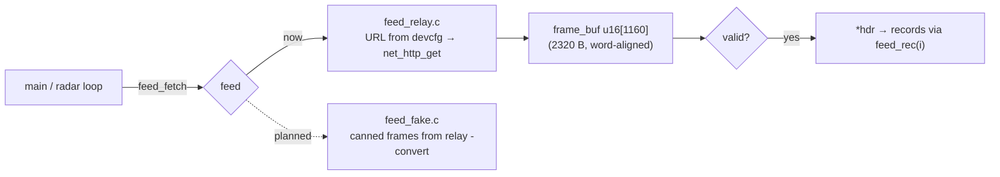

# Traffic feed (src/feed.h)

The console's single entry point for traffic data. Renderers and the spike call `feed_fetch()` and
never deal with HTTP or URLs. Today there's one implementation, the relay (`src/feed_relay.c`). A
fake, in-ROM source for emulators will implement the same interface; the build picks one.



```c
const struct ar_hdr *h;
struct feed_stats st;                 /* http_status, bytes, chunks, frames */
if (feed_fetch(&h, &st) == FEED_OK)
    for (u16 i = 0; i < h->count; i++) use(feed_rec(h, i));   /* nearest first */
```

## Contracts
- **Blocking.** `feed_fetch` runs a whole HTTP request (`net_http_get`). It's fine for the spike's
  5 s poll; the radar loop will need a non-blocking variant (see the roadmap's open decision).
- The returned frame lives in `frame_buf` and is **valid until the next `feed_fetch()`**. Consumers that
  keep data across polls (trails) copy what they need.
- Records are read **in place**. `frame_buf` is `u16[]`, so `ar_hdr` and every `ar_rec` (16 + 24·i)
  are on even addresses; `feed_rec()` steps by `rec_size`, so future larger records skip cleanly.
- Validation (as in [../architecture/frame-format.md](../architecture/frame-format.md)): magic `AR`, `ver == 1`,
  `rec_size >= 24` and even, `16 + count·rec_size == bytes`. A body over 2,320 B → `FEED_ERR_SIZE`.
- URL: `<devcfg_relay_url>/v1/frame?lat=<e4>&lon=<e4>&range=<nm>&max=96`, built in a 128-byte
  buffer, so the base URL may be up to 64 chars. With no `DEV_RELAY_URL`, `FEED_ERR_CONFIG`.

## Spike screen (src/main.c)
Rows 1–6: title, home, detect, firmware, join, IP. Row 7: `#n HTTP 200 712B 1ch 9f` (red on error).
Row 8: `AR v1 29 ac seq 12 [TRUNC] [UPSTREAM ERR]`. Rows 10–26: up to 17 aircraft,
`CALLSIGN ALT GS DIST` with alt in hundreds of ft (`GND`/`---`), gs in kt, distance in 0.1 nm via
`isqrt32`, then `E` (emergency, red) / `S` (stale). Row 27: `Data: adsb.fi`. It re-polls every 300 frames (~5 s)
while the spinner turns.

Related: [net-layer.md](net-layer.md), [../relay/relay.md](../relay/relay.md).
