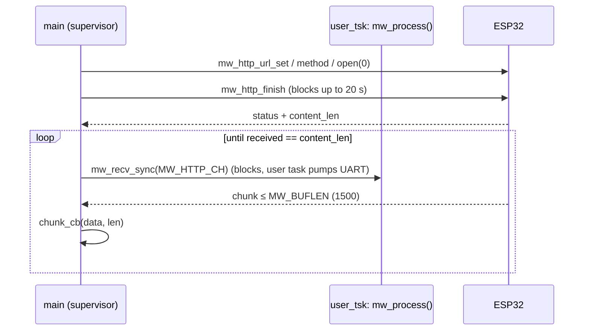

# Network layer (src/net.c)

Blocking MegaWiFi helpers for start-up and setup screens. The radar loop must **not** call them;
the non-blocking path (async API or `mw_send`/`mw_recv`) is still to be designed.

```c
net_init();                                   /* mw_init(cmd_buf, MW_BUFLEN) + TSK_userSet(user_tsk) */
net_detect(&mod);                             /* mw_detect -> fw major.minor + variant */
net_ensure_ap(ssid, pass);                    /* slot 0, DHCP, default, mw_cfg_save; no-op if unchanged */
net_join(ip);                                 /* mw_ap_assoc(def slot) + wait 30 s + mw_ip_current */
net_http_get(url, chunk_cb, ctx, &res);       /* url/method/open(0)/finish, then recv chunks on MW_HTTP_CH */
```



## Contracts
- `cmd_buf` (`MW_BUFLEN` = 1500 B) is shared by commands and body chunks. A chunk pointer is only
  valid inside the callback.
- `net_ensure_ap` writes ESP flash only when the SSID, password or default slot differ, so it doesn't wear flash on every boot.
- IP `0.0.0.0` in `mw_ip_cfg` means DHCP (firmware `megawifi.c`).
- The body loop needs a real `Content-Length`, so the relay must send it (no chunked encoding).
- Timeouts: assoc 30 s, HTTP finish 20 s, per-chunk receive 10 s (`MW_MS_TO_FRAMES`).
- `res.frames` (VBlanks from open to last byte) is the latency/throughput metric.

## Spike ROM (src/main.c)
Detect → `net_ensure_ap(DEV_WIFI_SSID…)` → join → GET `DEV_HTTP_URL` (default `http://example.com/`)
→ prints the status, length, chunk count, frames, and the first ~15 lines of the body. Then a spinner
proves the main loop is alive. Dev settings live in the git-ignored `src/dev_config.h` (template:
`src/dev_config.h.example`).

`src/rom_header.c` overrides SGDK's: system `"SEGA MEGAWIFI   "` and **no SRAM** (SGDK's default
declares SRAM at `$200000`, which is ROM on Rev.C).

Related: [../platform/sgdk-megawifi.md](../platform/sgdk-megawifi.md), [../architecture/data-path-options.md](../architecture/data-path-options.md).
