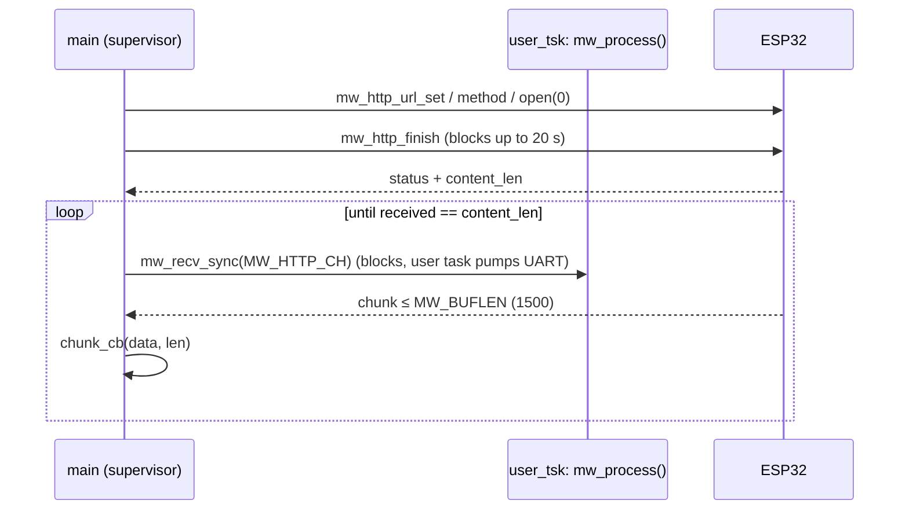

# Network layer (src/net.c)

Blocking MegaWiFi helpers for start-up and setup screens. The radar loop must **not** call them;
the non-blocking path (async API or `mw_send`/`mw_recv`) is still to be designed.

```c
net_init();                                   /* mw_init(cmd_buf, MW_BUFLEN) + TSK_userSet(user_tsk) */
net_detect(&mod);                             /* mw_detect -> fw major.minor + variant (5 tries x 2 s) */
net_reset();                                  /* mw_init again: ESP32 reset + fresh lsd/comm state */
net_ensure_ap(ssid, pass);                    /* slot 0, DHCP, default, mw_cfg_save; no-op if unchanged */
net_join(ip);                                 /* mw_ap_assoc(def slot) + wait 30 s + mw_ip_current */
net_http_get(url, chunk_cb, ctx, &res);       /* url/method/open(0)/finish, then recv chunks on MW_HTTP_CH */
```



## Contracts
- **`TSK_userSet(user_tsk)` must come before `mw_init()`.** SGDK's `uart_start()` times the ESP32
  reset with `TSK_superPend()`, which returns *immediately* when no user task is set
  (`tst.l task_pc; beq no_task` in `task.s`). Without the 30 ms + 1 s waits, RTS goes active
  while the chip is still booting. On Rev.C ~RTS drives GPIO9, the boot strap, so the ESP32 boots
  into **download mode**: `mw_detect` fails, and the module, which had booted normally at power-on, "goes off".
  SGDK's own `sample/megawifi/basic` uses the wrong order.
- **`user_tsk` needs a compiler memory barrier in its loop.** With `-flto -O3`, `mw_process()` is
  inlined into the infinite loop, and gcc hoists loads of SGDK's non-volatile globals
  (`activeCommType`, the lsd `d.rx.stat`) to task entry. Because the task starts before `mw_init()`,
  it cached a NULL driver and never serviced the UART: replies sat in the RX FIFO and every
  `mw_detect` timed out. That only showed on **cold boots**. A soft reset doesn't clear RAM, so the
  stale pointer from the last run happened to be valid. Verify with
  `m68k-elf-objdump -d out/release/rom.out` that `activeCommType` is loaded *inside* the loop.
  ```c
  while (TRUE) {
      __asm__ volatile ("" ::: "memory");   /* re-read SGDK state every pass */
      if (mw_up) mw_process();
  }
  ```
  How it was found (2026-10-28): the bring-up ROM passed cold; `net_diag` showed init 62f, detect
  600f, LSR 60, CTS set; a raw LSD VERSION frame got a valid 15-byte reply on the same cold boot,
  so the fault was in the ROM's software path; the disassembly then showed the hoisted loads.
- Detect still makes up to 3 attempts (`DETECT_ATTEMPTS`), each a full `net_reset()` + `mw_detect`,
  printing `net_diag` per attempt and a raw-probe line (`net_raw_version_probe()`) after a failure.
  These are spike diagnostics; trim them once the radar's start-up screen exists.
- Soft reset keeps statics: anything that must start fresh is set at the top of `main` (e.g. `line = 1`).
- `user_tsk` idles until the `mw_up` flag is set after `mw_init()` returns, because lsd/comm state isn't valid before then.
- `cmd_buf` (`MW_BUFLEN` = 1500 B) is shared by commands and body chunks. A chunk pointer is only
  valid inside the callback.
- `net_ensure_ap` writes ESP flash only when the SSID, password or default slot differ, so it doesn't wear flash on every boot.
- IP `0.0.0.0` in `mw_ip_cfg` means DHCP (firmware `megawifi.c`).
- The body loop needs a real `Content-Length`, so the relay must send it (no chunked encoding).
- Timeouts: assoc 30 s, HTTP finish 20 s, per-chunk receive 10 s (`MW_MS_TO_FRAMES`).
- `res.frames` (VBlanks from open to last byte) is the latency/throughput metric.

## Spike ROM (src/main.c)
Detect (≤ 3 attempts) → `net_ensure_ap(devcfg_wifi_ssid…)` → join → GET `devcfg_http_url` (default `http://example.com/`)
→ prints the status, length, chunk count, frames, and the first ~15 lines of the body. Then a spinner
proves the main loop is alive.

### Dev settings
The git-ignored `src/dev_config.h` (template: `src/dev_config.h.example`) is included **only** by
`src/devcfg.c`, which exposes `devcfg_wifi_ssid` / `devcfg_wifi_pass` (NULL = use the module's saved
AP) and `devcfg_http_url`. The host `make` deletes `devcfg.o` before every build.

```c
#if __has_include("dev_config.h")   /* SGDK's .d files never list a header that was absent */
#include "dev_config.h"             /* at the last build, so creating it later wouldn't    */
#endif                              /* trigger a rebuild. Hence the forced devcfg.o rebuild. */
```
Lesson: any `__has_include`d optional file must sit behind a forced-rebuild object like this.
Wi-Fi credentials end up in `out/rom.bin`. `out/` is git-ignored; don't share dev ROMs.

`src/rom_header.c` overrides SGDK's: system `"SEGA MEGAWIFI   "` and **no SRAM** (SGDK's default
declares SRAM at `$200000`, which is ROM on Rev.C).

Related: [../platform/sgdk-megawifi.md](../platform/sgdk-megawifi.md), [../architecture/data-path-options.md](../architecture/data-path-options.md).
