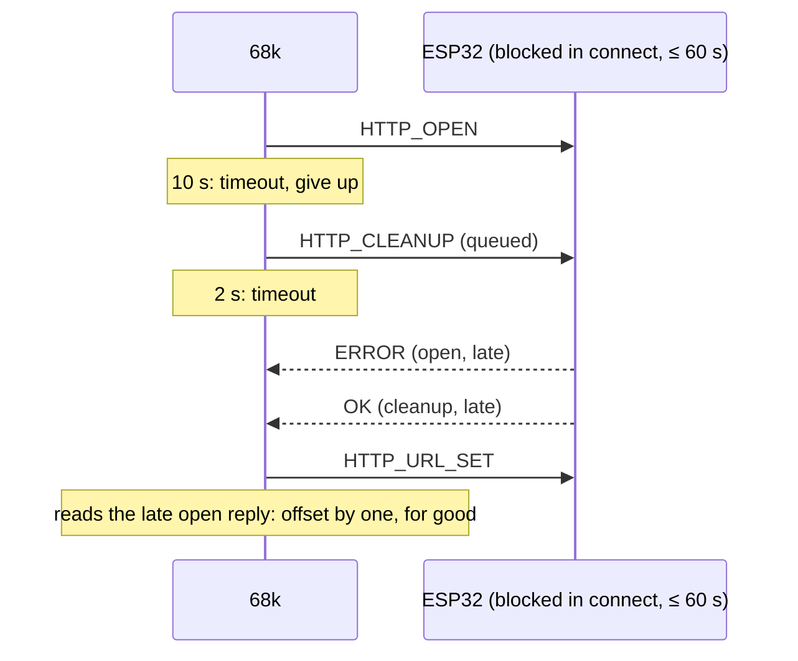
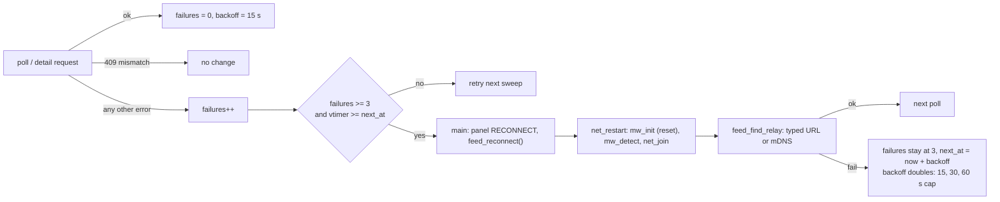

# Reconnect: recovering a wedged link mid-session

The radar keeps working when the relay host goes away mid-session (laptop lid closed, out of power) and comes
back later. After `RELAY_RETRIES` (3) failed requests in a row, the cart **restarts the module**: an ESP32
hardware reset, then detect, Wi-Fi join and relay lookup again, the same as boot. While the relay stays away,
attempts back off.

## Why plain retries aren't enough
A host that vanishes doesn't close its TCP connections: no RST, no ARP reply. The firmware then blocks in
`esp_http_client_open` / `fetch_headers` / `read` for up to its `timeout_ms = 60000` (`mw-fw-rtos/main/http.c`),
inside the command handler, so it answers nothing else meanwhile. The 68k gives up much sooner
(`mw_http_open` 10 s, `HTTP_TOUT` 20 s, `RECV_TOUT` 10 s, other commands 2 s).

SGDK's `mw_command()` takes **the next reply on channel 0**, whatever command it answers, and checks only
`cmd == MW_CMD_OK`. Once one command times out, the firmware's late replies stay in the pipe, and from then on each
command reads its predecessor's reply. That offset never clears. HTTP, mDNS (`mw_udp_set`) and everything else
fail for good, and the panel stays `STALE` after the host is back. `make relay-stop` doesn't reproduce this: a
stopped relay on a live host refuses at once (RST), so nothing times out.



The only reliable way back into sync is a reset. `mw_init()` pulses the ESP32 reset line (`uart_reset` +
`uart_start`, ~1 s) and clears SGDK's lsd/comm state, so all replies still in flight are lost with it.

## Flow



```c
enum net_err net_restart(u8 ip_out[4]);      /* net.c: mw_up off, mw_init, mw_up on, net_detect, net_join */
bool feed_reconnect_due(void);               /* feed_relay.c: failures >= RELAY_RETRIES && past next_at */
enum feed_err feed_reconnect(void);          /* net_restart + feed_find_relay; arms the back-off */

/* main.c poll() */
if (feed_reconnect_due()) {
    radar_panel(ROW_NET, "RECONNECT");
    if ((e = feed_reconnect()) != FEED_OK) { radar_panel(ROW_NET, feed_err_str(e)); return; }
}
```

## Contracts
- **Every failure counts except a 409.** Net errors, non-200, bad frame, oversized body and a failed relay lookup
  all bump `failures`, because a desynced link produces any of them. `FEED_ERR_VERSION` is a real answer from a
  relay and changes nothing. Detail (pop-up) requests share `get()`, so they count too; only `poll()` reconnects.
- **Typed relay URLs and AUTO both reconnect.** AUTO then runs mDNS again (the relay may have a new lease);
  a typed URL is reused.
- `mw_up` is cleared around `mw_init()` so the user task doesn't run `mw_process()` on half-reset state. The
  user task stays installed, which `uart_start()`'s reset timing needs ([net-layer.md](net-layer.md)).
- `net_detect` right after the reset also cancels the firmware's 30 s inactivity sleep
  ([../platform/firmware.md](../platform/firmware.md)).
- A reconnect blocks the main loop for ~3–8 s (reset 1 s, detect, join, mDNS ≤ 3 s). The V-Int keeps the sweep
  turning; the pad isn't read meanwhile.
- Back-off: `next_at` is armed by every attempt; a successful request resets `backoff` to 15 s. With the relay
  gone, the cart costs one reset every ≤ 60 s.
- Panel: `RECONNECT` during an attempt, then `NO WI-FI` / `NO RELAY` if it failed, then `STALE <n>s` from the
  clock tick.

## SGDK cleanup bug (patched)
Stock `mw_http_cleanup()` sends `MW_CMD_HTTP_FINISH` (46), not `MW_CMD_HTTP_CLEANUP` (47).
`sgdk/patches/0004-mw-http-cleanup-cmd.patch` fixes it, so a failed request really runs the firmware's
`http_cleanup()` (state IDLE, client freed). That doesn't prevent the desync above; the reset does.

## Verifying on the cart
Let the radar run, close the relay host's lid for ~2 min (panel: `STALE`, `RECONNECT`, `NO RELAY`), open it.
The radar is back to `NET OK` within one back-off step (≤ 60 s).

Related: [net-layer.md](net-layer.md), [feed.md](feed.md), [discovery.md](discovery.md).
