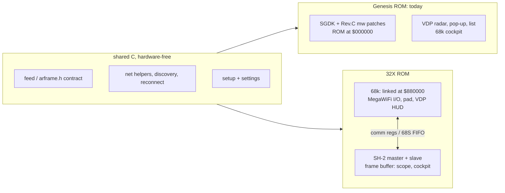
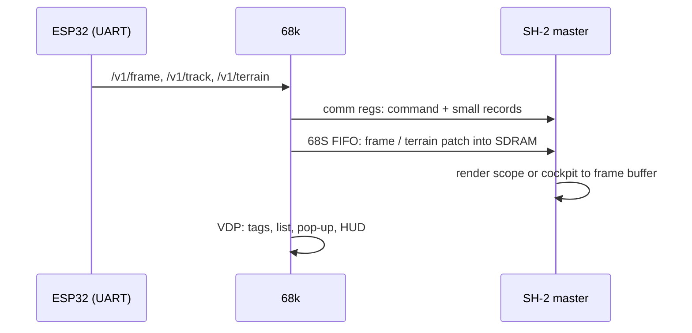

# Plan: 32X ROM (exploratory)

A **separate 32X ROM**, built from this repo next to the Genesis ROM. It shares the network, feed, contract and
setup C code, and hands drawing to the two SH-2s. **Status: built.** The 32X ROM runs in MAME on the demo feed (radar, pop-up, setup, cockpit;
[../mars/summary.md](../mars/summary.md)); not yet on the tower. Before it, **go:** the spike ROM (branch `32x`,
[../build/mars-build.md](../build/mars-build.md)) ran end to end on the tower on 2026-10-31: ESP32, echo, Wi-Fi join and
`GET /healthz` from the relay all pass in 32X mode, with two hard rules (UART needs RV = 1; SH-2s off the cart bus
during UART I/O, section 3). Nothing of the product ROM exists. Target console: the owner's Tower of Power
(Genesis + Sega CD + 32X). Related: [cockpit-mode.md](cockpit-mode.md), [roadmap.md](roadmap.md),
[../platform/hardware.md](../platform/hardware.md), [../architecture/contract.md](../architecture/contract.md).

## Decisions so far
- **Two ROMs, not one dual-mode ROM.** The Genesis ROM (0.2.x, verified on the cart) stays as it is. The 32X ROM
  is a second build target. A dual-mode image would need two 68k builds packed into one ROM with different link
  addresses; two ROMs make that two ordinary builds.
- **The 32X ROM is 32X-only.** It boots straight into 32X mode. Without a 32X attached it shows only a
  "32X required" screen. It has no 68k fallback renderer.
- **The 68k keeps all MegaWiFi I/O.** The SH-2s can't reach the Genesis I/O area. They get data from the 68k.
- **No implementation until the hardware spike passes.**

## Relation to the Genesis cockpit
v0.3.0 ships cockpit mode on the 68000 ([../ui/cockpit.md](../ui/cockpit.md)): 80 logical columns straight into
VRAM, 16-22 fps on the cart, terrain from contract v3 (`/v1/terrain` 128×128 patch, `/v1/track`, `/v1/strip`).
An SH-2 cockpit in the 32X ROM would be a second renderer over the **same** endpoints; the relay already does the
work. It only needs a contract change if it wants bigger or finer patches than 128×128.

## Build layout



`make` / `make sim` stay as today. The 32X side has its own image and `mars-*` targets
([../build/mars-build.md](../build/mars-build.md)); a product ROM would add e.g. `make mars` / `make mars-sim` (relay
or fake feed) and a `.32x` release asset.

## How the 32X ROM boots
The 68000 boots from the cart vectors at `$000000`, checks for the 32X, then sets ADEN and runs from `$88xxxx`.

```c
#define MARS_ID   (*(volatile u32 *)0xA130EC)   /* "MARS" when a 32X is attached */
if (MARS_ID != 0x4D415253)
    show_32x_required();                         /* VDP text, halt */
mars_boot();                                     /* set ADEN, start SH-2s, run the $88xxxx-linked 68k code */
```

## Constraints

### 1. The cart ROM moves under ADEN
| 68k address | Contents with ADEN = 1 |
|---|---|
| `$000000-$0000FF` | 32X vector ROM, not the cart |
| `$880000-$8FFFFF` | cart offsets `$000000-$07FFFF` (fixed 512 KB) |
| `$900000-$9FFFFF` | 1 MB cart bank, chosen by bank register `$A15104` |
| `$A15100+` | 32X system registers |

The 68k code is linked for `$880000`; the SH-2s read the cart at `$02000000` (4 MB max). VDP DMA from ROM needs
the **RV bit** set, and the SH-2s are locked out of ROM while it's set.

### 2. Leaving SGDK (the main cost)
SGDK assumes the ROM is at 0, so its startup, its VDP DMA from ROM and our patched MegaWiFi stack (`mw_*`, LSD,
the Rev.C 16C550 patch, `sgdk/patches/`) don't carry over as they are. **Decided:** our own minimal startup on
both CPUs (`mars/spike/md/boot.s`, `sh/start.s`, laid out like marsdev's), with only Sega's boot code taken from
pinned marsdev at image build; no marsdev library or SGDK. The shared C (feed, contract,
net helpers, discovery, setup logic) ports; build and boot plumbing doesn't. To keep it shareable, the shared C
must not include SGDK headers directly. Today it does (`net.h` and `feed.h` include `<genesis.h>` for types and
`mw_*`), so a thin platform layer (types + net calls) is part of the work.

The toolchain is a separate hash-tagged image, `mwradar-mars:<hash>` from `mars/Dockerfile`
([../build/mars-build.md](../build/mars-build.md)); the Genesis image is unchanged.

### 3. MegaWiFi UART in /TIME: reads and writes need RV = 1
The UART is at `$A130C1` (odd bytes, `+2n`); its chip select is the slot's `~TIME`, its strobes the slot's `~OE`
(read) and `~W` (write). The 32X passes /TIME through, but **with ADEN = 1 and RV = 0 the 68000 can neither write nor
read it**: the 32X's ASIC holds /LWR inactive (Charles MacDonald, SpritesMind thread 1265) and, measured on the
tower, reads return open bus (`C0`). **With RV = 1 both work.** SH-2s can never write the cartridge, so the 68000
does all UART I/O.

Cart runs on the tower (2026-10-31):

| Build | Result |
|---|---|
| RV = 0 everywhere | rows 1-3 pass, UART SPR fails |
| RV = 1 for writes only | same: the read-back still fails |
| RV probe `v0.3.0-3-g2e4b8fb` | RV0 regs all `C0`; RV1 regs `20 00 01 00 00 60 30 04` (idle UART); SPR write/read works only with RV = 1 for both; SPR + register decode pass; **8 KiB loopback lost one byte** (expected `DD`, got the next one, `EE`, at byte ≥ 130) while the slave SH-2 read ROM |

**In the spike:** all UART access goes through `md/uart_ram.c`, routines in work RAM (`.ramcode`, copied with `.data`):
`uart_wr`, `uart_rd`, `uart_tx` set RV, access the UART, clear RV. They must run from RAM because RV = 1 also
unmaps the cartridge from `$880000`, and must not touch ROM (buffers in RAM, no calls). While RV = 1 the SH-2s'
ROM reads wait; they don't fail.

```c
uint8_t RAMCODE uart_rd(uint8_t reg) { uint8_t v; RV = uart_rv_rd; v = UREG(reg); RV = 0; return v; }
```
| quiet/busy `v0.3.0-5-g88f7b5d` | loopback with the slave SH-2 paused: drop 0, bad 0; **while it reads ROM: drop 51, bad 658**. With the slave paused: ESP32 1.5.1 (ec3), echo 300/300, Wi-Fi join, `GET /healthz` → `HTTP/1.0 200 OK`, 119 bytes, drawn by the master SH-2 |

**Rule 2: no SH-2 cartridge access while the 68000 uses the UART.** SH-2 ROM reads during UART traffic drop and
corrupt bytes (likely the SH-2 cycles' `~OE` reaching the UART while the 68000's `/TIME` cycle is open around an
RV switch). The spike's slave SH-2 pauses on request (`COMM_SLAVE_PAUSE` / `COMM_SLAVE_PAUSED`). A product keeps SH-2
code and data in SDRAM (copied from ROM at boot or in windows the 68000 grants) and never lets the SH-2s read the
cart while networking runs; in practice that means "never" for a live radar. The master SH-2 reading COMM registers
and drawing the frame buffer is fine: neither touches the cart.
Still unknown: how the Rev.C flat 8 MiB decode behaves behind the 32X's 4 MB cart window (the ROMs are far smaller).

### 4. Data bridge 68k → SH-2
The 68k receives small binary frames ([../architecture/frame-format.md](../architecture/frame-format.md)) and
forwards them, never pixels.
- **Comm registers** (`$A15120-$A1512F`, 16 bytes): commands, camera state, handshakes.
- **68S FIFO / DREQ** (`$A15112`): bulk copies into SH-2 SDRAM (frames, terrain patches).



### 5. Dev loop
As far as known, **no emulator runs both MegaWiFi and 32X**: BlastEm emulates MegaWiFi but not the 32X;
PicoDrive / ares emulate the 32X but not MegaWiFi. The 32X ROM's rendering is developed against the fake feed
(`make mars-spike-sim`: MAME's `32x` driver with the owner's BIOS dumps in git-ignored `bios/32x/`). Everything
networked is tested only on the tower. The Genesis ROM keeps
its BlastEm loop.

### 6. Tower of Power
The cart goes in the 32X slot. The Sega CD underneath stays idle (a cart boots ahead of the CD BIOS). Settings stay
in ESP32 flash, so CD backup RAM isn't needed.

## What the 32X gives

| | Genesis ROM | 32X ROM |
|---|---|---|
| CPU | 68000 @ 7.6 MHz | + 2 × SH-2 @ ~23 MHz |
| RAM | 64 KiB (11.7 KB start-up heap) | + 256 KB SDRAM, 2 × 128 KB frame buffers |
| Picture | 4 palettes × 16 from 512, tiles | 320×224, 256 colours from 32,768, chunky pixels |
| Layering | VDP planes + sprites | 32X frame buffer above or below VDP layers (priority bit) |

- **Cockpit:** Voxel Space per-column raycast at full width (no 80-column × 4-px limit, no direct-VRAM spans,
  no two-copy flip). Terrain patches sized for SDRAM, not the shared RAM overlay.
- **Radar:** rings, sweep and trails drawn as frame-buffer pixels with a 256-colour afterglow, plus an optional
  basemap underlay. The palette-rotation sweep and V-Int renderer perf tricks aren't needed. The VDP keeps tags,
  the traffic list, the pop-up and the setup screen.
- **RAM:** tracks, trails and terrain live in SDRAM. The 68k's 64 KiB only holds I/O buffers and HUD state, so the
  static overlay and start-up heap limits ([../build/ram-budget.md](../build/ram-budget.md)) don't apply.

## Contract impact
Both ROMs talk to the same relay. A 32X ROM asking for bigger or higher-colour terrain patches needs a capability
flag on the request (e.g. `&hw=32x`); under lock-step, any contract change bumps `AR_VER` for both ROMs
([../architecture/contract.md](../architecture/contract.md)). Both ROMs ship in the same release with the same
`AR_VER`.

## Hardware spike (go/no-go): `mars/spike/`
A standalone 32X ROM, not the product: `make mars-spike [RELAY=host:port]` → `out/mars/spike.32x`,
`make mars-spike-flash` to put it on the cart, then run it on the tower. The 68000 side reuses the SGDK-free UART/LSD
code of the mw-cart bring-up ROM; interrupts stay masked on all three CPUs (timing polls the VDP vblank flag).

| Row | Test | Proves |
|---|---|---|
| 1 | 32X adapter: MARS ID, code running at `$88xxxx` | boot path, ADEN |
| 2-3 | master / slave SH-2 counters move (COMM8 / COMM10) | SH-2 start-up, 32X frame buffer flips |
| 2-4 | raw UART reads with RV = 0 / 1, SPR write/read with every RV combination | which RV setting the UART needs |
| 4-5 | UART SPR scratch + register decode at `$A130C1` | **UART reads and writes work with ADEN = 1** |
| 6-7 | 8 KiB internal loopback at 1.25 Mbaud, slave SH-2 paused / reading ROM; drops counted | UART data path, cart-bus contention |
| 8-9 | ESP32 `MW_CMD_VERSION`, 300 `MW_CMD_ECHO` (1..1024 B), slave paused if row 7 failed | LSD through the 32X |
| 10 | default AP slot, `MW_CMD_AP_JOIN`, wait READY, show IP | Wi-Fi from 32X mode |
| 11 | TCP to `RELAY`, `GET /healthz`, size → COMM14, state → COMM12 | end to end; the SH-2 band turns green/red with the byte count |

```c
/* mars/spike/shared.h: one writer per COMM register; COMM0-7 carry the boot handshake */
#define COMM_MASTER_FRAMES	8	/* master SH-2 -> 68k */
#define COMM_SLAVE_PASSES	10	/* slave SH-2 -> 68k */
#define COMM_NET_STATE		12	/* 68k -> master SH-2: enum net_state */
#define COMM_NET_BYTES		14	/* 68k -> master SH-2 */
```

Pass = rows 4-11 pass on the tower (bottom line "MegaWiFi works in 32X mode", or "MegaWiFi works, SH-2 off cart bus"
when only the quiet loopback is clean). **Result: "MegaWiFi works, SH-2 off cart bus".**
MAME result: rows 1-3 pass, 4+ fail (no MegaWiFi in MAME), as expected.

## Open questions
- Throughput with RV toggled per UART access (the spike calls a RAM routine per register read): measure LSD KB/s, and
  move whole LSD frames into one RAM routine if it's too slow for `/v1/terrain` (32 KB).
- How SH-2 code gets into SDRAM beyond the boot copy (`.data`, ≤ 256 KB minus buffers) if it outgrows it.
- What RV toggling costs in a product: each write stalls SH-2 ROM reads; keep SH-2 code and data in SDRAM/cache.
- How does the Rev.C flat 8 MiB decode behave behind the 32X's 4 MB cart window?
- How much of `sgdk/patches/` the product's `mw` port has to repeat (the spike talks LSD directly, no SGDK)?
- Does an SH-2 cockpit use contract v3's 128×128 patches as they are, or ask for larger ones (`&hw=32x`)?
- Does the 32X ROM redo the radar on the frame buffer, or keep the VDP radar and add only cockpit mode?
