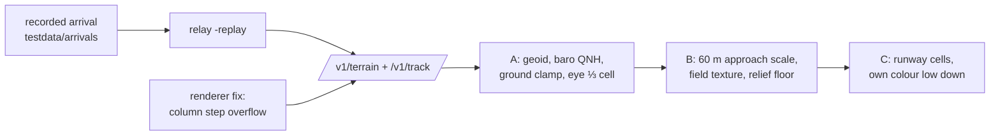

# Cockpit mode near the ground (active plan, decided 2026-11-02; built, cart check pending)

**Problem (owner, on the cart):** close to the ground the voxels turned into near-single colours and the view looked
glitchy. **Goal:** a believable ride down to touchdown, with the runway visible. Agreed: A (camera above the
ground), B (one approach scale), C (runways as terrain cells, not an outline overlay); recordings pulled in from
[watch-arrivals.md](watch-arrivals.md) to test with. All built for 0.6.1 (contract unchanged, v8); how it works now
lives in [../ui/cockpit.md](../ui/cockpit.md) and [../relay/recordings.md](../relay/recordings.md).

## What the causes turned out to be
1. **The renderer** (the biggest, found while chasing the missing runway): the column step overflowed an s16 for
   every heading since 0.3.0, mirroring and stretching the view sideways. Low down that made wide single-colour bands.
2. **Camera underground:** GPS altitude is above the ellipsoid (−30 m geoid at BNA, aircraft 100 ft low), low fixes
   are noisy, and nothing clamped the camera.
3. **Scale steps:** a 2.5 s patch reload every time the height halved; the 30 m floor sank the camera below 5 cells.
4. **No texture:** graded airport ground was one band, one shade.

## Done when
- [x] A recorded BNA arrival replays through the relay (`-replay`, `scripts/relay replay`) and the emulator.
- [x] MAME (SWA3569, 1,525 ft → rollout): no one-colour frames, no reload below 500 m AGL, runway out of the
  horizon from ~1.4 nm, lit (dimly) at night.
- [x] **On the cart (2026-11-02), replaying `kbna-20r-scx3003-b738.jsonl.gz`:** owner: "quite amazing for a Sega
  Genesis". Relay log: two loads only (221 m on entry at ~1,100 m, 60 m at ~400 m; a third was the replay looping).
  Still disorienting: the **position jumps**, not reloads. adsb.fi updated it every ~4 s (fixes alternate 0 / ~200 m),
  an 18 s freeze on short final ended in a 24-cell (1,454 m) jump (> `SNAP`, so the camera lurched), and on the
  ground the camera rolls on at landing speed through frozen fixes, then snaps back.
- [x] Lode, changelog, manual (Cockpit View note), `docs/relay.md`.

## Second round (owner: "smoothing, then A and F", 2026-11-02): built, checked on the cart
- Smoothing: 1.5 s blends up to 60 cells, ground deceleration + 3 s extrapolation cap, the relay's fix age
  counted from now. Not done: velocity averaging (velocity comes from gs/track, not from fixes, so the 0/200 m
  pattern was the age); entering approach scale higher (at 60 m cells from 750 m up the terrain would end
  31 rows under the horizon).
- A: every column sampled at every depth (16 cells changed almost nothing: a pair is under a cell wide there).
- F: band dithering, dotted runway edge + approach lights at night, dark airfields, dark night runway.
- Then (owner, on the cart): the sky now banks and pitches with the ground (dithered bands), the roll overflow past
  ~39° is fixed, rollouts brake instead of reversing, and the relay's bank comes from ≥ 4 s of sightings.
  **Checked on the cart 2026-11-02** with `make replay` (SCX3003): the turn onto final banked steadily (relay
  bank 4-17°, was 8-45°), and through two 22-25 s position freezes the rollout was smooth (owner: "it was smooth").
- Still open: finer depth steps, bilinear heights (2-3x sampling), 160 columns (nibble writes in `vox.s`, ~half
  the fps), 30 m cells (view halves: RAM caps the map at 128²).

## Follow-ups (not started)
- Frame rate low down: ~10 fps (all depth steps; z_min is 0 when the camera is under the patch's `hmax`). A
  per-frame z_min from the terrain actually near the camera, or fewer far steps at approach scale.
- Runway seen only from 64 cells (3.8 km); seeing it from further needs a wider buffer (the 90° view at depth > 64
  wraps sideways in 128 cells) or bigger approach cells.

Related: [watch-arrivals.md](watch-arrivals.md), [cockpit-mode.md](cockpit-mode.md), [roadmap.md](roadmap.md).
