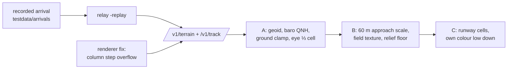

# Cockpit mode near the ground (active plan, decided 2026-11-02; built, cart check pending)

**Problem (owner, on the cart):** close to the ground the voxels turned into near-single colours and the view looked
glitchy. **Goal:** a believable ride down to touchdown, with the runway visible. Agreed: A (camera above the
ground), B (one approach scale), C (runways as terrain cells, not an outline overlay); recordings pulled in from
[watch-arrivals.md](watch-arrivals.md) to test with. All built for 0.6.1 (contract unchanged, v8); how it works now
lives in [../ui/cockpit.md](../ui/cockpit.md) and [../relay/recordings.md](../relay/recordings.md).

## What the causes turned out to be
1. **The renderer** (the biggest, found while chasing the missing runway): the column step overflowed an s16 for
   every heading since 0.3.0, mirroring and stretching the view sideways. Low down that made wide single-colour bands.
2. **Camera underground:** GPS altitude is above the ellipsoid (−30 m geoid at BNA, aircraft 100 ft low), low fixes
   are noisy, and nothing clamped the camera.
3. **Scale steps:** a 2.5 s patch reload every time the height halved; the 30 m floor sank the camera below 5 cells.
4. **No texture:** graded airport ground was one band, one shade.

## Done when
- [x] A recorded BNA arrival replays through the relay (`-replay`, `scripts/relay replay`) and the emulator.
- [x] MAME (SWA3569, 1,525 ft → rollout): no one-colour frames, no reload below 500 m AGL, runway out of the
  horizon from ~1.4 nm, lit (dimly) at night.
- [ ] **On the cart, against the dev relay replaying `relay/testdata/arrivals/kbna-20r-scx3003-b738.jsonl.gz`:**
  the same, plus the frame rate (MAME: ~10 fps on short final) and a normal cruise ride after the renderer fix.
- [x] Lode, changelog, manual (Cockpit View note), `docs/relay.md`.

## Follow-ups (not started)
- Frame rate low down: ~10 fps (all depth steps; z_min is 0 when the camera is under the patch's `hmax`). A
  per-frame z_min from the terrain actually near the camera, or fewer far steps at approach scale.
- Through position gaps on the ground (20-70 s at BNA) the camera rolls on at the last ground speed; the next fix
  snaps it back. Decelerate on the ground (`AR_K_GROUND`) toward taxi speed.
- Runway seen only from 64 cells (3.8 km); seeing it from further needs a wider buffer (the 90° view at depth > 64
  wraps sideways in 128 cells) or bigger approach cells.

Related: [watch-arrivals.md](watch-arrivals.md), [cockpit-mode.md](cockpit-mode.md), [roadmap.md](roadmap.md).
