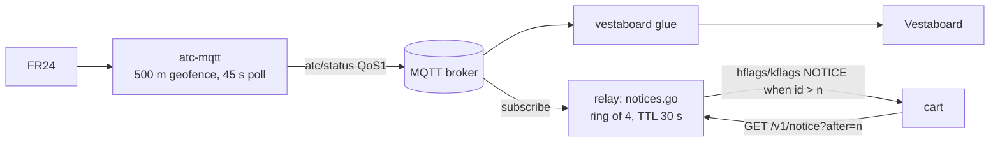

# Plan: flyover notices (MQTT → relay → cart), target 0.4.0 / contract v4

**Status: phase 1 in progress.** Done: relay MQTT client, env config, dev broker, `parseATC` (relay logs entering
flights; [../relay/relay.md](../relay/relay.md)). Next: notice ring, text composer, ICAO match.

## Goal
When a plane passes within ~500 m of the owner's house, the cart, if it's on, shows a short, playful notice
and plays a chime: a **banner over the top of the scope** in radar mode, a **non-blocking HUD line** in cockpit
mode. The trigger is the owner's existing `atc-mqtt` service; the relay subscribes to its MQTT topic. Off unless
the relay is given a broker, so the public release behaves the same for everyone else.

**Done when** (all of these, on the real cart against the real broker):
1. A flight entering the geofence shows the banner within ~5 s in radar mode, with relay-composed text; it closes
   itself after `secs`, B closes it early, and with an ICAO match C opens that aircraft's detail pop-up.
2. In cockpit mode the same notice shows as `OVERHEAD!` + a marquee on the HUD, and the view never stops.
3. The generic chime plays; with home airport KBNA the Nashville chime plays instead. `CHIME OFF` in setup silences it.
4. A relay without `-mqtt` behaves exactly as 0.3.x apart from the v4 contract; idle polling adds no requests.
5. `go test ./...`, the contract test + lock, `make release` + ram-check, and `make sim` (banner screenshot) pass.
6. Docs, manual, CHANGELOG and the lode describe it; 0.4.0 tagged (relay and cart from the same tag).



## The source data (`frykin/atc-mqtt`, `INTERFACE.md`)
- Topic **`atc/status`** (QoS 1, **not retained**), published only when something enters or leaves the geofence:
  `{timestamp, entering_flights[], exiting_flights[], tracked_flights[], summary{}, error?}`.
- Flight object: `flight_uuid, flight_number, airline, aircraft_type, origin, destination, heading, altitude_feet,
  latitude, longitude, ground_speed_knots, timestamp, event_type`. Missing strings are `"Unknown"`.
  `flight_number` is FR24's callsign (may be IATA style, `WN1234`, not the ADS-B `SWA1234`). No ICAO hex.
- Topics are hard-coded in `mqtt_client.py`; any number of subscribers can read `atc/status`, so **atc-mqtt needs no
  change**. Legacy `atc/incoming` carries single flight objects (accept both shapes, cheap).
- Only `entering_flights` make notices. Dedupe on `flight_uuid` (QoS 1 can redeliver).
- "Keep clear": `atc/status` isn't retained, so nothing lingers. If the owner points the relay at a dedicated
  *retained* topic, `-mqtt-clear` publishes an empty retained message after consuming (the MQTT way to clear one).
  The relay always connects with a clean session, so a backlog never replays after downtime; notices older than
  90 s (by the flight `timestamp`) are dropped anyway.

## Relay (`relay/mqtt.go`, `relay/notice.go`)
- **Minimal MQTT 3.1.1 client in stdlib** (same call as the hand-written mDNS: the relay has no dependencies):
  CONNECT (user/pass, clean session, keepalive 60), SUBSCRIBE QoS 1, receive PUBLISH QoS 0/1 + PUBACK, PINGREQ,
  PUBLISH (retained empty, for `-mqtt-clear` only). ~250 lines, reconnect with 5/10/30/60 s back-off. No TLS in v1
  (LAN broker); `mqtts://` later if wanted.
- Config (built): `MQTT_BROKER_HOST` (empty = off) / `_PORT` / `MQTT_USERNAME` / `MQTT_PASSWORD` (env only),
  `MQTT_TOPIC`, `MQTT_CLEAR`, atc-mqtt's names, each with a flag; see [../relay/relay.md](../relay/relay.md).
  Still to add: `-notice-ttl` / `NOTICE_TTL` (30 s).
- **Notice ring:** the 4 newest notices, ids `u16` increasing from a random start (so a relay restart doesn't
  collide with a cart's remembered id). Each lives `-notice-ttl`. Stateless toward carts: nothing is per-client.
- **ICAO match:** look the flight up in `source.last` (newest adsb.fi snapshot, already kept): nearest aircraft
  within 1.5 km and 1,500 ft of the reported position. A match fills `icao` and lets the cart cross-link it; no match
  leaves it 0 (still shown).
- **Text is composed on the relay**, three 26-char lines in the cart's charset, so the cart stays dumb and the jokes
  can change without cart code:
  ```
  OVERHEAD!  SWA1234          (headline: picks from a small list by flight_uuid hash:
  SOUTHWEST  B737-800           OVERHEAD! / LOOK UP! / INCOMING! / FLYBY!)
  BNA > MDW  1,800FT 160KT
  ```
  `aircraft_type` gets shortened (`Boeing 737-800` → `B737-800`, `Airbus A321neo` → `A321NEO`), airline trimmed
  to a word, `"Unknown"` → omitted. Emergencies (if the ICAO match says EMERG) get `MAYDAY OVERHEAD`.
- **Signal:** the cart sends `n=<last notice id seen>` on `/v1/frame` and `/v1/track`. If a live notice with a later
  id exists, the relay sets `AR_H_NOTICE` (hflags bit 2) / `AR_K_NOTICE` (kflags bit 4). Cost when idle: zero
  extra requests.
- **`GET /v1/notice?after=<n>&v=4`** → the oldest live notice with id after `n` (wrapping compare), as
  `struct ar_notice`, or 204 if none. Explicit Content-Length as always.
- Logs: one line per MQTT connect/drop and per notice (`notice 4512 SWA1234 icao a1b2c3`).

## Contract v4 (`src/arframe.h`; [../architecture/contract.md](../architecture/contract.md))
```c
#define AR_H_NOTICE     0x04          /* ar_hdr.hflags: a notice after n= is waiting */
#define AR_K_NOTICE     0x10          /* ar_track.kflags: same, in cockpit mode */
#define AR_FRAME_QUERY  "?lat=%s&lon=%s&range=%u&max=%u&n=%u&v=%u"
#define AR_TRACK_QUERY  "?icao=%02x%02x%02x&p=%s&n=%u&v=%u"
#define AR_NOTICE_PATH  "/v1/notice"
#define AR_NOTICE_QUERY "?after=%u&v=%u"
#define AR_NOTICE_SIZE  88
#define AR_N_ICAO       0x01          /* icao is a match in the feed */
#define AR_N_EMERG      0x02
struct ar_notice {
    char magic[2];      /* "AN" */
    u8 ver, nflags;     /* AR_VER, AR_N_* */
    u16 id;
    u8 icao[3], secs;   /* show for secs (relay decides, ~15) */
    char line[3][26];   /* space padded, cart charset */
    char pad[2];
};                      /* 88 */
```
`AR_VER` 3 → 4, `make contract-lock`, contract test maps every new item (fake-broker test for the flag path).

## Cart
Common (`src/notice.c`, ~100 B static RAM: one `ar_notice`, last id, timer):
- `feed.c` passes `n=` and, when the flag is up, calls `feed_notice()` right after that poll (one ~0.1 s blocking
  GET, V-Int keeps drawing). Queue depth 1: a newer notice replaces a pending one; the ring on the relay feeds the
  rest one at a time via `after=`.
- Notices received in setup are discarded (id still advanced).

**Radar mode: banner** over the scope's top, window plane rows 0-5, cols 0-27 (VDP window in "top" mode, VPos 6;
the side panel is window already and is unaffected):
```
row 1  ┌──────────────────────────┐
row 2  │ OVERHEAD!  SWA1234       │   PAL2 headline, blinks for 2 s
row 3  │ SOUTHWEST  B737-800      │
row 4  │ BNA > MDW  1,800FT 160KT │
row 5  └───── C DETAILS ─────────┘   only when AR_N_ICAO
```
- Same machinery as the pop-up (`radar_popup_row`, opaque font, rows out a few per V-Int, all rows marked dirty),
  but a 6-row region. `sprites()` drops sprites in rows 0-5 while it's up.
- Shows `secs` then closes; B dismisses early. With `AR_N_ICAO`, the aircraft is selected in the traffic list, and
  C opens its detail pop-up (Y → cockpit, as today). If the detail pop-up or setup is open, the banner waits
  (still bounded by the relay TTL), then shows.
- Plays the home airport's chime on arrival ([Chimes](#chimes-cart-only-no-contract-change)).

**Cockpit mode: HUD line, never takes over.** The HUD writes one line per frame; the notice borrows:
- row 17 status slot → amber `OVERHEAD!` for `secs` (then back to `LIVE`);
- row 25 → a marquee of the three lines joined, 1 char per 4 frames, replacing the elevation credit for `secs`
  (exit messages already overwrite it; the credit returns after).
- Riding the very aircraft in the notice: `YOU ARE OVER HOME!`. Fun and cheap.

**Emulator:** fake `feed_notice` emits a canned notice ~20 s after entering the radar and every 90 s, so `make sim`
shows it and the manual can screenshot it.

## Chimes (cart only, no contract change)
A short PA-style "attention" chime when a notice arrives.
- **Why only two:** no public catalogue of airport chimes with notes exists (searched 2026-11-01). A few airports are
  known for theirs (Heathrow T5, shared by Schiphol; Haneda; Zürich), most use stock PA tones, and transcribing by
  ear isn't possible here. So: **one generic chime for every airport, and a custom KBNA chime as an easter egg** (the
  owner lives near Nashville). Avoid the NBC three-note G-E-C: it's a registered sound mark.
- `src/chime.c`: `chime_play(icao)` picks `KBNA` → Nashville, anything else → generic. A chime is a table of up to 8
  `{note (semitone, 0 = C4), start frame, length frames}` + a patch; `chime_tick()` runs once per frame from the main
  loop (and the cockpit loop) and keys notes on/off. Non-blocking; a new chime cuts off a playing one.
- **Generic:** FM bell, rising C5 E5 G5 C6, a note every 9 frames (~150 ms), each ringing ~45 frames so they overlap
  like a terminal chime (channels 1-4).
- **KBNA "Music City":** an FM twangy-guitar patch (steel-guitar flavour), an original short country lick, e.g.
  E4 G4 A4 · C5 (slide up from B4) · A4 C5 ending on a held E5, ~1.5 s. Original, not a quote of any song; the owner
  signs it off by ear from `make sim` audio and may hand over different notes.
- **Voice: YM2612 FM**, written by the 68k through SGDK's `YM2612_*` calls (no Z80 driver, no XGM). PSG squares
  sound like a game beep, not a terminal; FM bells are the Genesis's strength. Patches are two static register
  tables (~30 B each).
- **Setup:** `CHIME: ON / OFF` (default ON); toggling to ON previews the home airport's chime. This adds a field to
  `struct settings`, so the record goes `MWR1` → `MWR2` with a migration that reads an `MWR1` record and defaults
  the chime to ON (otherwise every owner loses their saved Wi-Fi and airport).
- **Verify:** `make sim` with MAME `-wavwrite`; a Python FFT over the WAV checks each note's pitch (±1 semitone) and
  onset. The emulator build plays the chime with the fake notice.

## Phases
1. Relay: ~~MQTT client, env config, dev broker, parser~~ (done), then ring + composer + ICAO match, tested with
   `relay/testdata/atc/` samples; verify with `make mqtt-start relay-start mqtt-pub`.
2. Contract v4: arframe.h, `/v1/notice`, `n=`, flags, contract test + lock.
3. Cart radar banner + fake feed + `make sim` screenshots; RAM check, boot the cart ROM in MAME.
4. Cockpit HUD notice.
5. Chimes: FM bell + generic chime, KBNA patch + lick, `CHIME` setup row + `MWR2` migration, WAV pitch check;
   owner signs off the KBNA lick on the cart.
6. Docs: `docs/relay.md` (flags, env, docker example), manual paragraph, CHANGELOG, lode (relay.md, contract,
   frame-format, cockpit.md, screen-layout, terminology). Release 0.4.0.

## Decided (2026-11-01)
Banner at the top of the scope; the relay composes the text; one generic chime for all airports plus a custom KBNA
easter-egg chime; FM (YM2612) voice; minimal stdlib MQTT client in the relay; contract v4 with `n=` + notice flag.

## Open questions
- The production broker's service name/credentials when the relay moves into the cluster with atc-mqtt (env only;
  no code change). Until then the dev Mac runs the relay against the local `mwradar-mqtt` broker.

Related: [roadmap.md](roadmap.md), [../relay/relay.md](../relay/relay.md), [../ui/detail-popup.md](../ui/detail-popup.md),
[../ui/cockpit.md](../ui/cockpit.md), [../ui/screen-layout.md](../ui/screen-layout.md).
