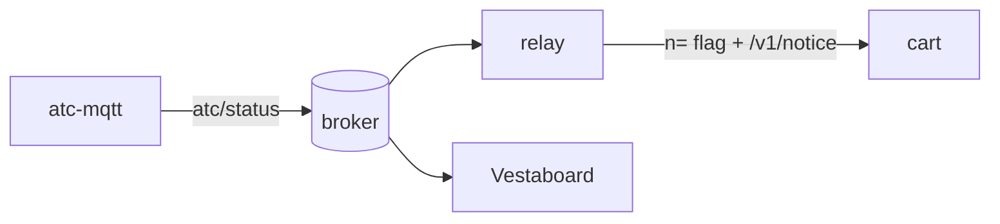

# Plan: flyover notices (0.4.0, contract v4)

**Status (2026-11-01): done and verified on the cart by the owner; only the 0.4.0 tag (and, later, the cluster
broker) remain.** How it works now: [../ui/notices.md](../ui/notices.md) (cart, contract, chime) and
[../relay/relay.md](../relay/relay.md) (MQTT client, env config, ring, composer, ICAO match, `/v1/notice`).

## Goal
When a plane passes within ~500 m of the owner's house, the cart shows a short, playful notice and plays a chime:
a banner over the top of the scope in radar mode, a non-blocking HUD line in cockpit mode. The trigger is the
owner's `atc-mqtt` service; the relay subscribes to its MQTT topic. Off unless the relay is given a broker.

## Done when
| # | Criterion | State |
|---|---|---|
| 1 | Radar banner within ~5 s, relay text, closes after `secs`, B early, C → that aircraft's details | ✓ cart |
| 2 | Cockpit: `OVERHEAD!` + a ticker along the bottom, the view never stops | ✓ cart (ticker at 7 frames/char) |
| 3 | Generic chime; KBNA plays the Nashville lick; `CHIME OFF` silences it | ✓ cart, owner approved |
| 4 | A relay without a broker behaves as 0.3.x (apart from v4); idle polling adds no requests | ✓ (the flag rides on existing polls) |
| 5 | `go test`, contract test + lock, `make release` + ram-check, `make sim`, cart ROM boots in MAME | ✓ |
| 6 | Docs, manual, CHANGELOG, lode; 0.4.0 tagged | docs/manual/CHANGELOG/lode ✓; **tag: to do** |

## Left to do
1. Tag 0.4.0 (relay and cart from the same tag; set the CHANGELOG date). Built on the cart:
   `4598aef`, CRC32 `55845B99` (notices, ticker, instrument-strip HUD).
2. Production: point the relay at the cluster broker (`MQTT_BROKER_HOST/PORT/USERNAME/PASSWORD`, atc-mqtt's names)
   when it moves into the cluster. No code change.

## Decisions (2026-11-01)
Banner at the top of the scope; the relay composes the text; one generic chime for every airport plus a KBNA
easter egg (no public list of airport chimes exists); FM (YM2612) voice; minimal stdlib MQTT client; env config
with atc-mqtt's variable names; contract v4 with `n=` + a notice flag (no extra request when idle); cockpit scrolls
the notice as a ticker along the bottom row (the owner's choice after seeing pages on the cart).

Related: [roadmap.md](roadmap.md).
