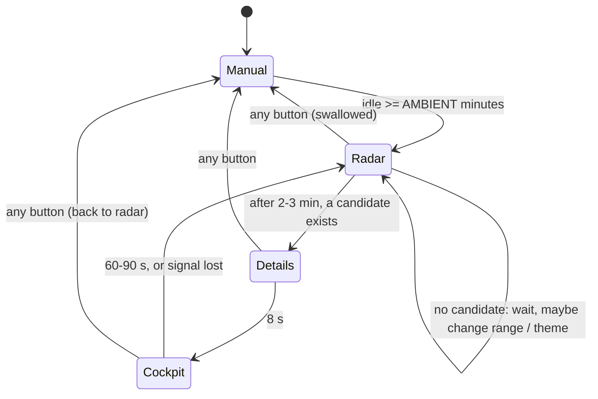

# Goal: ambient mode (idea, 2026-11-01)

**Outcome:** left alone, the cart runs itself like a museum display. After a few idle minutes it picks an
interesting flight, opens its details, rides along in cockpit mode for a minute, comes back to the radar, and repeats.
Any button hands control back at once. It also keeps a static screen from burning in (the manual's handling page
warns about plasma and projection TVs).

## Behaviour

- **Picking a flight** (score, highest wins; skip the one just shown, and ground traffic):
  1. emergency squawk (`AR_F_EMERG`);
  2. the aircraft of the latest flyover notice ([../../ui/notices.md](../../ui/notices.md));
  3. an arrival, if [../watch-arrivals.md](../watch-arrivals.md) exists (`AR_F_ARRIVING`);
  4. lowest airborne aircraft within 10 nm (most interesting terrain close to the ground);
  5. otherwise a random airborne one within range.
- **Optional variety:** every cycle, step the range (10 → 25 → 50) or the theme. Owner's call; off by default.
- **On screen:** a small `AUTO` in the panel's status row (or the cockpit HUD status slot) so it's clear why the
  screen is moving. The first button press only exits ambient mode; it doesn't also zoom or select.

## Design (cart only, no relay change)
- `src/ambient.c`: idle counter (frames since the last pad change, reset in the input handler in `main.c`), state,
  timers by `vtimer`, `ambient_pick()` over the `[main]` side of the track table (like `tlist_rebuild`).
- Uses what main already does for the user: `radar_select` + `tlist_move(0)`, the pop-up open, `cockpit_run(icao)`
  (Y's path), return through `radar_up`. Cockpit mode needs an exit hook: `cockpit_run` checks a "time's up"
  callback or deadline as well as B. Any pad input in cockpit mode ends ambient mode and stays in the cockpit? No:
  simplest is any button = back to the radar, manual.
- **Setting:** AMBIENT OFF / 2 / 5 / 15 min in setup. A new settings byte → `MWR3` record + migration from
  `MWR2` (bundle with [persist-sort-order.md](persist-sort-order.md): one format bump for both).
- Notices still pop up in ambient mode; ambient waits while a notice box is open.

```c
enum amb_state { AMB_OFF, AMB_RADAR, AMB_DETAILS, AMB_COCKPIT };
void ambient_input(void);          /* any pad change: idle = 0; leaves ambient mode */
bool ambient_tick(void);           /* main loop, every frame; TRUE if it consumed the frame's input */
s16  ambient_pick(void);           /* track slot or -1 */
```

## Risks / questions
- Cockpit entry costs a terrain patch (~2.5 s, relay + AWS tiles); every 3 minutes all day is ~500 patches/day.
  Fine for the relay cache, but check AWS terms (requester-pays doesn't apply to the public terrain bucket).
- adsb.fi fair use: cockpit mode polls `/v1/track` every 2 s; ambient mode adds no more than a user would.
- Overnight with no traffic: stay on the radar; maybe dim (NIGHT theme between configured hours: later).

## Done when
- [ ] Idle detection, the state machine, the picker; any button exits cleanly from every state.
- [ ] Setup AMBIENT row, MWR3 with migration, tested from an MWR2 record.
- [ ] `make sim` runs a full cycle unattended (fake feed + fake cockpit track); a long MAME run with no leaks
      (RAM, VRAM, sprite state after many cockpit round trips: the [scroll bug](../../ui/radar-renderer.md) class).
- [ ] An afternoon on the cart without a hang; manual: a short section and a controls note.

Related: [summary.md](summary.md), [../../ui/cockpit.md](../../ui/cockpit.md), [../../ui/traffic-list.md](../../ui/traffic-list.md).
