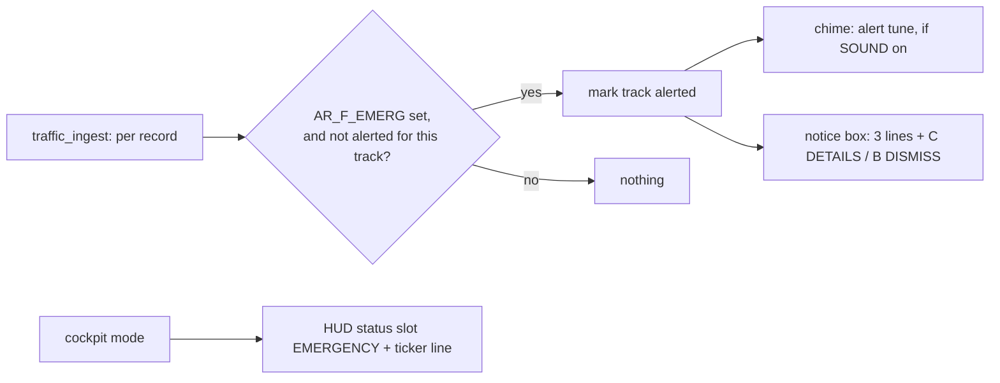

# Goal: emergency alert (idea, 2026-11-01)

**Outcome:** when an aircraft starts squawking 7500, 7600 or 7700 (or reports an emergency), the cart sounds an
alert and pops the notice box: `EMERGENCY 7700 / AAL1140 A321 / 12 NM NE 8,500 FT`. Today emergencies only turn
red and jump to the top of the list, which is easy to miss from the couch.

## Design (cart only, no relay or contract change)

- **Detection** in `traffic_ingest` (main loop): `AR_F_EMERG` newly set on a track (new aircraft with the flag, or
  the flag appears). One alert per track per session: a `u8 alerted` in `struct track`. The radar is the larger user of the mode
  overlay (36,736 B vs cockpit's 36,672 B), so the overlay grows by 96-192 B (146 B per track today; padding
  decides). Check `scripts/ram-check` (9.8 KiB heap today, min 8 KiB) and boot the cart ROM in MAME.
- **Which code:** the squawk is in the record (`squawk`, nibble per octal digit): `0x7500` hijack, `0x7600` radio
  failure, `0x7700` emergency; `AR_F_EMERG` without one of those is the `emergency` field (show `EMERGENCY`).
- **Box:** reuse `radar_box_open(text, pal)` from the notice code ([../../ui/notices.md](../../ui/notices.md)), lines
  composed on the cart (24 chars): line 1 in PAL3 (red), blinking like the notice title. C opens the pop-up for it,
  B dismisses. A flyover notice arriving meanwhile waits (notices already queue behind the pop-up).
- **Sound:** a new tune in `chime.c`: a two-tone hi-lo (like a master caution), the bell patch or a square-ish one,
  3 repetitions. `settings.sound` OFF silences it.
- **Cockpit mode:** if riding another aircraft, the HUD status slot shows `EMERG` and the ticker runs the three
  lines (the ticker is the notice ticker; feed it the composed text).
- 7600 (radio failure) and 7500 (hijack) can be tests, mistakes or real; the text says what the code means without
  drama: `SQUAWK 7600 RADIO FAILURE`.

```c
/* traffic.c, ingest */
if ((r->flags & AR_F_EMERG) && !t->alerted) { t->alerted = 1; alert_queue(slot); }
/* alert.c */
void alert_queue(u8 slot);          /* main loop */
void alert_tick(void);              /* main loop, like notice_radar_tick: shows when the box is free */
```

## Risks / questions
- False positives: ADS-B `emergency` fields glitch occasionally (a frame or two). Require the flag on 2 polls in a
  row before alerting (`emerg_polls` counter instead of a bit).
- Busy days near military bases: rate limit to one alert per minute.
- The fake feed needs a recorded emergency for `make sim`: synthesise one in `relay -pack` (flip a squawk).

## Done when
- [ ] Detection with the 2-poll debounce; one alert per aircraft; box + sound + cockpit ticker.
- [ ] Synthetic emergency in the fake feed; `make sim` shot; manual notices page mentions it.
- [ ] On the cart with a synthetic emergency (a test relay flag that forces 7700 on one aircraft).

Related: [summary.md](summary.md), [../../ui/traffic-list.md](../../ui/traffic-list.md), [../../architecture/frame-format.md](../../architecture/frame-format.md).
