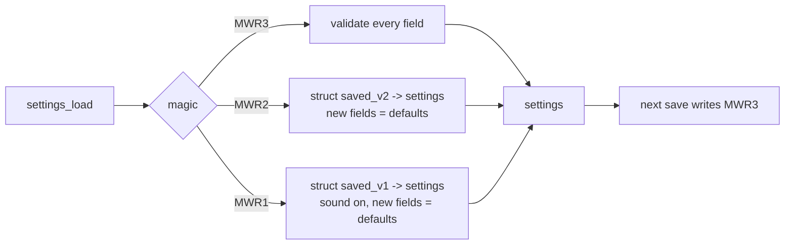

# Goal: settings record MWR3 (persist the sort order, and room for new settings) (idea, 2026-11-01)

**Outcome:** the traffic list's sort order survives a power cycle, and the settings record gains the bytes the
other ideas need (ambient timeout, weather and map toggles), so the format changes **once**, not per feature.

## Today
`struct settings` is saved as `"MWR2" + struct + checksum` in ESP32 user_data; a 0.3.x `"MWR1"` record is read as
`struct saved_v1` and upgraded ([../../ui/config-screen.md](../../ui/config-screen.md)). There are no spare bytes:
any new field means a new magic and the same kind of migration. The sort order is RAM only: every boot starts at
NEAREST (`tlist.c`, `sort_mode`).

## Design

```c
struct settings {
    u8 theme, range_idx, tag_mode;
    char icao[5];
    s32 lat_e4, lon_e4;
    char relay[RELAY_LEN + 1];
    u8 sound;
    u8 sort;                    /* new: enum sort_mode (when it's saved: below) */
    u8 ambient;                 /* new: 0 off, else minutes index (ambient-mode.md) */
    u8 layers;                  /* new: bit 0 weather, bit 1 runways, bit 2 map lines (weather-overlay, video-maps) */
    u8 rsv[5];                  /* new: spare, zero: future fields without another magic (validated == 0 now,
                                   accepted as anything once a later build gives them meaning) */
};
```
- **Reserve spare bytes this time** so the next small setting doesn't need `MWR4`. Validation: a later build
  defines a spare byte's meaning and its default for 0, so old records read correctly.
- **Saving the sort order:** settings are written in setup's SAVE & EXIT today (a flash write is slow and blocking:
  never from the radar loop, see [../../practices.md](../../practices.md)). Options: (a) save sort on the next
  setup save only (simple, but surprising); (b) a deferred save when leaving the radar for setup; (c) accept a
  blocking save on hold-C (~tens of ms? measure; the sweep keeps turning in the V-Int). Pick (c) if it measures
  short, else (a) with a note in the manual.
- Validation adds `sort < SORT_MODES`; a bad value invalidates the record as other fields do. (A ROM downgrade
  meets an `MWR3` record it doesn't know and falls back to defaults: acceptable, as before.)

## Done when
- [ ] `MWR3` with the new fields + spare bytes; MWR2 and MWR1 upgrade paths tested (write an old record with a
      test build, boot the new one, check every field).
- [ ] Sort order restored at boot; the save path chosen and measured.
- [ ] Lode: config-screen.md's record description; terminology `MWR3`.

Related: [summary.md](summary.md), [ambient-mode.md](ambient-mode.md), [../../ui/traffic-list.md](../../ui/traffic-list.md).
