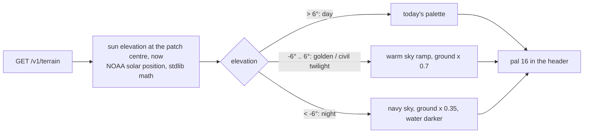

# Goal: real sky in cockpit mode (idea, 2026-11-01)

**Outcome:** cockpit mode's sky and ground follow the real sun at the aircraft: blue by day, orange and pink at
dawn and dusk, dark blue-black at night with the ground dimmed. Riding an evening arrival into BNA looks like an
evening arrival.

## Why it's small
The relay already composes the cockpit palette: `struct ar_terrain.pal[16]` (PAL0: 1-3 sky deep → pale, 4-5 water,
6-13 ground bands, 14 urban unused, 15 snow) ([../../ui/cockpit.md](../../ui/cockpit.md)). The cart loads it as is. So
time of day can be **relay-only**: compute the sun's elevation for the patch centre at the request time and tint
the palette. No cart change, no struct change, no `AR_VER` bump.

## Design (relay)
- `sun.go`: solar elevation from lat, lon, UTC (the NOAA approximation: declination + equation of time + hour
  angle; ~0.1° is plenty). Unit-tested against a few known sunrise times (BNA solstices).
- `skyPalette(elev)`: interpolate between keyframes (night, twilight, golden, day) for the three sky entries.
- `shadeGround(pal, factor)`: scale the ground bands' channels (keep the 3-bit VDP steps even: round to 0,2,..,E).
- **Twilight colour direction:** the sky bands are horizontal and the camera turns; a sunset glow only toward the
  sun would need per-column colour, which the renderer can't do. Use a uniform warm horizon band (index 3, the
  palest, sits at the horizon) and accept it.
- **Night lights (phase 2):** palette 14 "urban" is unused. A land-cover or night-lights layer (e.g. VIIRS
  Black Marble tiles, or ESA WorldCover "built-up") could mark urban cells, drawn as warm yellow at night: Nashville
  glowing under an arrival. That's a new data source and a change to how cells are coloured; still relay-only.
- A patch is fetched on entry and when the height halves/doubles; a sunset happens over minutes, so the tint
  updates naturally on reloads. Optionally `/v1/strip` responses could carry nothing new (palettes are per patch).

## Cart (optional)
- The HUD stays white/cyan; at night the HUD's PAL1-3 colours could dim (the cockpit sets them in `cockpit.c`).
- A test override: a relay env `RELAY_SKY_TIME=dusk` (or a query parameter) forces a time of day for screenshots
  and `make sim` (`-pack-cockpit` gains a `-time` flag).

## Risks / questions
- Colour quantisation: 3 bits per channel makes smooth twilight hard; pick keyframes by eye on the TV.
- Polar edge cases (no sunset): the formula handles them; clamp.
- Does the owner want "real" or a setting (DAY / REAL)? Default REAL, no setting at first.

## Done when
- [ ] `sun.go` + tests; palettes for day / golden / twilight / night chosen on the TV.
- [ ] Terrain responses tinted by the real time; an override for tests and shots.
- [ ] Manual cockpit page: one sentence ("the sky follows the real time of day").
- [ ] (Phase 2) urban lights at night.

Related: [summary.md](summary.md), [../../relay/relay.md](../../relay/relay.md), [../cockpit-mode.md](../cockpit-mode.md).
