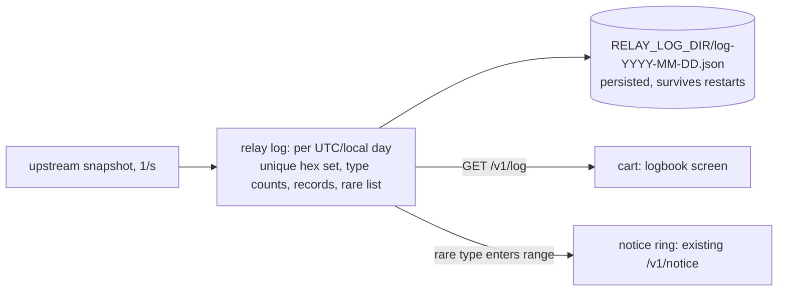

# Goal: spotter's logbook (idea, 2026-11-01)

**Outcome:** the relay remembers the day's traffic around home, and the cart shows a "TODAY AT KBNA" screen:
how many aircraft and types were seen, the day's records (lowest, fastest, highest, longest-tracked), and the
rare ones (military, unusual types, VIPs' registrations if public). A rare type arriving can trigger a flyover-style
notice: "RARE: C-17A GLOBEMASTER, 12 NM SW".

## Data
- Every upstream snapshot the relay already fetches (adsb.fi, 1/s) is the input: no extra requests.
- **Rarity:** adsb.fi's JSON includes `dbFlags` (bit 0 military, bit 1 interesting, bit 2 PIA, bit 3 LADD; to
  verify) and `t` (type). Add a curated list of "rare at a regional airport" types (A380, B748, AN-124, C-5, C-17,
  U-2, B-52, warbirds) embedded in the relay, overridable by a file.
- **Privacy:** LADD/PIA aircraft asked not to be tracked publicly; never log or show their registration (show
  "BLOCKED" or skip them).

## Design

- **Relay state:** this is the first durable relay state. One file per day, rewritten every minute (atomic
  rename), loaded on start. Container: a volume (`-v mwradar-log:/data`). Without `RELAY_LOG_DIR` the log lives in
  memory only (restart = a fresh day).
- **Which home?** The relay is shared, but the log is for the home it's asked about: key logs by the frame
  query's `lat,lon` rounded (most setups have one cart, one home).
- **Rare notices** reuse the flyover pipeline ([../../ui/notices.md](../../ui/notices.md)): the relay composes 3 × 24
  characters and adds it to the notice ring; the cart's box, chime and cockpit ticker need no change. Throttle:
  one per aircraft per day.
- **Cart screen:** reached from setup (a `LOGBOOK` row: a 3-button pad must reach everything, and setup has room)
  or from the radar via a long press of a button that isn't held yet (START hold?). Window-plane text like setup.
```
 TODAY AT KBNA           1 NOV
 ------------------------------
 AIRCRAFT  412      TYPES  57
 LOWEST    N739GX   C172   300 FT
 FASTEST   DAL768   A321   548 KT
 HIGHEST   GJS4505  E75L  41,000 FT
 LONGEST   N8065L   PA28   2 H 10 M
 ------------------------------
 RARE      RCH4521  C17   14:02
           N1945B   P51   16:40
           ...
 B BACK
```

## Contract (v5 or later)
```c
#define AR_LOG_PATH   "/v1/log"
#define AR_LOG_QUERY  "?lat=%s&lon=%s&v=%u"
#define AR_LOG_RARE   8
struct ar_log_rec  { char cs[8]; char type[4]; u16 value; u16 rsv; };          /* 16 */
struct ar_log_rare { char cs[8]; char type[4]; u16 minute; u16 rsv; };          /* 16, minute of the day */
struct ar_log { char magic[2]; u8 ver, lflags; u16 day, aircraft, types, rsv;
                struct ar_log_rec rec[4]; struct ar_log_rare rare[AR_LOG_RARE]; };   /* 12 + 64 + 128 = 204 */
```

## Risks / questions
- Day boundary: local midnight at home (needs the home's time zone: derive from longitude, or a relay env `TZ`).
- Unique counting on a 1/s stream: a map of hex → first/last seen; a busy day at KORD is ~3,000 entries, fine.
- adsb.fi terms: personal, non-commercial; a local log for one person fits. Don't publish logs.

## Done when
- [ ] Relay log with persistence + tests (a replay of recorded snapshots produces the expected records).
- [ ] `/v1/log` + contract; rare-type notices through the existing ring.
- [ ] Cart logbook screen from setup; manual page (setup or its own).
- [ ] A day on the real relay: the numbers look plausible against an ADS-B site's history.

Related: [summary.md](summary.md), [../../relay/relay.md](../../relay/relay.md), [../../data/adsb-sources.md](../../data/adsb-sources.md).
