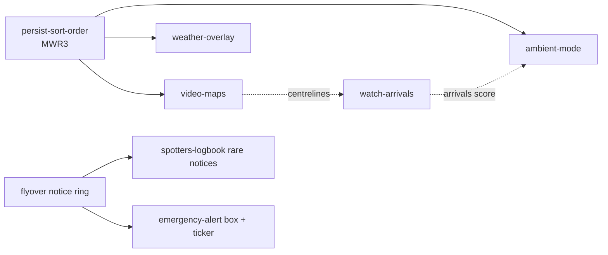

# Feature ideas (goals backlog, written 2026-11-01)

Ideas the owner can promote to goals. Each file states the outcome, a design that fits the current code, the
contract and RAM/V-Int costs, risks, and a "done when" checklist. None is scheduled; nothing here is built.
When one is picked: re-read its file against the code (things drift), settle its open questions with the owner,
then move it to `plans/` as the active plan and update it to the current state as it's built.

| Goal | What you get | Where | Contract | Size | Depends on |
|---|---|---|---|---|---|
| [ambient-mode.md](ambient-mode.md) | idle cart tours flights: details → cockpit → radar | cart | none | M | MWR3 for its setting |
| [real-sky.md](real-sky.md) | cockpit sky/ground follow the real sun; night lights later | relay | none | S | — |
| [emergency-alert.md](emergency-alert.md) | sound + box when a 7500/7600/7700 appears | cart | none | S | — |
| [persist-sort-order.md](persist-sort-order.md) | settings `MWR3`: sort order saved, spare bytes for the rest | cart | none | S | — |
| [weather-overlay.md](weather-overlay.md) | NEXRAD precipitation as STARS-style stippled cells | both | v5+ `/v1/wx` | L | MWR3 for a toggle |
| [video-maps.md](video-maps.md) | runways + extended centrelines (+ rivers, airspace) | both | v5+ `/v1/map` | L | sweep slow-path measurement |
| [stars-data-blocks.md](stars-data-blocks.md) | leader lines + 8-direction tags in STARS/ERAM | cart | none (phase 2: type in record) | M | — |
| [spotters-logbook.md](spotters-logbook.md) | "today at KBNA" stats, rare types, rare-type notices | both | v5+ `/v1/log` | L | relay persistence |
| [../watch-arrivals.md](../watch-arrivals.md) | ARRIVALS list order, cockpit through touchdown, relay on the Pi | both | v5 flag bit | M-L | cockpit low-altitude fixes |

S = a session or two, M = a few sessions, L = a release of its own.

## Suggested order
1. **Quick wins, no contract change:** emergency-alert, real-sky, persist-sort-order (MWR3 with spare bytes).
2. **Ambient mode** on top of MWR3: the best fit for a cart that sits on a TV all day.
3. **One contract release (v5)** bundling what needs the relay: pick from weather, maps, logbook, arrivals.
   Bundle them so the cart and relay bump `AR_VER` once ([../../architecture/contract.md](../../architecture/contract.md)).

## Shared constraints (from the lode)
- RAM: ~9.8 KiB heap at start-up, minimum 8 KiB ([../../build/ram-budget.md](../../build/ram-budget.md)); big buffers go
  in the mode overlay; boot the cart ROM in MAME after RAM changes.
- V-Int: ~175 of 262 lines used on the radar; measure with `RADAR_DEBUG` ([../../ui/radar-renderer.md](../../ui/radar-renderer.md)).
- Free palette entries: PAL0 13 (nothing else in PAL0); PAL1 7-13, PAL2 1-13, PAL3 5-13 (14 is the background everywhere) ([../../ui/screen-layout.md](../../ui/screen-layout.md)).
- 3-button pad must reach everything; new screens hang off setup.
- Each user-visible change: changelog, manual section, shots ([../../practices.md](../../practices.md)).

Related: [../roadmap.md](../roadmap.md).
