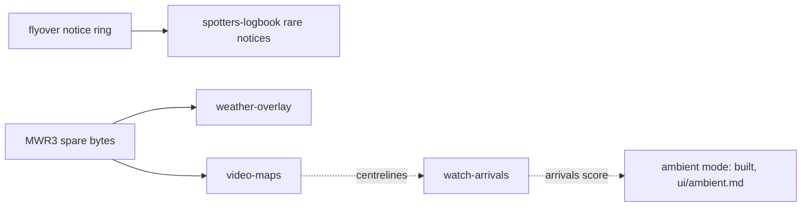

# Feature ideas (goals backlog, written 2026-11-01)

Ideas the owner can promote to goals. Each file states the outcome, a design that fits the current code, the
contract and RAM/V-Int costs, risks, and a "done when" checklist. None is scheduled; nothing here is built.
When one is picked: re-read its file against the code (things drift), settle its open questions with the owner,
then move it to `plans/` as the active plan and update it to the current state as it's built.

| Goal | What you get | Where | Contract | Size | Depends on |
|---|---|---|---|---|---|
| *night lights* (below) | cockpit: urban cells lit warm yellow at night | relay | none | M | a land-cover / night-lights source |
| [weather-overlay.md](weather-overlay.md) | NEXRAD precipitation as STARS-style stippled cells | both | v5+ `/v1/wx` | L | — |
| [video-maps.md](video-maps.md) | runways + extended centrelines (+ rivers, airspace) | both | v5+ `/v1/map` | L | sweep slow-path measurement |
| *STARS type line* (below) | data blocks alternate line 2 with the aircraft type | both | v5: type in `ar_rec` (24 → 28) | M | v5 release |
| [spotters-logbook.md](spotters-logbook.md) | "today at KBNA" stats, rare types, rare-type notices | both | v5+ `/v1/log` | L | relay persistence |
| [../watch-arrivals.md](../watch-arrivals.md) | ARRIVALS list order, cockpit through touchdown, relay on the Pi | both | v5 flag bit | M-L | cockpit low-altitude fixes |

S = a session or two, M = a few sessions, L = a release of its own.

## Night lights (phase 2 of the real sky)
The relay already tints the cockpit palette by the sun ([../../ui/cockpit.md](../../ui/cockpit.md)). Palette 14 "urban"
is unused: a land-cover or night-lights layer (ESA WorldCover "built-up", or VIIRS Black Marble tiles) could mark
urban cells, coloured dark grey by day and warm yellow at night, so Nashville glows under an evening arrival.
Relay-only (cells' colour codes and the palette), no contract change. Done when: a source is chosen and cached,
`code()` marks urban cells, night shows them lit in a `-sky night` emulator preview and on the cart.

## STARS type line (phase 2 of the data blocks)
STARS and ERAM draw tags as data blocks on leader lines ([../../ui/radar-renderer.md](../../ui/radar-renderer.md)). Real
STARS time-shares line 2: altitude + speed, then the type (B38M), every ~2 s. The record has no type (only the
96-byte `ar_detail` does), so it means growing `ar_rec` to 28 bytes (`char type[4]`): ~1.2 KB more RAM (tracks ×2
records + `frame_buf`), and a contract bump, so it belongs in the v5 release. The cart then swaps `tag[1]` on a
timer for tags in leader themes (≤ 2 redraws a frame already bound it). Open: STARS's own format (speed in tens of
knots, 2 digits) or today's `016 174`.

## Suggested order
1. **Night lights**, if the real sky makes you want more; relay only.
2. **One contract release (v5)** bundling what needs the relay: pick from weather, maps, logbook, arrivals, the STARS type line.
   Bundle them so the cart and relay bump `AR_VER` once ([../../architecture/contract.md](../../architecture/contract.md)).

## Shared constraints (from the lode)
- RAM: ~9.8 KiB heap at start-up, minimum 8 KiB ([../../build/ram-budget.md](../../build/ram-budget.md)); big buffers go
  in the mode overlay; boot the cart ROM in MAME after RAM changes.
- V-Int: ~175 of 262 lines used on the radar; measure with `RADAR_DEBUG` ([../../ui/radar-renderer.md](../../ui/radar-renderer.md)).
- Free palette entries: PAL0 13 (nothing else in PAL0); PAL1 7-13, PAL2 1-13, PAL3 5-13 (14 is the background everywhere) ([../../ui/screen-layout.md](../../ui/screen-layout.md)).
- 3-button pad must reach everything; new screens hang off setup.
- Each user-visible change: changelog, manual section, shots ([../../practices.md](../../practices.md)).

Related: [../roadmap.md](../roadmap.md).
