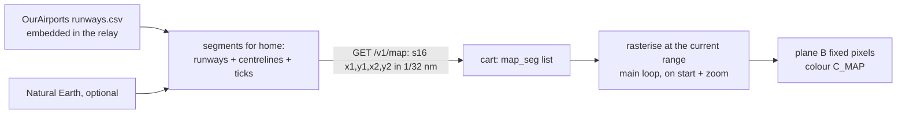

# Goal: video maps (idea, 2026-11-01)

**Outcome:** faint map lines on the scope like a TRACON's video map: the home airport's runways with
**extended centrelines** (ticks every mile out to 10 nm), and optionally rivers, interstates and airspace edges. At
BNA you'd see the four runways, the approach paths lining up the arrivals, and the Cumberland River.

## Data
| Layer | Source | Licence |
|---|---|---|
| Runways (ends, headings) | OurAirports `runways.csv` | public domain (already our airport source) |
| Extended centrelines | computed from runway ends | — |
| Rivers, coastlines, roads | Natural Earth 10 m | public domain |
| Class B/C/D airspace | FAA ADDS / NASR shapefiles | public (US) |

Start with runways + centrelines: smallest data, most useful, and it pairs with
[../watch-arrivals.md](../watch-arrivals.md).

## Design

- **Relay** builds segments for the cart's home (`lat`, `lon` like the frame) in the frame's units (1/32 nm,
  x east, y north), clipped to the largest range (100 nm), at most N segments (e.g. 128 × 8 B = 1 KB).
  Different layers get a class byte so the cart can colour or hide them.
- **Cart** rasterises with Bresenham into the scope's RAM tiles at radar start and on every zoom (main loop,
  then a full-scope upload like a theme change), in a new PAL0 colour `C_MAP` (13 if weather doesn't take it; else
  share it).
- **The sweep problem.** Sweep pixel lists exclude ring pixels at build time, and drawing ORs glow nibbles into
  pixels known to be 0 ([../../ui/sweep.md](../../ui/sweep.md)). Map pixels change with home and range, so they can't be
  excluded at build time. Options:
  1. **Reuse the trail-dot slow path** (recommended): trail dots are already runtime plane-B pixels the sweep
     must not erase (`trail_cnt[tile]` + a 1-bit pixel map; retiring restores `C_TRAIL`). Generalise it to "fixed
     pixels" with a colour per pixel class. Cost: every tile a map line crosses takes the slow path whenever the
     sweep crosses it. Measure (`RADAR_DEBUG`); the sweep is ~45 lines/frame today, total ~175 of 262.
  2. Maps only in no-sweep themes (STARS, POCKET, ERAM): trivial, but Classic users never see them.
  3. Plane A unique tiles per map cell: conflicts with tags and labels cell by cell; no.
- **Toggle:** MAP OFF / RWY / ALL in setup (a spare byte of the MWR3 record, [../../ui/config-screen.md](../../ui/config-screen.md)).

## Contract (v5 or later)
```c
#define AR_MAP_PATH   "/v1/map"
#define AR_MAP_QUERY  "?lat=%s&lon=%s&v=%u"
#define AR_MAP_MAX    128
struct ar_map_hdr { char magic[2]; u8 ver, count; };                 /* "AM", then count segments */
struct ar_map_seg { s16 x1, y1, x2, y2; };                           /* 1/32 nm, like ar_rec */
```
A class byte per segment would make it 10 B (keep even sizes: add a pad) or put classes in runs (header gives
counts per class).

## Budget
- RAM: 1 KB of segments (cart build); the pixel map already exists for trails if option 1 extends it.
- Rasterising 128 segments at 208 px: a few thousand pixels, main loop only, once per zoom.
- Sweep: the unknown; measure with BNA's map at 10 nm (densest) before committing.

## Risks / questions
- Sweep cost on the slow path (above). If too high: precompute per-step "has map pixels" lists at zoom time.
- Clutter at 100 nm: drop centrelines past 25 nm range, keep runways as a dot.
- Should ring pixels and map pixels share a colour? Probably not: maps dimmer than rings.

## Done when
- [ ] Relay: `/v1/map` from embedded OurAirports runways, tests for KBNA (4 runways, 8 centrelines).
- [ ] Cart: map drawn at every range, sweep and trails don't erase it, measured V-Int cost stays < 85 %.
- [ ] Setup toggle; manual Scope page shows a map; `make sim` shot.
- [ ] On the cart: arrivals visibly ride the centrelines.

Related: [summary.md](summary.md), [weather-overlay.md](weather-overlay.md), [../../ui/radar-renderer.md](../../ui/radar-renderer.md).
