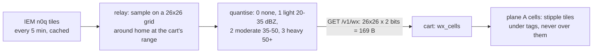

# Goal: weather overlay (idea, 2026-11-01)

**Outcome:** precipitation from weather radar shows on the scope behind the traffic, as a real STARS display
draws it: coarse cells, three intensities (light / moderate / heavy), refreshed every few minutes. A storm line
crossing Middle Tennessee is visible on the TV with the planes weaving round it.

## Data source
| Source | Coverage | Form | Notes |
|---|---|---|---|
| Iowa Environmental Mesonet (IEM) NEXRAD `n0q` composite | CONUS | PNG, EPSG:4326 or web-mercator tiles, every 5 min | free, no key; pixel value → dBZ (scale to verify: about `dBZ = v * 0.5 - 32.5`) |
| RainViewer | global | web-mercator tiles, 10 min | free tier, terms to read (attribution, rate) |
| NWS / MRMS | CONUS | GRIB2 | authoritative but heavy for a stdlib relay |

Start with IEM tiles (PNG decodes with `image/png`, as the terrain tiles do), behind an interface so a global
source can be added. Attribution goes on screen like `Data: adsb.fi` (to check per source).

## Design

- **Grid = the scope's tile grid.** The scope is a 208×208 block of 26×26 cells at (8, 8); the relay samples one
  value per 8×8 px cell at the cart's current range (the cell's centre, projected like the frame: azimuthal
  equidistant about home, `K = 104 · 65536 / (range_nm · 32)`). Cells outside the disc are 0.
- **Plane A, not plane B.** Plane B's sweep ORs glow nibbles into pixels known to be 0 ([../../ui/sweep.md](../../ui/sweep.md));
  weather pixels there would break that or force every weather tile onto the slow path. Plane A cells are cheap: one
  map word per cell. STARS itself draws weather as stippled cells, so it's also the authentic look.
- **Tags win.** A cell holding tag or label text keeps the text; when the tag moves, the cell gets its weather
  tile back. Bookkeeping like `label_cells` ([../../ui/radar-renderer.md](../../ui/radar-renderer.md)): `wx_cells[26][26]`
  holds the level; tag erase writes `wx_tile[level]` instead of blank. The notice box and pop-up already cover
  plane A / the window and restore on close.
- **Tiles:** 3 stipple patterns (25 %, 50 %, 75 % of pixels) in PAL0 colour 13 (free in every theme today; add a
  `C_WX` to `theme.h` and give each theme a dim weather colour, e.g. Classic `0x040`, STARS `0x822`). 3 tiles of VRAM.
- **When:** fetch on the poll after the relay says it's new (a header flag like `AR_H_NOTICE`: `AR_H_WX`, carrying
  no data, so the frame stays the same) and after every zoom. The cart draws cells from the main loop through a
  request to the V-Int, a few rows a frame, like the panel rows (≤ 3 rows/frame budget: 26 words each).

## Contract (v5 or later)
```c
#define AR_H_WX         0x08    /* weather newer than the request's w= is waiting */
#define AR_WX_PATH      "/v1/wx"
#define AR_WX_QUERY     "?lat=%s&lon=%s&range=%u&v=%u"
#define AR_WX_N         26
#define AR_WX_SIZE      (8 + AR_WX_N * AR_WX_N / 4)     /* 177 */
struct ar_wx { char magic[2]; u8 ver, wflags; u32 time; u8 cells[AR_WX_N * AR_WX_N / 4]; };  /* 2 bits/cell */
```
The frame query gains `w=<time of the weather held>` so the relay can flag newer weather; or simpler, the cart
re-fetches every N polls (no flag, no `w=`). Pick during design: the flag is one more query field.

## Budget
- RAM: `wx_cells` 676 B (or 169 B packed) + the 177 B body; check `scripts/ram-check` (9.8 KiB heap today, min 8).
  Could live in the radar's overlay if static RAM is tight ([../../build/ram-budget.md](../../build/ram-budget.md)).
- V-Int: a full redraw is 676 words, spread over ~9 frames at 3 rows a frame; nothing per frame once drawn.
- Relay: one upstream fetch per 5 min, shared by every cart; sampling 676 points is trivial.

## Risks / questions
- `dBZ` scale and the colour → value mapping of the IEM product (read their docs; test against a known storm).
- Non-CONUS homes get nothing from IEM: show "WX N/A" or hide the feature.
- Readability with dense tags: the stipple must stay dimmer than any text. Test on Classic and POCKET (non-black bg).
- Toggle: a setup row (WX ON/OFF) takes a spare byte of the MWR3 settings record ([../../ui/config-screen.md](../../ui/config-screen.md)).

## Done when
- [ ] Relay: `/v1/wx` + IEM source + cache + tests from a saved storm tile in `relay/testdata/`; contract test, lock.
- [ ] Cart: cells drawn under tags, restored when tags move, redrawn on zoom; every theme has a weather colour.
- [ ] `make sim` shows a recorded storm (fake feed gets a weather body); manual shot + Scope page text.
- [ ] On the cart during real weather: matches a weather app's radar within a cell.

Related: [summary.md](summary.md), [video-maps.md](video-maps.md), [../../ui/screen-layout.md](../../ui/screen-layout.md).
