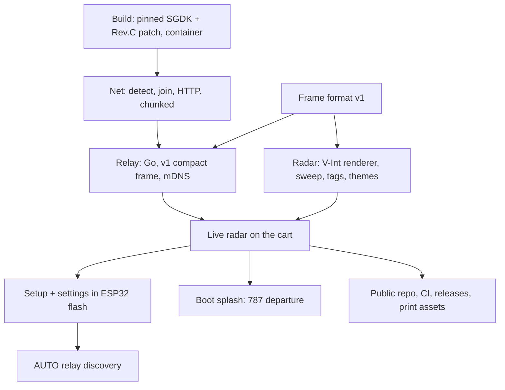

# Roadmap



## Status (current)
- **Released:** v0.1.0 (radar), v0.1.1 (print assets), v0.1.2 (boot splash), v0.1.3 (mDNS discovery / AUTO relay,
  setup RESET, contract check, Wi-Fi fixes), **v0.2.0** (traffic list, new controls, detail pop-up + `/v1/detail`, setup
  CONTROLS, contract v2 with version lock-step, start-up RAM check), v0.2.1 (full clamshell wrap: back, spine, front, plus an A4 sheet).
  0.2.2 is open in `CHANGELOG.md` (empty).
- **The cart** runs the v0.2.0 release ROM (CRC32 `DA73BCE4`). The dev file (`src/dev_config.h`) is gone, so dev builds are
  release-style; settings and Wi-Fi live on the module.
- **The dev relay** is the `mwradar-relay` container on the dev Mac (:8080), a local build tagged with the checkout's
  version (`mwradar-relay:v0.2.0-2-ga93cd63`), advertised by `dns-sd -P` from `scripts/relay start`.
- Everything ships from github.com/jfryman/mega-wifi-radar: cart + emulator ROMs, label/cover/manual PDFs, and the relay
  image `ghcr.io/jfryman/mega-wifi-radar-relay:<version>` ([../build/ci-release.md](../build/ci-release.md)).
- **Verified on the cart:** cold-boot detect, Wi-Fi join, polling once per sweep, renderer timing, setup + flash
  persistence, the splash, mDNS discovery and mid-session re-discovery, setup RESET and the first-boot Wi-Fi flow,
  the Wi-Fi scan + rejoin from the radar's setup, and all of 0.2.0: traffic list, ▲▼ selection, hold-C sort, ◀▶ tags,
  the detail pop-up against the real relay, X on a 6-button pad, setup CONTROLS, the relay-mismatch message.

## Not yet checked on hardware
- Nothing outstanding.

```sh
make flash                     # cart ROM (FlashKit); then cold-boot
make relay-stop && make relay-start   # exercise AUTO re-discovery mid-session
dns-sd -B _mwradar._tcp        # is the relay advertised?
```

## Open decisions / ideas
- [ ] Data path A vs B: relay (current) or a firmware digester ([../architecture/data-path-options.md](../architecture/data-path-options.md)).
- [ ] Relay binaries for macOS/Linux in releases (native runs advertise mDNS themselves; easier than a container on a Mac).
- [ ] Persist the host mDNS advertisement across reboots (launchd / systemd unit); today it's `scripts/relay advertise`.
- [ ] STARS polish: data blocks with leader lines.
- [ ] Y / Z on 6-button pads (reserved).
- [ ] Persist the sort order (RAM only today; adding it to `struct settings` would invalidate saved `MWR1` records).
- [ ] Sound (PSG engine noise on the splash), non-KBNA fake feeds for emulator demos.

## Decided
SGDK master `9a78a44` in a container; V-Int renderer, so blocking polls never stall the sweep; compact frame over HTTP GET
once per sweep with Content-Length; relay and cart in lock-step (contract version, 409 on mismatch); no pan, a traffic
list and detail pop-up instead (0.2.0); relay in Go (stdlib); screen layout and thin-line sweep; settings record `MWR1` in
user_data sector 0; OurAirports large + scheduled airports; print assets in Typst; boot splash driven by boot steps;
relay discovery by mDNS legacy unicast with AUTO default.
