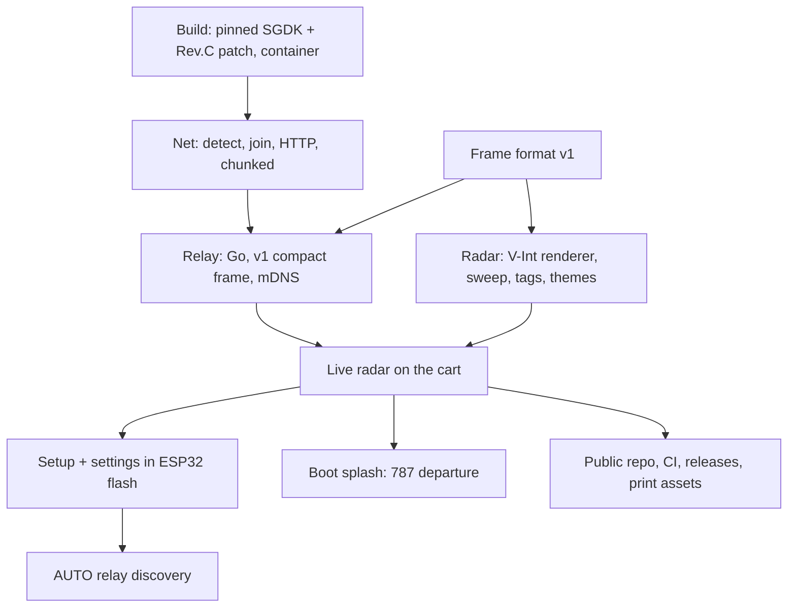

# Roadmap



## Status (current)
- **Released:** v0.1.0 (radar), v0.1.1 (print assets), v0.1.2 (boot splash), v0.1.3 (mDNS discovery / AUTO relay,
  setup RESET, contract check, Wi-Fi fixes), **v0.2.0** (traffic list, new controls, detail pop-up + `/v1/detail`, setup
  CONTROLS, contract v2 with version lock-step, start-up RAM check), v0.2.1 (full clamshell wrap: back, spine, front, plus an A4 sheet),
  **v0.3.0** (2026-10-31: cockpit mode with streamed terrain, contract v3, `/v1/terrain` + `/v1/track` + `/v1/strip`;
  reconnect after a lost relay host; manual Cockpit View page), **v0.4.0** (2026-11-01: flyover notices from an MQTT
  feed: a box over the radar, a cockpit ticker, FM chimes with a KBNA easter egg, setup CHIME + `MWR2` settings; the
  cockpit's instrument-strip HUD; relay env config; contract v4; `docs/flyover.md`), **v0.4.1** (2026-11-01: boot
  radio calls in speech bubbles with time to read, the scene re-laid out; boot sound: PSG whine/roar/radio + FM twin
  engines and bass; setup CHIME → SOUND; contract unchanged, v4), **v0.4.2** (2026-11-01: seven new themes, the
  emergency alert, settings record MWR3 with radar changes remembered, real sky in cockpit mode, the scope-scroll fix after
  cockpit mode; contract unchanged, v4), **v0.4.3** (2026-11-01: ambient mode, STARS data blocks, city lights in
  cockpit mode; contract unchanged, v4; released after MAME tests only, cart checks below), **v0.4.4** (2026-11-02: the weather overlay from IEM NEXRAD, setup WEATHER + Z, contract v5;
  weather seen on the cart). **v0.4.5** (2026-11-02: video maps
  (solid runways, dashed centrelines), setup MAP + GUIDE, a Video Map manual section (24 pages), contract v6; seen on
  the cart). **v0.5.0** (2026-11-02: panel tabs + the control
  remap, the relay's SQLite logbook with rare notices, contract v7; controls, tabs and the logbook checked on the
  cart). **v0.6.0** (2026-11-02: the STARS type line,
  ~2.7 KB of RAM freed, contract v8; seen on the cart). 0.6.1 is open in `CHANGELOG.md`.
- **The cart** runs the v0.6.0 tag (contract v8, built at `4fcd820`, CRC32 `65D7E71A`, flashed 2026-11-02)
  with the dev relay from the same checkout (a build needs the relay from the same contract version). The dev file (`src/dev_config.h`) is gone, so dev builds are
  release-style; settings and Wi-Fi live on the module.
- **The dev relay** is the `mwradar-relay` container on the dev Mac (:8080), a local build tagged with the checkout's
  version, advertised by `dns-sd -P` from `scripts/relay start`. Since 2026-11-02 it's built from the 0.6.0 checkout, **contract v8**, with its logbook on the `mwradar-data` volume, and uses the local MQTT broker `mwradar-mqtt` (`make mqtt-start`).
- Everything ships from github.com/jfryman/mega-wifi-radar: cart + emulator ROMs, label/cover/manual PDFs, and the relay
  image `ghcr.io/jfryman/mega-wifi-radar-relay:<version>` ([../build/ci-release.md](../build/ci-release.md)).
- **Verified on the cart:** cold-boot detect, Wi-Fi join, polling once per sweep, renderer timing, setup + flash
  persistence, the splash, mDNS discovery and mid-session re-discovery, setup RESET and the first-boot Wi-Fi flow,
  the Wi-Fi scan + rejoin from the radar's setup, and all of 0.2.0: traffic list, ▲▼ selection, hold-C sort, ◀▶ tags,
  the detail pop-up against the real relay, X on a 6-button pad, setup CONTROLS, the relay-mismatch message; and of 0.4.0: flyover notices (C/B, chimes incl. the KBNA lick, cockpit
  ticker), setup CHIME, the MWR1 → MWR2 settings upgrade, the instrument-strip HUD; and of 0.4.1: the speech-bubble
  boot with its reading pauses, the boot sound (engines, radio, FM twin engines + bass) on a TV; and of 0.4.2: the
  radar's layout after leaving cockpit mode (N at the top), all nine themes on a TV, the MWR2 → MWR3 settings upgrade,
  the remembered sort order, the night sky in cockpit mode.

## Not yet checked on hardware
- Reconnect after the relay host sleeps mid-session (0.3.0, [../net/reconnect.md](../net/reconnect.md)): run the radar,
  close the Mac's lid ~2 min, open it; expect `STALE` → `RECONNECT` → `NET OK` within ≤ 60 s. Also confirm the
  patched `mw_http_cleanup` doesn't upset normal polling.

```sh
make flash                     # cart ROM (FlashKit); then cold-boot
make relay-stop && make relay-start   # exercise AUTO re-discovery mid-session
dns-sd -B _mwradar._tcp        # is the relay advertised?
```

## Open decisions / ideas
- [ ] Watch arrivals (tabled): ARRIVALS list order, cockpit through touchdown, relay on the fr24feed Pi; see [watch-arrivals.md](watch-arrivals.md).
- [ ] Feature goals backlog (STARS type line): [ideas/summary.md](ideas/summary.md).
- [ ] 0.5.0 still unchecked on the cart: a rare-aircraft notice, a day rolling over at Nashville midnight, the relay's DB
  surviving `make relay-stop relay-start` with a full day in it (owner couldn't check these 2026-11-02; the tabs,
  ◀▶ zoom and the LOGBOOK tab + page are checked).
- [ ] Video maps (0.4.5, [../ui/video-maps.md](../ui/video-maps.md)) on the cart: KBNA's runways and centrelines at 5/10/25
  nm, arrivals riding them; colours on a TV; MAP OFF clears it and trail dots come back.
- [ ] Weather overlay (0.4.4, [../ui/weather.md](../ui/weather.md)): seen on the cart's TV (light cells, after the brighter
  colours). Still to check during real storms: cells match a weather app's radar within a cell; Z on a 6-button pad;
  the MWR3 `wx` byte saved.
- [ ] City lights in cockpit mode (0.4.3, relay only, MAME-previewed): look at a night ride on the TV with the rebuilt relay.
- [ ] STARS data blocks (0.4.3, MAME-verified only): look at them on the TV at 10 and 25 nm.
- [ ] Ambient mode (0.4.3, MAME-verified only): check on the cart: a tour after AFTER 1 MIN, a ride's 75 s, any button ending it.
- [ ] Data path A vs B: relay (current) or a firmware digester ([../architecture/data-path-options.md](../architecture/data-path-options.md)).
- [ ] Relay binaries for macOS/Linux in releases (native runs advertise mDNS themselves; easier than a container on a Mac).
- [ ] Persist the host mDNS advertisement across reboots (launchd / systemd unit); today it's `scripts/relay advertise`.
- [ ] Y / Z on 6-button pads (reserved).
- [ ] Production flyover feed: run the relay in the cluster next to atc-mqtt (env only: `MQTT_BROKER_HOST/PORT/USERNAME/PASSWORD`;
  the cart then needs a typed RELAY URL, see `docs/flyover.md`).
- [ ] More sound (engine noise on the splash; `chime.c` has FM patch + note code to reuse), non-KBNA fake feeds for emulator demos.

## Decided
SGDK master `9a78a44` in a container; V-Int renderer, so blocking polls never stall the sweep; compact frame over HTTP GET
once per sweep with Content-Length; relay and cart in lock-step (contract version, 409 on mismatch); no pan, a traffic
list and detail pop-up instead (0.2.0); relay in Go (stdlib); screen layout and thin-line sweep; settings record `MWR1` in
user_data sector 0; OurAirports large + scheduled airports; print assets in Typst; boot splash driven by boot steps;
relay discovery by mDNS legacy unicast with AUTO default.
