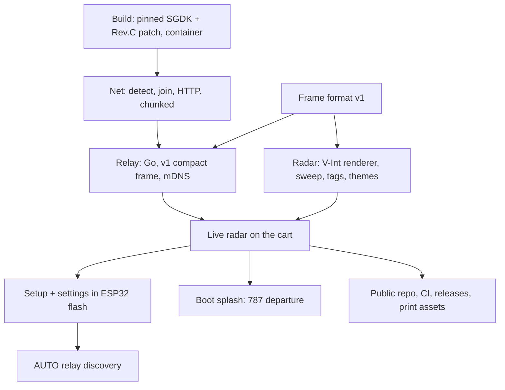

# Roadmap



## Status (current)
- **Released:** v0.1.0 (radar), v0.1.1 (print assets), v0.1.2 (boot splash, label/tag bug fixes).
  **0.1.3 is unreleased** (see `CHANGELOG.md`): mDNS relay discovery (AUTO RELAY), the setup RESET, the
  relay ↔ cart contract check, and the Wi-Fi save / first-boot join fixes. **Verified on the cart (2026-10-28):**
  RESET → Everything → first-boot Wi-Fi page → SAVED + CONNECTED → SAVE & EXIT → AUTO relay → radar, and a power cycle
  keeps it. The dev file (`src/dev_config.h`) is removed, so the dev cart runs release-style builds.
- Everything ships from github.com/jfryman/mega-wifi-radar: cart + emulator ROMs, label/cover/manual PDFs, and the relay
  image `ghcr.io/jfryman/mega-wifi-radar-relay` ([../build/ci-release.md](../build/ci-release.md)).
- Verified on the cart: cold-boot detect, Wi-Fi join, relay polling once per sweep, renderer timing, setup + flash
  persistence, the splash, mDNS discovery, setup RESET, and first-boot Wi-Fi save + join.
- The dev relay runs as the `mwradar-relay` container on the dev Mac (:8080), advertised by `dns-sd -P` from
  `scripts/relay start`.

## Not yet checked on hardware
- AUTO re-discovery mid-session: `make relay-stop` while the radar runs, then `make relay-start`. After 3 failed polls the
  cart searches again and should recover without a reboot.
- Opening WI-FI from the radar's setup (scan while joined → leave AP → rejoin after setup).

```sh
make flash                     # cart ROM (FlashKit); then cold-boot
make relay-stop && make relay-start   # exercise AUTO re-discovery mid-session
dns-sd -B _mwradar._tcp        # is the relay advertised?
```

## Open decisions / ideas
- [ ] Data path A vs B: relay (current) or a firmware digester ([../architecture/data-path-options.md](../architecture/data-path-options.md)).
- [ ] Relay binaries for macOS/Linux in releases (native runs advertise mDNS themselves; easier than a container on a Mac).
- [ ] Persist the host mDNS advertisement across reboots (launchd / systemd unit); today it's `scripts/relay advertise`.
- [ ] STARS polish: data blocks with leader lines, pan indicator; aircraft type in frame v2 (28-byte record).
- [ ] Sound (PSG engine noise on the splash), non-KBNA fake feeds for emulator demos.

## Decided
SGDK master `9a78a44` in a container; V-Int renderer, so blocking polls never stall the sweep; frame v1 over HTTP GET
once per sweep with Content-Length; relay in Go (stdlib); screen layout and thin-line sweep; settings record `MWR1` in
user_data sector 0; OurAirports large + scheduled airports; print assets in Typst; boot splash driven by boot steps;
relay discovery by mDNS legacy unicast with AUTO default.
