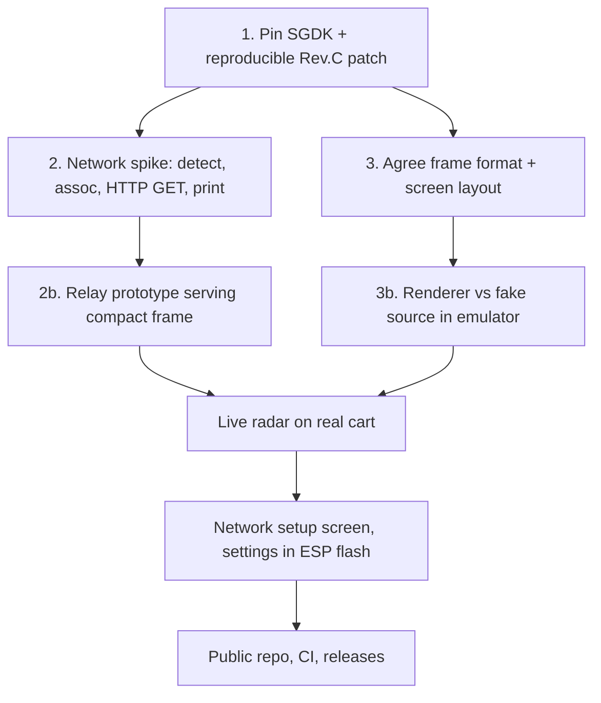

# Roadmap

## Status
- Step 1 is done: image + patches + guard.
- Step 2 network spike works on the real cart from a cold boot: detect → join (DHCP) → plain-HTTP
  GET of `http://example.com/` → body on screen ([../net/net-layer.md](../net/net-layer.md)).
- Frame format v1 is agreed; `src/arframe.h` mirrors it with layout asserts.
- Relay prototype (2b) works: `relay/` (Go, stdlib only, tests cover every conversion rule and the
  HTTP contract) serves live KBNA frames at `http://relay-host.example.lan:8080/v1/frame`.
- **End to end works on the cart:** the spike polls the relay through `feed_fetch()`
  ([../net/feed.md](../net/feed.md)) every ~5 s and lists the nearest aircraft around KBNA (verified 2026-10-28).
- **Radar built** ([../ui/radar-renderer.md](../ui/radar-renderer.md)): sweep, blips, trails, tags, panel,
  zoom/select/pan, Classic + STARS themes, setup screen with Wi-Fi/airport/relay + flash persistence
  ([../ui/config-screen.md](../ui/config-screen.md)). Verified in MAME (`make sim-run`) and working on the real cart.
- **Published** at github.com/jfryman/mega-wifi-radar with CI building release ROMs and the relay image
  ([../build/ci-release.md](../build/ci-release.md)). User-facing docs are in `docs/`.

## Planned: start-up config screen
Runs before the radar when no saved settings exist, or when START is held at boot. Dev builds bypass it
with `src/dev_config.h` (Wi-Fi credentials, home point; default KBNA).
- **Wi-Fi:** `mw_ap_scan` + `mw_ap_fill_next` list, an on-screen keyboard for the password, then
  `mw_ap_cfg_set` / `mw_ip_cfg_set` (DHCP) / `mw_def_ap_cfg` / `mw_cfg_save`.
- **Home airport:** pick from an in-ROM airport table (ICAO, name, lat/lon e4) and set the range.
  Saved in ESP32 `user_data` flash (`mw_flash_*`); the format is still to be designed.

## Open decisions
- [x] SGDK pin: master `9a78a44` ([../build/container-build.md](../build/container-build.md)).
- [x] Toolchain: container image (Podman/Docker), patches applied in-image.
- [x] Radar-loop networking: neither. The renderer runs in the V-Int, so blocking polls in main never stall the sweep.
- [ ] Data path A vs B ([../architecture/data-path-options.md](../architecture/data-path-options.md)).
- [x] Frame format v1 ([../architecture/frame-format.md](../architecture/frame-format.md)).
- [x] Transport: HTTP GET `/v1/frame`, once per sweep, with Content-Length.
- [x] Relay in Go, run on the dev Mac for now; the console finds it by its DHCP-registered FQDN.
- [x] Screen layout ([../ui/screen-layout.md](../ui/screen-layout.md)): scope r=104 + side panel, ≥ 8 px overscan
      margin, ranges 5/10/25/50/100 with 5 rings, trails = 5 positions, themes Classic (first) + STARS (later).
- [x] Sweep: thin line with palette afterglow ([../ui/sweep.md](../ui/sweep.md)).
- [x] Settings record (`MWR1`, user_data sector 0) and airport table (OurAirports large + scheduled).

## Known issues (found in emulator screenshots, 2026-10-28)
- [ ] After zooming in, the ring range labels keep stale digits from the previous range (5 nm shows `1 20 35 40 50`).
  The label redraw doesn't clear the old, wider text.
- [ ] STARS: a tag next to the compass `S` merged with it (`5017 120` for `CAP4105 017 120`). Check that label cells block tag placement in every theme.
