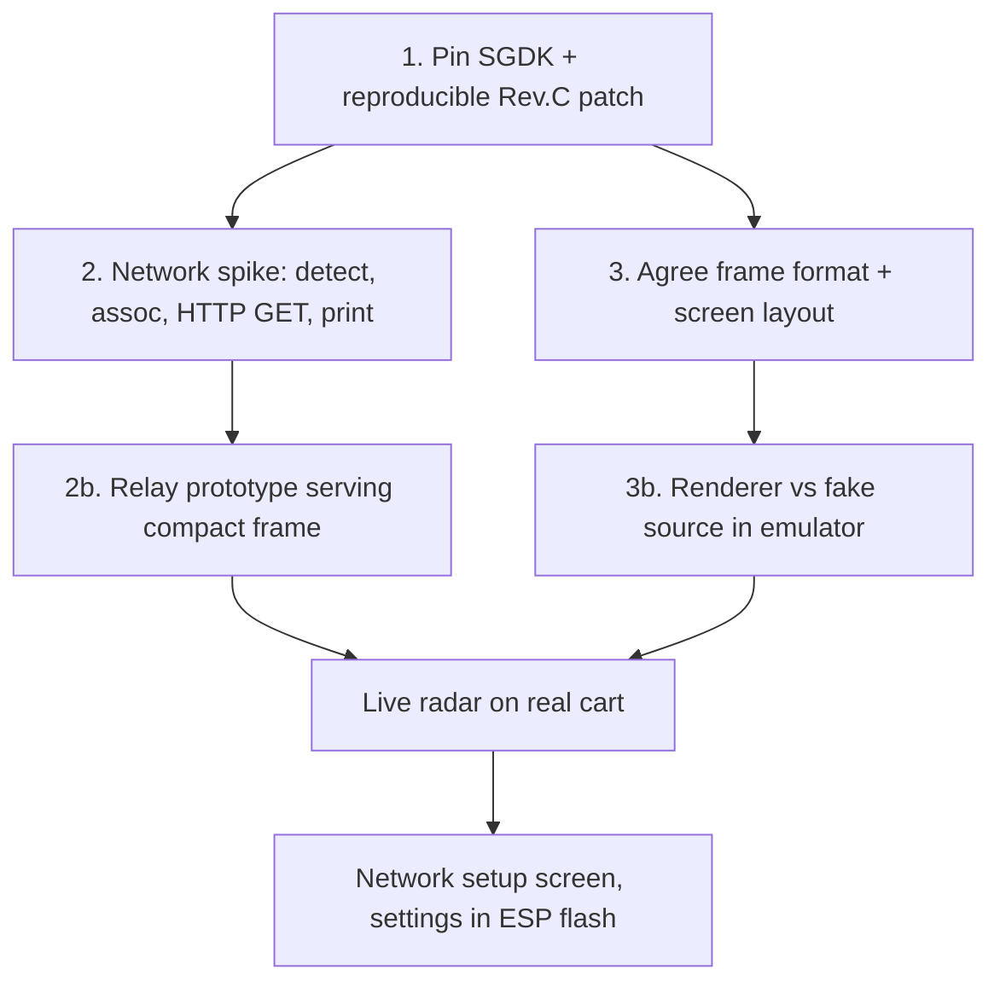

# Roadmap

## Open decisions
- [ ] SGDK pin: v2.11 tag vs master commit (see [../platform/sgdk-megawifi.md](../platform/sgdk-megawifi.md)).
- [ ] How to deliver the toolchain on macOS + Arch: container image vs native install.
- [ ] Patch mechanism: patch script over a pinned checkout vs vendored submodule fork.
- [ ] Data path A vs B ([../architecture/data-path-options.md](../architecture/data-path-options.md)).
- [ ] Compact frame field ranges (altitude above FL255? ground speed resolution?).
- [ ] Transport for the frame: HTTP GET via `MW_HTTP_CH` vs raw TCP socket.
- [ ] Screen layout and the sweep technique.
- [ ] Git repository: not initialised yet.
