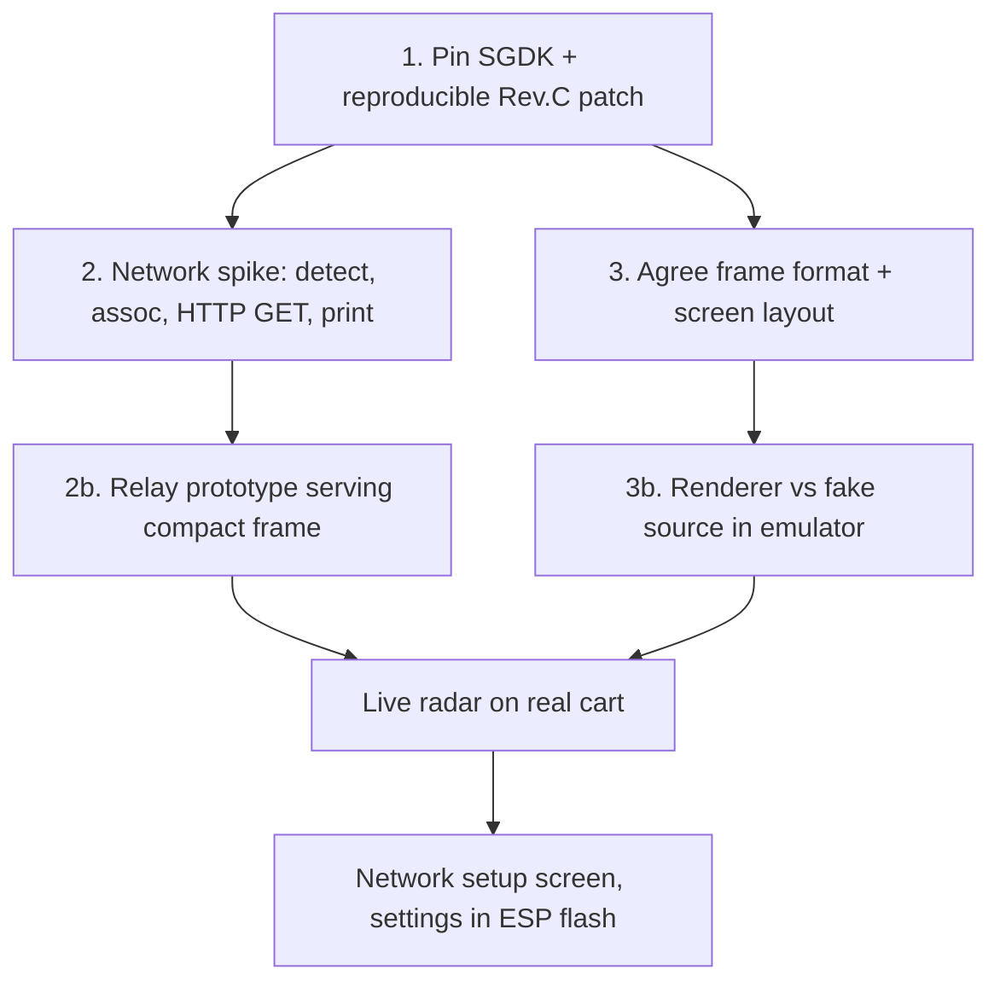

# Roadmap

## Status
- Step 1 is done: image + patches + guard.
- Step 2 network spike works on the real cart from a cold boot: detect → join (DHCP) → plain-HTTP
  GET of `http://example.com/` → body on screen ([../net/net-layer.md](../net/net-layer.md)).
- Frame format v1 is agreed; `src/arframe.h` mirrors it with layout asserts.
- Next: the relay prototype (2b) serving `/v1/frame`, and the screen layout (3).

## Open decisions
- [x] SGDK pin: master `9a78a44` ([../build/container-build.md](../build/container-build.md)).
- [x] Toolchain: container image (Podman/Docker), patches applied in-image.
- [ ] Radar-loop networking: async API (`MODULE_MEGAWIFI_ASYNC`) vs a hand state machine on `mw_send`/`mw_recv`.
- [ ] Data path A vs B ([../architecture/data-path-options.md](../architecture/data-path-options.md)).
- [x] Frame format v1 ([../architecture/frame-format.md](../architecture/frame-format.md)).
- [x] Transport: HTTP GET `/v1/frame`, once per sweep, with Content-Length.
- [ ] Relay implementation language and where it runs.
- [ ] Screen layout and the sweep technique.
