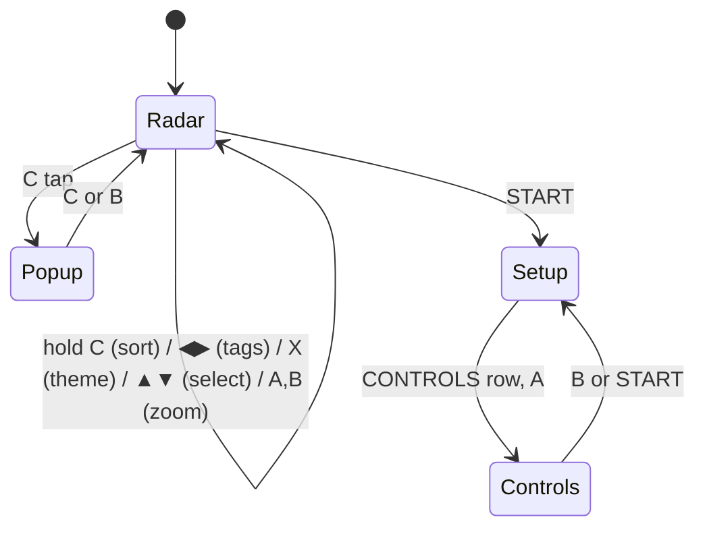

# 0.2.0 plan: radar UX (traffic list, detail pop-up, controls)

Agreed 2026-10-29. All four stages are built and verified in MAME; hardware check pending (roadmap). This is the build plan. When a stage ships, its design moves into the topic files
(`ui/`, `architecture/`, `relay/`) and the stage is ticked here. Delete this file once 0.2.0 is released.

## Controls
| Button | Action | Notes |
|---|---|---|
| ▲ / ▼ | move the selection up and down the traffic list | replaces pan; pan and its scroll offsets are removed |
| ◀ / ▶ | cycle tags: all / selected / off | replaces *hold C* |
| C (tap) | open the detail pop-up; C or B closes it | the action fires on release, so it can be told apart from a hold |
| C (hold 40 frames) | cycle sort: NEAREST → A-Z → Z-A → LOW ALT → HIGH ALT | the list header always shows the order |
| A / B | zoom in / out | unchanged |
| X (6-button) | cycle themes | optional: everything X does is also in setup |
| Y / Z | reserved | |
| START | setup | unchanged |

A 3-button pad must reach every feature. 6-button buttons are shortcuts only.



## Side panel
```
 KBNA
 RNG  25NM
 17:16:01Z
 28 AC   NET OK
 -- NEAREST --      list header: the sort order
 UAL2414  0.5       callsign + distance (nm); selected row highlighted
 SWA4720 19.6       15 rows; scrolls with the cursor
 ...
 ▼ 13 MORE
 -----------
 CLASSIC  ALL       theme + tag mode
 Data: adsb.fi      required, always visible
```
- The list re-sorts once per sweep (as it passes north), not continuously.
- The selection follows the aircraft by ICAO address, not the row.
- Emergencies (`AR_F_EMERG`) are pinned to the top in every order.
- The per-aircraft lines (ALT, GS, TRK, SQK, POS) move to the pop-up.

## Detail pop-up and `/v1/detail`
- The pop-up covers the scope; the radar keeps running underneath, so closing is instant.
- Live fields (altitude, rate, speed, track, squawk, position) come from the frame and update on each sweep crossing.
- Static and nav fields come from `GET /v1/detail?icao=abfcda&v=<AR_VER>`: registration (`r`), type (`t`),
  description (`desc`), operator (`ownOp`), year, geometric altitude, selected altitude and heading
  (`nav_altitude_mcp`, `nav_heading`) and QNH (`nav_qnh`).
- The cart fetches the detail when the pop-up opens and refreshes it once per sweep, after the frame poll.
  Missing values show `--`.
- The record is a fixed-size binary struct in `src/arframe.h` (`struct ar_detail` + `AR_AT` lines) and is covered by
  the contract test.

## Version lock-step (relay vX ⇔ cart vX)
The relay and the cart ship from the same tag and are a single product.
1. **Build time:** `relay/contract.lock` records `AR_VER` and a hash of `src/arframe.h`. The contract test fails if the
   header changes while `AR_VER` stays the same ("contract changed: bump AR_VER, then `make contract-lock`").
2. **Runtime:** the cart sends `v=AR_VER` on every request. The relay refuses a mismatch with HTTP 409. When the cart
   gets a 409, or a frame header whose version doesn't match, it shows a hold-position message,
   e.g. `RELAY SPEAKS v1, CART v2 - RUN RELAY v0.2.0`, instead of a generic ERR.
3. **Discovery:** the mDNS TXT record `v=` is checked, so a mismatched relay is reported as a mismatch rather than
   as *not found*.
4. `AR_VER` becomes 2 in 0.2.0.

## Stages
- [x] 1. Controls and panel: remove pan, add the traffic list and ▲▼ selection, ◀▶ tags, hold-C sort, X theme;
       add the setup CONTROLS page. → [../ui/traffic-list.md](../ui/traffic-list.md)
- [x] 2. Contract: `AR_VER` 2, `struct ar_detail`, `/v1/detail`, the `v=` check, `contract.lock`.
       → [../architecture/contract.md](../architecture/contract.md)
- [x] 3. Pop-up: C tap to open, live and detail rows, refresh once per sweep, the mismatch message.
       → [../ui/detail-popup.md](../ui/detail-popup.md)
- [x] 4. Manual and print: rewrite the controls and scope pages, add the CONTROLS and 6-button notes, re-shoot the
       screenshots and add a pop-up shot. CHANGELOG 0.2.0 (controls change under BACKWARDS INCOMPATIBILITIES).

Related: [roadmap.md](roadmap.md), [../ui/screen-layout.md](../ui/screen-layout.md),
[../architecture/contract.md](../architecture/contract.md), [../ui/config-screen.md](../ui/config-screen.md).
