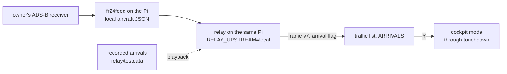

# Watch arrivals (future, tabled 2026-11-01)

**Goal:** sit in the cockpit of a plane landing at the home airport (BNA). Find an arrival fast in the traffic
list, press Y, ride it to touchdown. Not scheduled; this file holds the design so far and what to explore.

**End state:** the relay runs on the owner's Raspberry Pi next to `fr24feed`, reading the local receiver's
aircraft JSON directly instead of adsb.fi. Most of the work is test scaffolding: recordings of real arrivals,
played back through the relay and cockpit mode.



## Decisions so far
- **Routes are not needed for the goal.** ADS-B carries no origin/destination, but a plane worth watching is already
  close, low and descending; a geometric classifier decides "arriving" in the relay.
- **No FR24 API as the position feed.** Credits are charged per returned flight; polling a whole area every sweep
  would exhaust any plan in days. adsb.fi (or the local receiver) stays the position source.
- **FR24 only as a later fallback**, through atc-mqtt (it already holds the FR24 key and polls every 30 s for the
  500 m flyover box, [../ui/notices.md](../ui/notices.md)). If the classifier misjudges (low overflights, helicopters),
  atc-mqtt adds a BNA-inbound query (`airports=inbound:BNA`, ~15 nm box) on the same timer and the relay reads it from
  MQTT, as it reads notices. Cost scales with arrivals only (3–8 flights).
- The owner feeds FR24 from their receiver; that likely buys a Business app subscription, not API credits (unverified).

## Arrival classifier (relay, sketch)
Thresholds to tune against recordings; all relative to the home airport's elevation.
```go
// arriving: on approach to home, from geometry alone
func arriving(distNM, aglFt, vrateFPM, bearingToHome, track float64) bool {
	toward := math.Abs(angleDiff(track, bearingToHome)) < 45
	return distNM < 15 && aglFt < 5000 && toward && (vrateFPM < -300 || aglFt < 2000)
}
```
Departing is the mirror (close, low, climbing, heading away). Ground traffic is neither.

## Contract (v7, when built)
- Record flag bit 7 (reserved today, [../architecture/frame-format.md](../architecture/frame-format.md)) becomes
  `AR_F_ARRIVING`; the record stays **24 bytes**, no RAM cost. Departures would need a second bit: grow the record
  to 26 (`u8 route` + pad, ~576 B static RAM: 96 × 2 recs × 2 B + 192 B `frame_buf`) only if DEPARTURES is wanted.
- Bump `AR_VER` to 5, relay + `contract_test.go` + `make contract-lock` ([../architecture/contract.md](../architecture/contract.md)).

## Cart
- New hold-C orders after HIGH ALT: `- ARRIVALS -` (filter: arriving only, nearest to home first), optionally
  `- DEPARTURES`. Emergencies still first ([../ui/traffic-list.md](../ui/traffic-list.md)).
```c
enum sort_mode { SORT_NEAREST, SORT_AZ, SORT_ZA, SORT_ALT_LOW, SORT_ALT_HIGH, SORT_ARRIVALS, SORT_MODES };
/* tlist_rebuild: in SORT_ARRIVALS, skip slots without AR_F_ARRIVING; key = dist[] */
```
- Open: dim non-arrival blips on the scope in that order (touches the V-Int renderer; probably not).

## Things to explore
1. **Cockpit through touchdown** (biggest risk). A whole new terrain patch loads whenever height above ground halves
   ([../ui/cockpit.md](../ui/cockpit.md)): ~4 reloads between 3,000 ft and the runway, during the best part.
   Also: `cell_m` floors at 30 m; behaviour once `AR_K_GROUND` / ground altitude arrives; a rollout at 30 kt.
   Ideas: hold the patch below some height instead of reloading; never reload after the ground flag.
2. **Recordings.** Capture several BNA arrivals as upstream JSON sequences (1 s apart) into `relay/testdata/`,
   from adsb.fi now and from the Pi's receiver later. Reuse `-pack` / `-pack-cockpit` so `make sim` plays them.
3. **Playback upstream.** A relay mode (or a tiny test server) that serves a recording as if it were live, so the real
   cart can fly an arrival on demand, not only when one happens.
4. **Local receiver as upstream.** Find which JSON fr24feed exposes on the Pi and where (fr24feed's built-in decoder vs
   dump1090/readsb's `aircraft.json`; ports and paths to verify). Known difference: readsb's `now` is in seconds,
   the relay expects adsb.fi's milliseconds (`relay/frame.go`). Fixed receiver means positions only within its range;
   `source` byte and on-screen attribution need a "local" value.
5. **Relay on the Pi.** The release image is multi-arch ([../build/ci-release.md](../build/ci-release.md)); confirm arm64
   runs there, mDNS advertisement from the Pi, and that MQTT notices still reach it.
6. **Classifier tuning** against the recordings: false positives from overflights, GA in the pattern, helicopters.

Related: [roadmap.md](roadmap.md), [cockpit-mode.md](cockpit-mode.md), [../relay/relay.md](../relay/relay.md),
[../data/adsb-sources.md](../data/adsb-sources.md).
